# Trans-DIC1 — Dossier d'architecture complet

Date : 28 octobre 2026 · Branche : `develop` · Auteur du dépôt : Boubacar Sidibe

Ce document répond à trois questions pour chaque élément du projet : **pourquoi** il existe, **comment** il est réalisé, et **donc** ce qui en découle. Il distingue toujours ce qui est **réalisé dans le code** de ce qui est **décidé mais pas encore codé** (cible).

Légende : ✅ réalisé et présent dans le code · 🟡 décidé (ADR ou diagramme), à implémenter · ⚪ prévu au backlog, sans décision détaillée.

---

## Table des matières

1. [Résumé](#1-résumé)
2. [Le problème et les objectifs](#2-le-problème-et-les-objectifs)
3. [Ce qui a été réalisé](#3-ce-qui-a-été-réalisé)
4. [Vue d'ensemble de l'architecture](#4-vue-densemble-de-larchitecture)
5. [Architecture du backend](#5-architecture-du-backend)
6. [Modèle de données](#6-modèle-de-données)
7. [Comportements clés (séquences et états)](#7-comportements-clés-séquences-et-états)
8. [Sécurité](#8-sécurité)
9. [Frontend](#9-frontend)
10. [Qualité, CI/CD et exploitation](#10-qualité-cicd-et-exploitation)
11. [Décisions d'architecture et justifications](#11-décisions-darchitecture-et-justifications)
12. [Écarts entre le code et la cible, risques](#12-écarts-entre-le-code-et-la-cible-risques)
13. [Feuille de route](#13-feuille-de-route)
14. [Annexes](#14-annexes)

---

## 1. Résumé

Trans-DIC1 est une plateforme interne de supervision des équipements réseau et serveurs de l'École Polytechnique de Thiès (EPT), destinée au CRI et à son centre d'opérations réseau (NOC). Elle doit inventorier les équipements, collecter leurs mesures, détecter les dépassements de seuil, gérer le cycle de vie des alertes, notifier par e-mail et produire des rapports.

**Où en est le projet** : le socle technique et la qualité sont solides (API sécurisée, inventaire, modèle de données complet, CI exigeante, Docker). Le cœur fonctionnel de la supervision (collecte, évaluation des seuils, alertes, notifications, rapports, temps réel) est **modélisé mais pas encore codé**.

**Principaux choix** : monolithe modulaire Spring Boot + React, PostgreSQL, JWT court, modèle de domaine riche vérifié par ArchUnit. Sept ADR documentent les décisions. Les six sont acceptées ou proposées ; les quatre dernières (0003 à 0006) ont été rédigées après une revue critique appuyée sur des recherches (section 11).

---

## 2. Le problème et les objectifs

**Pourquoi.** Le CRI doit savoir en continu quels équipements du campus fonctionnent, être averti avant les utilisateurs et garder une trace des incidents. Sans outil, la détection dépend des plaintes.

**Acteurs** (trois rôles humains, hiérarchiques) :

| Rôle | Peut |
|---|---|
| Lecteur (`VIEWER`) | Consulter tableau de bord, équipements, métriques, alertes, rapports |
| NOC (`NOC_OPERATOR`) | Tout ce que fait le lecteur + gérer l'inventaire, prendre en charge et résoudre les alertes |
| Administrateur (`ADMIN`) | Tout + utilisateurs, rôles, seuils, assignation des alertes |

Systèmes externes : agent Trans-DIC1 installé sur les serveurs, équipements SNMP, service e-mail.

**Exigences structurantes** (issues de l'ADR-0001) : fonctionner en réseau interne sans Internet, ne jamais exposer la topologie, ne jamais mettre de secret dans Git ni dans les journaux, tracer les actions sensibles, builds reproductibles.

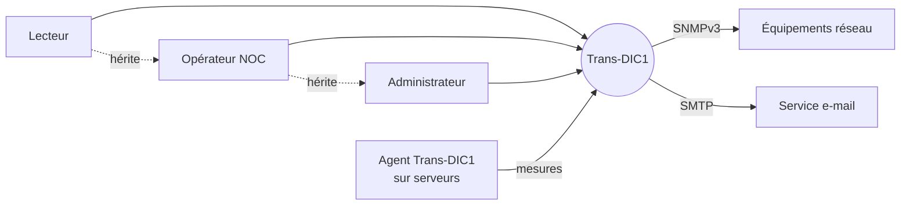

*Lecture : la flèche pointillée traduit la hiérarchie des rôles (Lecteur ⊂ NOC ⊂ Administrateur).*

---

## 3. Ce qui a été réalisé

Source : historique git (`develop`, 41 commits d'avance sur `main`), code et documentation vérifiés dans le dépôt.

### 3.1 Tableau d'avancement

| Domaine | Élément | État | Preuve dans le dépôt |
|---|---|---|---|
| Fondations | Monorepo `backend/` + `frontend/`, Maven Wrapper, Node 24 | ✅ | `README.md`, `pom.xml` |
| Fondations | Docker Compose (PostgreSQL 16, Mailpit, backend, frontend) + script `.env` | ✅ | `docker-compose.yml`, `scripts/init-dev-env.ps1` |
| Authentification | Login JWT, hash de mot de passe, réponse uniforme 401, compte factice anti-énumération | ✅ | `AuthService`, `JwtService` |
| Authentification | Limitation de débit par IP (Bucket4j) + verrouillage progressif du compte (SEC-01) | ✅ | `LoginRateLimitFilter`, V6 |
| Authentification | Renouvellement de jeton par cookie HttpOnly avec rotation, déconnexion | ✅ | `AuthController`, `AuthService`, `RefreshTokenTests` |
| Authentification | Réinitialisation de mot de passe | ⚪ | table `password_reset_token` créée |
| Autorisation | Rôles `ADMIN`/`NOC_OPERATOR`/`VIEWER` sur les endpoints (`@PreAuthorize`) | ✅ | `EquipmentController` |
| Inventaire | CRUD équipements `/api/v1/equipements`, DTO validés, erreurs `problem+json` | ✅ | `EquipmentController`, `ApiExceptionHandler` |
| Inventaire | Audit des mutations d'inventaire (US07) | ✅ | `AuditService`, `EquipmentAuditTests` |
| Inventaire | Gestion des sites : création, modification, suppression d'un site vide, code immuable, audit ; le formulaire d'équipement liste désormais les vrais sites | ✅ | `SiteController`, `SiteService`, `SiteApiTests` |
| Utilisateurs | Gestion des comptes par les administrateurs : création, rôle, activation, réinitialisation du mot de passe, garde-fous (soi-même, dernier administrateur), connexions révoquées, audit | ✅ | `UserController`, `UserAdminService`, `UserAdminApiTests` |
| Métriques | Lecture des dernières mesures `/api/v1/metrics/latest`, mesure CPU synthétique | ✅ | `MetricController`, V4 |
| Métriques | Partitions mensuelles, agrégats horaires, purge sans perte d'historique | ✅ | V9, V12, `MetricRetentionService`, `MetricRetentionTests` |
| Modèle | 28 entités JPA, 28 tables, contraintes `CHECK`, index uniques partiels (US02) | ✅ | V7, V8, `PersistenceModelTests` |
| Modèle | Repositories du domaine et leurs tests (US03) | ✅ | `*Repository` |
| API | Contrat OpenAPI + Swagger UI (désactivés en prod), types TypeScript générés | ✅ | `OpenApiConfig`, `docs/api/openapi.yaml` |
| Observabilité | Identifiant de corrélation dans chaque journal et réponse, `/actuator/health` sans détails | ✅ | `CorrelationIdFilter` |
| Frontend | Connexion, routes protégées, tableau de bord, page de gestion des équipements (US06, US08) | ✅ | `frontend/src/` |
| Qualité | Règles ArchUnit (18 contrôles), JaCoCo ≥ 80 % lignes / 60 % branches, Spotless, Vitest ≥ 75 %, ESLint | ✅ | `pom.xml`, `vite.config.js` |
| CI | Hygiène du dépôt, backend, frontend, gitleaks, Trivy, actions épinglées par empreinte | ✅ | `repository-guard.yml` |
| Documentation | 6 ADR, ~40 diagrammes Mermaid, modèle StarUML, maquettes, 2 présentations | ✅ | `docs/`, `deliverables/` |
| Collecte | Enregistrement des agents (jeton), réception des mesures `POST /api/v1/agent/measures`, stockage et évaluation | ✅ | `AgentController`, `MeasureIngestionService`, `AgentApiTests` |
| Collecte | Surveillance des agents silencieux : alerte de collecte critique, résolue seule à la prochaine mesure, réouverture avant archivage | ✅ | `AgentWatchdogService`, `CollectionAlertService`, `AgentWatchdogTests` |
| Collecte | Collecte SNMP v2c et v3 planifiée (SNMP4J) : lecture des OID, stockage, évaluation des alertes, panne et reprise | ✅ | `SnmpCollectionService`, `Snmp4jClient`, `SnmpCollectionTests` (faux équipement UDP réel) |
| Collecte | Configuration SNMP par équipement, secrets par référence `env:NOM` | ✅ | `SnmpConfigController`, `SnmpConfigApiTests` |
| Collecte | Statut automatique des équipements : hors service quand l'agent ou l'équipement ne répond plus, en service dès qu'une mesure arrive (la maintenance n'est jamais écrasée) | ✅ | `Equipment.markUnreachable` / `markReachable`, `AgentWatchdogTests` |
| Collecte | Écran de configuration de la collecte SNMP et des agents | ⚪ | API prête, pas d'écran |
| Équipements | Écran de gestion des sites | ⚪ | API prête (le formulaire d'équipement les utilise), pas d'écran dédié |
| Alertes | Évaluation des seuils : confirmation, hystérésis, déduplication, réouverture, maintenance | ✅ | `AlertEvaluationService`, `AlertEvaluationTests` |
| Alertes | API du cycle de vie : liste, détail et historique, prise en charge, assignation, résolution manuelle, archivage, suppression logique, audit | ✅ | `AlertController`, `AlertWorkflowService`, `AlertApiTests` |
| Alertes | Écran des alertes (liste filtrable, actions selon le rôle, historique) | ✅ | `AlertsPage.jsx` |
| Alertes | Administration des règles : seuil, durée de confirmation, hystérésis, portée (sites et équipements), audit | ✅ | `AlertRuleController`, `AlertRuleService`, `AlertRuleApiTests` |
| Alertes | Maintenances : planification sur un site ou un équipement, annulation, état calculé, notifications supprimées pendant la fenêtre | ✅ | `MaintenanceController`, `MaintenanceService`, `MaintenanceApiTests` |
| Alertes | Écran des règles (liste pour tous, création, modification, suppression pour les administrateurs, validation identique à l'API) | ✅ | `RulesPage.jsx` |
| Alertes | Écran des maintenances (liste filtrable, planification, annulation) | ✅ | `MaintenancesPage.jsx` |
| Utilisateurs | Écran d'administration des comptes (réservé aux administrateurs) | ✅ | `UsersPage.jsx` |
| Notifications | E-mails à l'ouverture et à la résolution d'une alerte : événement, file en base, envoi différé, reprises bornées, préférences par utilisateur, aucun envoi pendant une maintenance | ✅ | `NotificationQueueService`, `NotificationDispatchService`, `NotificationTests` (serveur SMTP réel en mémoire) |
| Notifications | Écran « Mes notifications » | ✅ | `NotificationsPage.jsx` |
| Rapports | Rapports à la demande : disponibilité par équipement (coupures reconstituées depuis l'historique des alertes, rognées à la période) et incidents (volumes, sévérités, délai moyen de résolution, équipements les plus touchés), JSON et CSV sûr pour tableur | ✅ | `ReportService`, `ReportCsvService`, `ReportApiTests` |
| Rapports | Écran des rapports : période, site, tableau, export CSV, impression | ✅ | `ReportsPage.jsx` |
| Rapports | Rapports planifiés envoyés par e-mail, export PDF | ⚪ | entités créées, aucun service |
| Tableau de bord | Chiffres clés réels : équipements par statut, alertes actives par sévérité, agents actifs | ✅ | `OverviewController`, `DashboardPage.jsx` |
| Notifications / rapports | Envoi e-mail, tentatives, rapports planifiés | ⚪ | entités créées, aucun service |
| Temps réel | Flux SSE vers le tableau de bord | 🟡 | ADR-0006 |
| Déploiement | Nginx, TLS, staging, production | ⚪ | prérequis externes ouverts |

**Vérification faite pour ce dossier** : `./mvnw verify` sous Java 21 se termine par `BUILD SUCCESS` avec 245 tests backend sans échec (PostgreSQL 16 embarqué, sans Docker), seuils JaCoCo et Spotless passés. Côté frontend : 70 tests, couverture 92 %, lint sans erreur, build et audit des dépendances sans faille. La CI distante n'a pas été relancée.

### 3.2 Chronologie

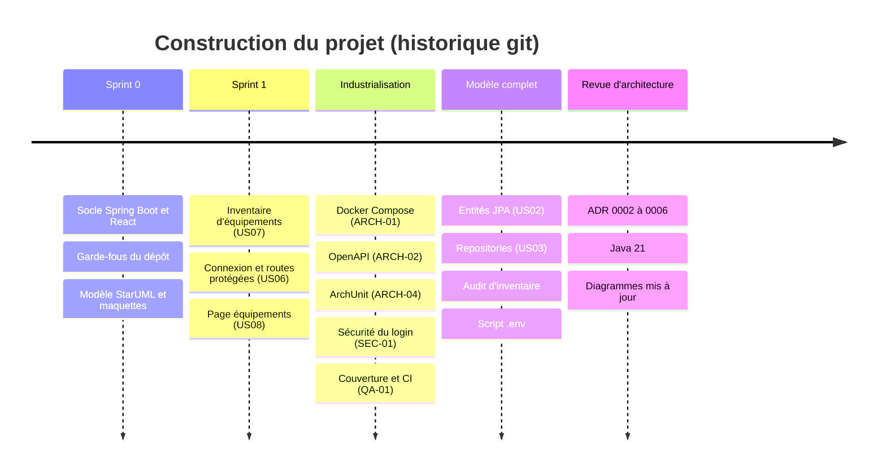

### 3.3 Ce que cela signifie

**Donc** : le projet a terminé de poser les fondations et avance sur le premier flux métier de bout en bout (se connecter, gérer l'inventaire, voir une mesure). Tout le reste de la valeur de supervision reste à construire. C'est cohérent avec le backlog (Sprint 2 : collecte, tableau de bord, métriques).

---

## 4. Vue d'ensemble de l'architecture

### 4.1 Contexte et conteneurs

**Pourquoi un monolithe modulaire** : deux développeurs, un serveur, un domaine très lié (une mesure déclenche une alerte qui déclenche une notification). Des microservices ajouteraient du réseau, du déploiement et de la complexité sans bénéfice. Un monolithe découpé en modules avec règles vérifiées garde la possibilité d'extraire un module plus tard.

**Comment** : un backend Spring Boot unique, un frontend React servi séparément, une base PostgreSQL. La collecte vit d'abord dans le backend (ADR-0006) et pourra devenir un processus à part si la charge l'exige.

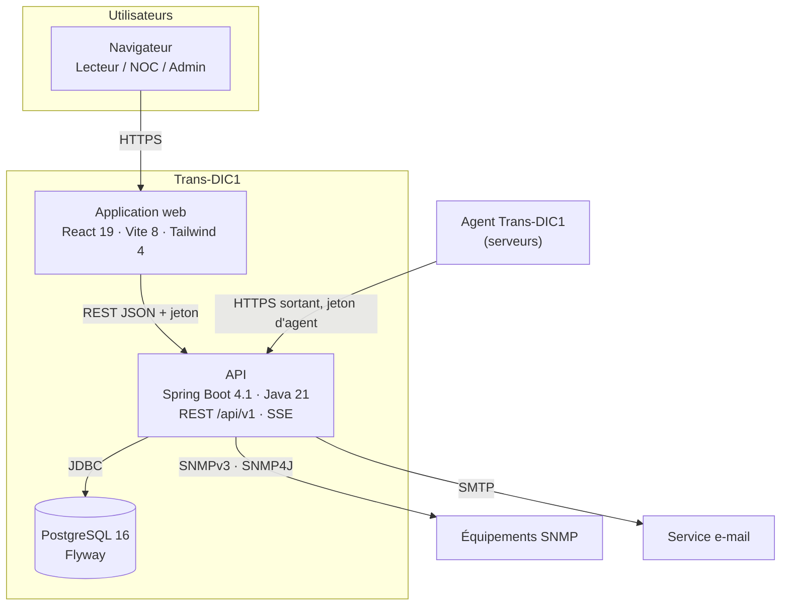

*Réalisé : navigateur → web → API → base. Cible : agent, SNMP, SMTP.*

**Donc** : le seul flux entrant vers le centre est HTTPS. Les pare-feu des sites n'ont qu'à autoriser la sortie de l'agent vers l'API.

### 4.2 Déploiement

**Pourquoi** : les builds doivent être identiques entre développement, staging et production (ADR-0001).

**Comment (réalisé)** : `docker compose up --build` lance quatre conteneurs. PostgreSQL est exposé sur `127.0.0.1:5433` seulement. Les secrets viennent d'un `.env` généré par `scripts/init-dev-env.ps1` et jamais commité.

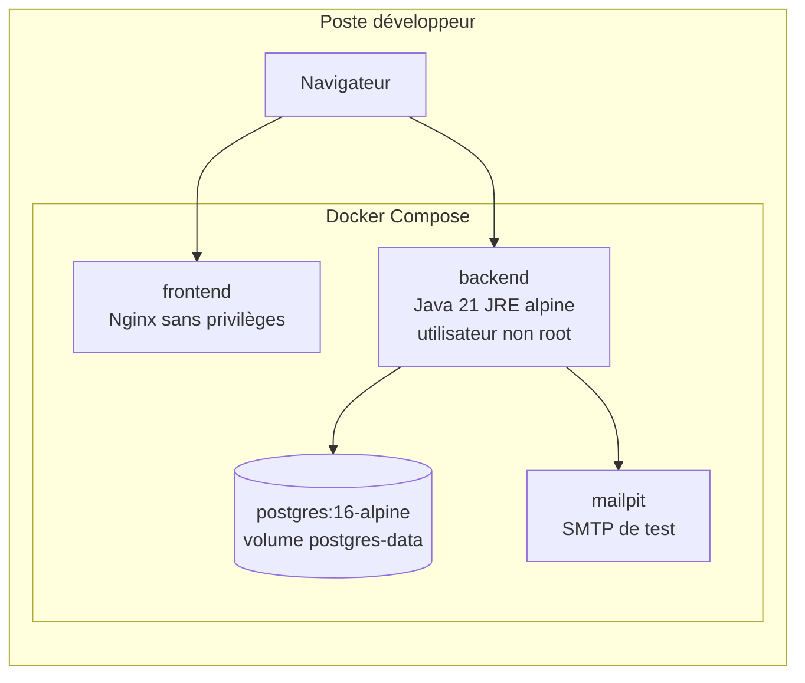

**Cible** (🟡/⚪) : un Nginx en frontal unique, qui sert l'application web et relaie l'API sur le même site (nécessaire pour les cookies `SameSite=Strict` de l'ADR-0005), TLS, serveur de données séparé, staging puis production. L'hébergement EPT n'est pas encore connu.

---

## 5. Architecture du backend

### 5.1 Modules

**Pourquoi** : isoler les responsabilités pour qu'un changement dans les rapports ne casse pas la sécurité.

**Comment** : un paquet Java par module sous `sn.ept.transdic1`, chacun découpé en `controller`, `service`, `repository`, `domain`, `dto`. Les dépendances autorisées sont codées dans `ArchitectureTests` et vérifiées à chaque build.

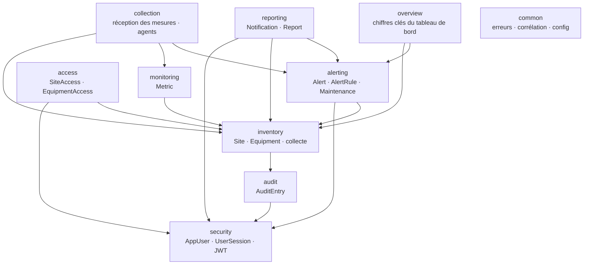

**Donc** : `access` est un module à part pour éviter un cycle `security` ↔ `inventory`. `alerting` peut tracer ses actions dans `audit` (acquitter, résoudre, assigner sont audités, ADR-0001). `collection` orchestre : elle reçoit les mesures, les stocke via `monitoring` et les fait évaluer par `alerting`, que personne d'autre ne rappelle (aucun cycle). Le moteur d'alertes lit l'historique par un port (`MetricHistory`) que `collection` implémente. Les modules du bas (`security`, `audit`, `inventory`) ne connaissent jamais `alerting` ni `reporting`.

### 5.2 Règles automatiques (ArchUnit)

| Règle | Pourquoi |
|---|---|
| Contrôleur → service → repository, jamais autrement | La logique et les transactions restent dans les services |
| Le domaine ne dépend ni de l'API ni de la persistance | Le modèle reste pur |
| Aucun cycle entre modules, sens imposé | Modules modifiables séparément |
| Les contrôleurs n'exposent aucune entité | L'API échange des DTO, jamais des entités JPA |
| `Equipment` sans sous-classe | Serveur, routeur… sont des valeurs de `EquipmentType` |
| Pas d'injection par champ | Dépendances explicites et testables |

**Donc** : l'architecture est un contrat exécutable et non un document qui vieillit.

### 5.3 Endpoints réalisés

| Méthode et chemin | Rôle requis | Description |
|---|---|---|
| `POST /api/v1/auth/login` | public (limité en débit) | Authentifie et renvoie un JWT |
| `GET /api/v1/equipements` · `GET /{id}` | authentifié | Liste et détail |
| `POST /api/v1/equipements` | `ADMIN`, `NOC_OPERATOR` | Création (201 + `Location`) |
| `PUT /api/v1/equipements/{id}` | `ADMIN`, `NOC_OPERATOR` | Modification |
| `DELETE /api/v1/equipements/{id}` | `ADMIN`, `NOC_OPERATOR` | Suppression |
| `GET /api/v1/metrics/latest` | authentifié | Dernières mesures |
| `GET /api/v1/alertes` · `/{id}` | authentifié | Liste paginée filtrable (état, équipement) · détail et historique |
| `POST /api/v1/alertes/{id}/prise-en-charge` · `/resolution` | `ADMIN`, `NOC_OPERATOR` | Prend en charge une alerte ouverte · la résout |
| `POST /api/v1/alertes/{id}/assignation` · `/archivage` · `DELETE /{id}` | `ADMIN` | Assigne ou réassigne · archive une alerte résolue · supprime (logique) |
| `GET /api/v1/regles-alertes` · `/{id}` | authentifié | Liste paginée · détail d'une règle et de sa portée |
| `POST` · `PUT /{id}` · `DELETE /{id}` `/api/v1/regles-alertes` | `ADMIN` | Crée · remplace règle et portée · supprime (refusé si la règle a produit des alertes) |
| `GET` · `PUT` · `DELETE /api/v1/equipements/{id}/collecte-snmp` | `ADMIN` | Consulte · crée ou remplace · arrête la collecte SNMP d'un équipement (secrets par référence) |
| `GET /api/v1/maintenances` | authentifié | Liste paginée filtrable (état, site, équipement) |
| `POST /api/v1/maintenances` · `/{id}/annulation` | `ADMIN`, `NOC_OPERATOR` | Planifie une maintenance · l'annule |
| `GET /api/v1/rapports/disponibilite` · `/incidents` | authentifié | Rapports sur une période (400 jours au plus), filtre par site, `format=csv` pour un fichier de tableur |
| `GET /api/v1/vue-ensemble` | authentifié | Chiffres clés du tableau de bord |
| `GET` · `PUT /api/v1/mes-preferences` | authentifié | Préférences de notification de l'utilisateur connecté (inactives par défaut) |
| `GET /api/v1/sites` · `/{id}` | authentifié | Liste paginée (filtre par statut) · détail avec nombre d'équipements |
| `POST` · `PUT /{id}` · `DELETE /{id}` `/api/v1/sites` | `ADMIN`, `NOC_OPERATOR` | Crée · modifie (code immuable) · supprime un site vide |
| `GET` · `POST /api/v1/utilisateurs` | `ADMIN` | Liste des comptes · création |
| `POST /api/v1/utilisateurs/{id}/role` · `/activation` · `/mot-de-passe` | `ADMIN` | Change le rôle · active ou désactive · réinitialise le mot de passe |
| `POST /api/v1/auth/refresh` · `/logout` | cookie de renouvellement | Renouvelle le jeton d'accès (rotation) · révoque la connexion |
| `POST` · `DELETE /api/v1/equipements/{id}/agent` | `ADMIN` | Enregistre un agent (jeton affiché une fois) · le révoque |
| `POST /api/v1/agent/measures` | jeton d'agent | Reçoit un lot de mesures (500 au plus), les stocke et évalue les alertes |
| `GET /actuator/health` | public | Santé, sans détail |

Cible (chemins recommandés, 🟡) : `/api/v1/regles-alertes`, `/api/v1/alertes/{id}/prise-en-charge`, `/resolution`, `/api/v1/rapports`, réception des mesures d'agent, flux SSE.

---

## 6. Modèle de données

### 6.1 Vue d'ensemble

**Pourquoi** : le modèle a été validé avec le métier le 6 octobre 2026 et remplace des hypothèses antérieures (états d'alerte, rôle, Zabbix). Il est écrit en français dans les diagrammes et en anglais dans le code (décision d'équipe, correspondance dans `persistence-mapping.md`).

**Comment** : 28 tables, identifiants UUID, énumérations stockées en texte et protégées par `CHECK`, durées en secondes, horodatages avec fuseau.

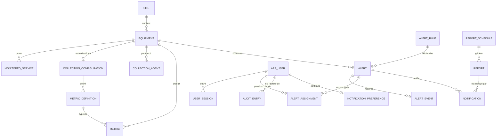

*Les tables de portée (`rule_site_scope`, `rule_equipment_scope`, `schedule_*_scope`), d'accès (`site_access`, `equipment_access`), `maintenance`, `password_reset_token` et `notification_attempt` sont omises pour la lisibilité ; elles figurent dans `persistence-mapping.md`.*

### 6.2 Règles garanties par la base

| Règle métier | Garantie |
|---|---|
| Une seule alerte active par équipement et règle | Index unique partiel (PostgreSQL) |
| Un seul agent actif par équipement | Index unique partiel |
| Une notification vient d'une alerte **ou** d'un rapport | `CHECK` |
| Une maintenance cible un site **ou** un équipement | `CHECK` |
| Mode `SNMP` exige une version, mode `AGENT` n'en a pas | `CHECK` |

**Pourquoi dans la base** : une règle codée seulement dans le service peut être contournée par une seconde instance ou un script. **Donc** un test sur un vrai PostgreSQL est indispensable (ADR-0003) : H2 ne gère pas ces index.

### 6.3 Migrations

| Version | Contenu |
|---|---|
| V1 | Base vide (socle) |
| V2 | Table `equipment` et cinq équipements fictifs |
| V3 | `site`, `app_user`, `audit_entry` |
| V4 | `metric` (mesure CPU synthétique) |
| V5 | Nettoyage des colonnes héritées |
| V6 | Verrouillage de compte (tentatives, `locked_until`) |
| V7 | Modèle persistant complet |
| V8 | Index uniques partiels |
| V9 | Table `metric` partitionnée par mois, clé `(collected_at, id)`, fonction `ensure_metric_partition` |
| V10 | Sessions : `family_id`, `replaced_by_id` (rotation des jetons de renouvellement) |
| V11 | `alert_rule.recovery_threshold` (hystérésis) avec contrainte de cohérence |
| V12 | `metric_hourly` (agrégats horaires) et fonction `drop_expired_metric_partitions` |
| V13 | `collection_agent.token_hash` (empreinte du jeton d'agent) |

La prochaine migration est la V14. Un seul dossier de migrations.

### 6.4 Stockage des métriques (cible, ADR-0004)

**Pourquoi** : environ 21 millions de lignes sur 30 jours pour 100 équipements × 5 métriques par minute (estimation à confirmer avec le CRI). **Comment** : partitionnement natif par mois, clé `(collected_at, id)` avec `id` entier généré, index BRIN sur l'horodatage. **Donc** la purge est instantanée et PostgreSQL seul suffit.

---

## 7. Comportements clés (séquences et états)

### 7.1 Connexion (réalisé)

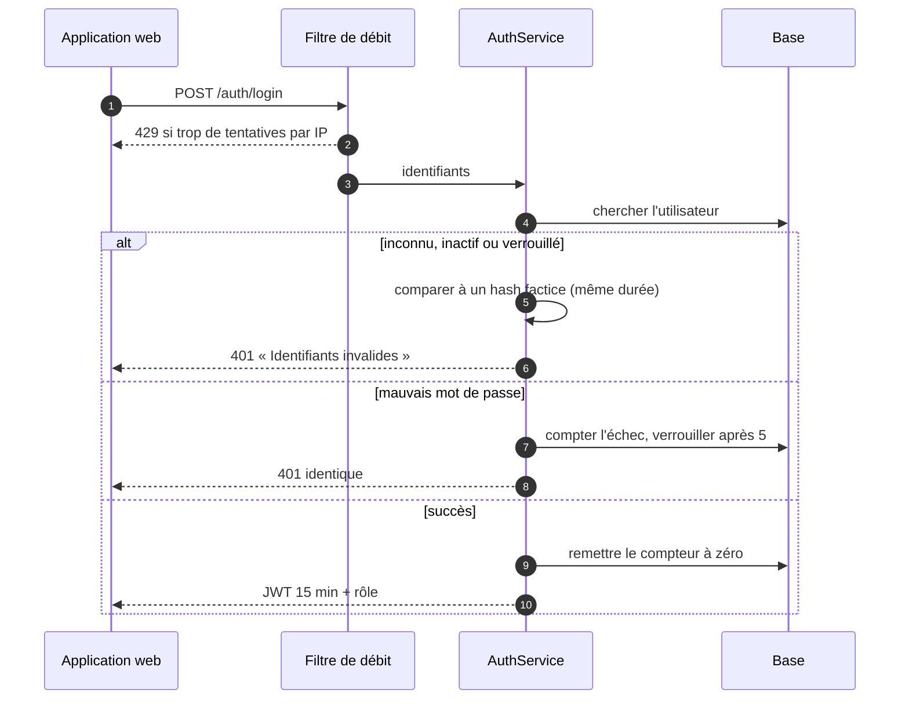

**Pourquoi la réponse identique** : un attaquant ne doit pas savoir si un compte existe. **Pourquoi le hash factice** : la durée de réponse ne trahit pas non plus l'existence du compte.

### 7.2 Renouvellement de jeton (réalisé, ADR-0005)

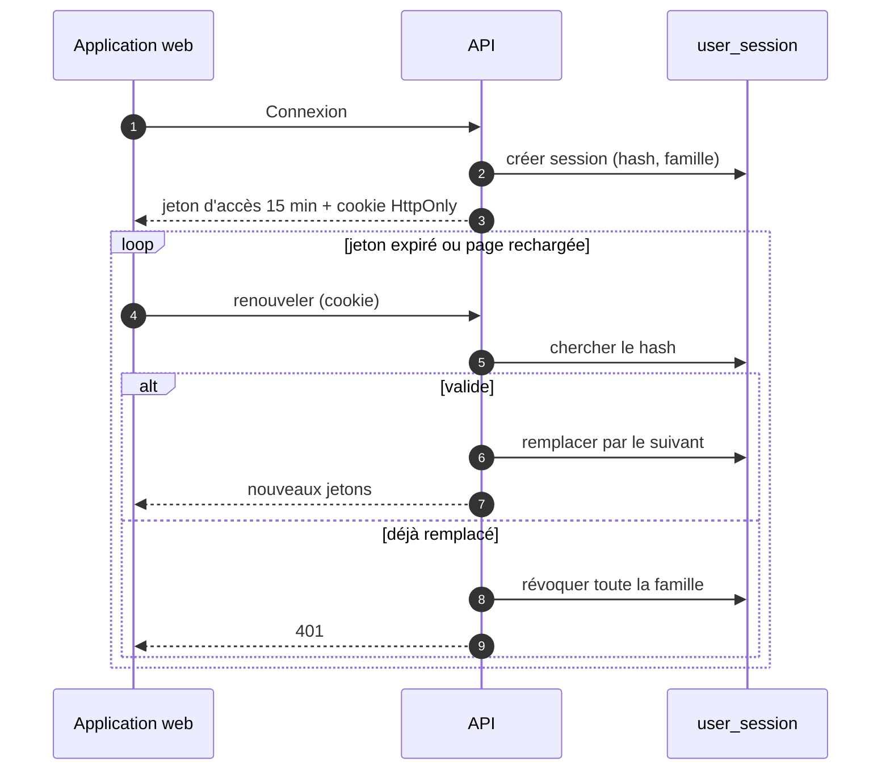

### 7.3 Collecte vers alerte (cible)

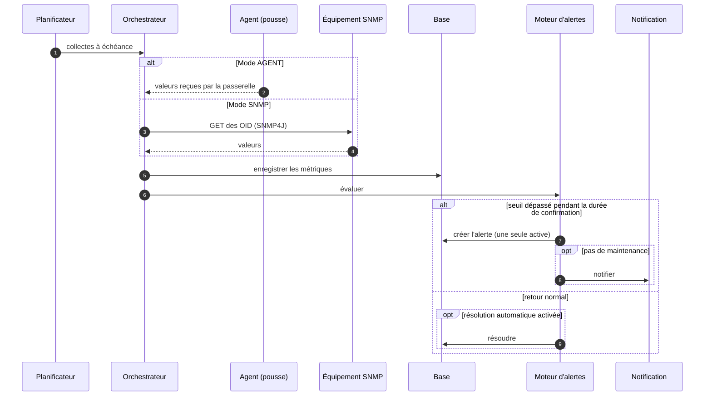

**Pourquoi la durée de confirmation** (`dureeConfirmation` dans `AlertRule`, déjà modélisée) : ignorer les pics brefs. Le seuil de retour à la normale distinct (hystérésis) n'existe pas encore (section 12).

### 7.4 Cycle de vie d'une alerte (modèle validé)

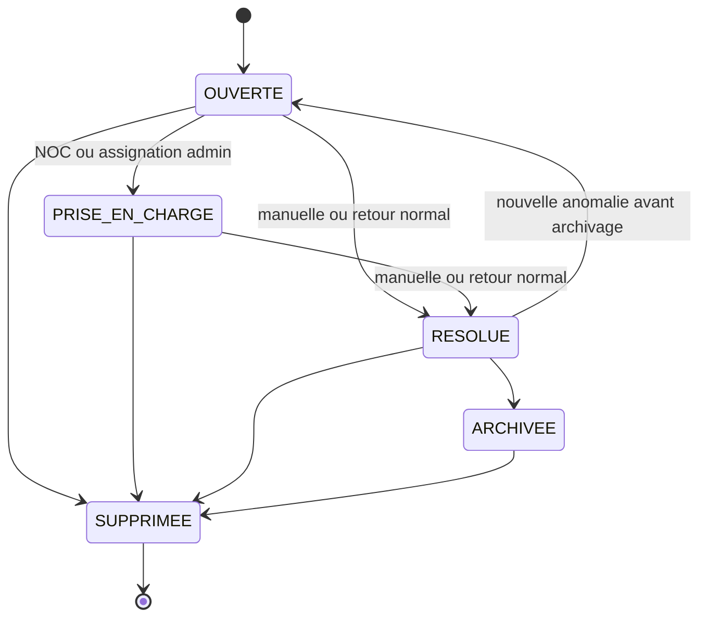

Sévérité indépendante de l'état : `INFO`, `WARNING`, `CRITICAL`. Le code de ce cycle n'existe pas encore (entités et énumération seulement).

---

## 8. Sécurité

| Mesure | État | Pourquoi / comment |
|---|---|---|
| Mots de passe hachés, jamais journalisés | ✅ | `PasswordEncoder` Spring Security |
| JWT 15 min, API sans session (`STATELESS`) | ✅ | Pas d'état serveur à compromettre |
| CORS restreint aux origines configurées, en-têtes autorisés explicites | ✅ | `SecurityConfig` |
| En-têtes de sécurité (referrer, permissions…) | ✅ | `SecurityConfig` |
| Limitation de débit et verrouillage progressif | ✅ | 10 requêtes/60 s par IP, verrou 1 min doublé jusqu'à 30 min |
| Secrets de collecte par **référence** seulement | ✅ | `@JsonIgnore`, pas de `toString`, testé |
| Audit des actions sensibles | ✅ partiel | inventaire audité ; rôles, alertes à venir |
| Analyse des secrets (gitleaks) et dépendances (Trivy, `npm audit`) | ✅ | CI |
| Jeton en mémoire + renouvellement par cookie avec rotation | ✅ | ADR-0005 |
| SNMPv3 par défaut, v2c explicitement autorisé par équipement | 🟡 | ADR-0001 |

**Corrigé** : le jeton d'accès n'est plus dans `sessionStorage` mais en mémoire ; le renouvellement passe par un cookie `HttpOnly` avec rotation (une faille XSS ne vole plus de session durable). **CSRF** : désactivé car l'API n'utilise pas de cookie d'authentification pour l'instant ; l'ADR-0005 réintroduit un cookie pour le seul endpoint de renouvellement, avec `SameSite=Strict` et contrôle de l'origine.

---

## 9. Frontend

**Pourquoi React 19 + Vite + Tailwind** : écosystème dominant, démarrage rapide, composants testables ; choix de l'ADR-0001.

**Comment** : `App.jsx` déclare les routes ; `ProtectedRoute` redirige vers `/connexion` sans session ; `AuthContext` fournit l'utilisateur et le rôle ; `permissions.js` n'est qu'un confort d'affichage (le contrôle réel est côté serveur) ; `api/client.js` centralise l'URL de l'API et l'en-tête `Authorization`.

| Route | Page | État |
|---|---|---|
| `/connexion` | Connexion | ✅ |
| `/tableau-de-bord` | Tableau de bord : chiffres clés, statuts, alertes par sévérité, dernière mesure | ✅ |
| `/equipements` | Liste, création, modification, suppression | ✅ |
| `/alertes` | Alertes : liste, filtre par état, prise en charge, résolution, archivage, historique | ✅ |
| `/regles` | Règles d'alerte : liste, création, modification, suppression | ✅ |
| `/maintenances` | Maintenances : liste filtrable, planification, annulation | ✅ |
| `/rapports` | Rapports : disponibilité et incidents, export CSV, impression | ✅ |
| `/notifications` | Mes notifications : activation, sévérité minimale | ✅ |
| `/utilisateurs` | Comptes : création, rôle, activation, mot de passe (administrateurs) | ✅ |
| Métriques (graphiques d'historique), administration de la collecte | — | ⚪ maquettes dans `docs/design` |

Les types TypeScript de l'API sont générés depuis `openapi.yaml`, pour éviter les écarts de contrat.

---

## 10. Qualité, CI/CD et exploitation

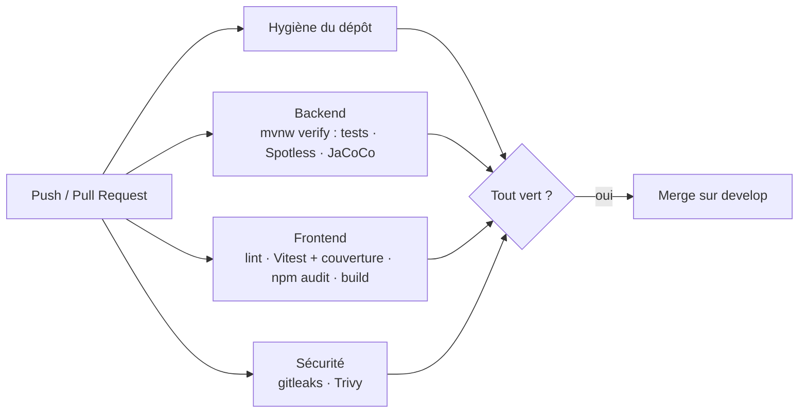

| Contrôle | Seuil / outil | Pourquoi |
|---|---|---|
| Couverture backend | JaCoCo ≥ 80 % lignes, 60 % branches | Empêche l'érosion des tests |
| Couverture frontend | Vitest ≥ 75 % lignes | Idem |
| Format | Spotless (fichiers modifiés) | Diffs lisibles |
| Architecture | ArchUnit | Voir 5.2 |
| Secrets | gitleaks (historique inclus) | Aucun secret dans Git |
| Dépendances | Trivy, `npm audit` (HIGH/CRITICAL) | Failles connues |
| Actions GitHub | épinglées par empreinte, Dependabot | Chaîne d'approvisionnement |

**Exploitation** : journaux avec identifiant de corrélation, `/actuator/health` (sondes), documents `docs/devops/` (opérations, PostgreSQL, variables, workflow Git).

---

## 11. Décisions d'architecture et justifications

### 11.1 Index

| ADR | Décision | Statut |
|---|---|---|
| [0001](adr/0001-application-stack.md) | Stack : Spring Boot, React, PostgreSQL, Flyway, JWT | acceptée |
| [0002](adr/0002-build-versus-adopt.md) | Construire sur mesure, en réutilisant des briques | proposée |
| [0003](adr/0003-integration-tests-on-real-postgresql.md) | Tests sur un vrai PostgreSQL embarqué (sans Docker) au lieu de H2 | acceptée, implémentée |
| [0004](adr/0004-metrics-storage.md) | Métriques : partitionnement natif, clé entière, BRIN | acceptée, implémentée (hors purge) |
| [0005](adr/0005-authentication-and-refresh.md) | Jeton en mémoire + renouvellement par cookie avec rotation | acceptée, implémentée |
| [0006](adr/0006-collection-realtime-runtime.md) | Java 21, SNMP4J, agent actif, SSE | acceptée, implémentée |
| [0007](adr/0007-email-notifications.md) | Notifications par e-mail : événement, file en base, envoi différé | acceptée, implémentée |
| [0008](adr/0008-events-outbox-channels.md) | Événements internes, Outbox, canaux webhook, Teams et Slack (d'abord numéroté 0007 par erreur) | acceptée, implémentée |
| [0009](adr/0009-postgresql-backup.md) | Sauvegarde : conteneur dédié, dump chiffré, restauration de contrôle | acceptée, implémentée |
| [0010](adr/0010-observability.md) | Observabilité : Prometheus, logs ECS, traces OpenTelemetry | acceptée, implémentée |
| [0011](adr/0011-deployment.md) | Déploiement : Compose de production derrière Nginx, retour arrière | acceptée, implémentée |
| [0012](adr/0012-agent.md) | Agent Trans-DIC1 : Python 3 sans dépendance, systemd | acceptée, implémentée |

L'index tenu à jour est [docs/adr/README.md](adr/README.md). Le PDF du dossier d'architecture n'a pas été régénéré depuis l'ajout des ADR 0008 à 0012.

### 11.2 Pourquoi / comment / donc, décision par décision

**Construire plutôt qu'adopter (0002).** *Pourquoi* : Zabbix, LibreNMS ou Prometheus + Grafana couvrent le besoin technique ; la question sera posée en soutenance. *Comment* : le projet est justifié par le cycle d'alerte, les rôles, l'audit et les rapports propres à l'EPT, avec briques réutilisées pour les protocoles et le stockage. *Donc* : périmètre assumé (pas de découverte automatique, pas de milliers d'équipements) et obligation de comparer avec ces outils dans le rapport. Les sources comparatives ne traitent pas le cas d'un projet pédagogique.

**Tests sur PostgreSQL réel (0003).** *Pourquoi* : H2 ne gère pas les index uniques partiels, donc les règles « une seule alerte active » ne sont jamais testées. Les sources convergent sur le risque de valider un code différent de celui de la production. *Comment* : PostgreSQL 16 embarqué (binaires lancés par la JVM, **sans Docker**, exigence du projet), mêmes migrations qu'en production, un test de violation par index. *Donc* : les tests tournent partout où tourne Java ; un seul dossier de migrations. Testcontainers a été écarté parce qu'il exige Docker.

**Stockage des métriques (0004).** *Pourquoi* : volume élevé, rétention différenciée. *Comment* : partitionnement natif mensuel. *Benchmarks* : les gains de TimescaleDB (insertions jusqu'à 20 fois plus rapides) viennent de l'éditeur et de PostgreSQL 14 ; une mesure isolée place le partitionnement natif avec BRIN à 15-30 % de TimescaleDB sauf pour les agrégats continus ([source](https://dev.to/gabrielanhaia/time-series-in-postgres-when-timescaledb-wins-when-native-partitioning-beats-it-1bk0)). Pour l'identifiant, `bigint` est le plus rapide, UUID v7 un compromis, UUID v4 le moins bon ([ardentperf](https://ardentperf.com/2024/02/03/uuid-benchmark-war/)). *Donc* : natif + `bigint` ; TimescaleDB réévalué seulement après mesure sur le volume réel. Aucun benchmark indépendant relu n'existe.

**Authentification (0005).** *Pourquoi* : le jeton en `sessionStorage` est exposé au XSS. *Comment* : jeton d'accès court en mémoire, renouvellement par cookie `HttpOnly` avec rotation et détection de réutilisation, état dans `user_session`. *Donc* : une faille XSS ne vole plus de session durable ; le frontend et l'API doivent partager le même site. Sources : blogs ; relire l'OWASP et la documentation Spring Security 7 avant l'implémentation.

**Exécution, collecte et temps réel (0006).**
- *Java 21* : recommandé par Spring Boot 4, threads virtuels ; Java 25 est meilleur (épinglage corrigé à partir de Java 24) mais n'est pas encore vérifié avec les outils du projet. *Donc* : 21 maintenant, 25 ensuite. **Appliqué** : `pom.xml`, Dockerfile, CI, README.
- *SNMP4J* : SNMPv3, asynchrone, GETBULK, maintenu (3.12). Aucun benchmark comparatif trouvé ; derrière un port, donc remplaçable.
- *Agent actif* : les contrôles actifs de Zabbix réduisent la charge du serveur et l'immunisent contre les agents lents (témoignages, pas de mesure) ; les pare-feu n'autorisent que la sortie. Le backend ne scrute que le SNMP.
- *SSE* : flux serveur → navigateur suffisant, reconnexion automatique, aucune dépendance. WebSocket seulement si un besoin bidirectionnel apparaît.

### 11.3 Ce qui est bon et conservé

Monolithe modulaire vérifié par ArchUnit, ports pour la collecte, énumérations plutôt que sous-classes, contraintes en base, secrets par référence, limitation de débit, couverture imposée par la CI.

---

## 12. Écarts entre le code et la cible, risques

| # | Écart ou risque | Gravité | Traitement |
|---|---|---|---|
| 1 | ~~Tests sur H2 : index partiels non testés~~ | Haute | **Corrigé** : ADR-0003, PostgreSQL embarqué ; 4 index partiels et partitionnement prouvés par des tests |
| 2 | ~~`metric` non partitionnée, clé UUID~~ | Haute | **Corrigé** : migration V9 (partitions mensuelles, clé `bigint`). Reste la purge des partitions expirées, à faire avec les agrégats |
| 3 | ~~Jeton en `sessionStorage`~~ | Moyenne | **Corrigé** : ADR-0005 implémenté. Limite connue : deux onglets qui renouvellent exactement en même temps peuvent déclencher la détection de réutilisation et fermer la session |
| 4 | ~~Pas de seuil de retour à la normale (hystérésis)~~ | Moyenne | **Corrigé** : `recovery_threshold` (V11) et méthodes `isBreachedBy` / `isRecoveredBy` testées |
| 5 | Pas de regroupement ni d'inhibition des alertes (un routeur en panne = 40 alertes) | Moyenne | à concevoir au Sprint 3 |
| 6 | Collecteur « séparé » dans certains diagrammes, intégré dans l'ADR | Faible | décision : intégré au monolithe d'abord ; mise à jour des diagrammes de déploiement faite en partie |
| 7 | Anciens diagrammes et `00-overview.md` périmés conservés | Faible | marqués obsolètes dans le README des diagrammes |
| 8 | `CHANGELOG.md` en retard sur le travail réalisé | Faible | à mettre à jour |
| 9 | Prérequis externes : autorisation CRI pour tests réels, cibles SNMP, serveurs, SMTP, DNS/TLS | Haute (blocage) | à obtenir |
| 10 | Aucune date de sprint | Moyenne | à fixer avec l'encadrement |

---

## 13. Feuille de route

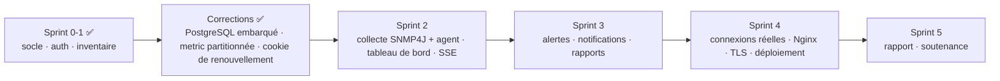

Corrections faites : tests sur PostgreSQL embarqué, migration `metric` (V9), renouvellement de jeton (V10). Aussi faits : hystérésis des règles d'alerte (V11), agrégats horaires et purge des partitions expirées (V12), limitation de débit de `/auth/refresh` et nettoyage des sessions expirées. Restent : passage à Java 25, regroupement des alertes, agrégats journaliers, flux SSE du tableau de bord.

---

## 14. Annexes

### 14.1 Technologies

| Couche | Choix | Version |
|---|---|---|
| Langage backend | Java | 21 |
| Framework | Spring Boot (MVC, Data JPA, Security, Validation, Actuator) | 4.1.1 |
| ORM | Hibernate | 7.4 |
| Base | PostgreSQL + Flyway | 16 |
| Limitation de débit | Bucket4j | 8.21 |
| API | springdoc OpenAPI | 3.1.1 |
| Tests backend | JUnit, Spring Boot Test, ArchUnit, PostgreSQL embarqué (zonky) | ArchUnit 1.5.1 |
| Qualité backend | JaCoCo 0.8.15, Spotless 3.10 | |
| Frontend | React 19, Vite 8, React Router 7, Axios 1, Tailwind 4 | Node 24 |
| Tests frontend | Vitest, Testing Library | |
| Conteneurs | Docker Compose, Mailpit | |

### 14.2 Jeu canonique de diagrammes

Dans `docs/architecture/diagrams/` : cas d'utilisation (`01`), modèle persistant (`02`), séquences collecte, alertes et renouvellement de jeton (`03`), activité de collecte (`04`), cycle de l'alerte (`05`), composants cibles (`06`), déploiement cible (`07`), paquets (`10`). Les autres fichiers sont des versions antérieures conservées pour la traçabilité. Les fichiers `.mmd` s'affichent dans tout rendu Mermaid ; les images StarUML sont dans `docs/uml/`.

### 14.3 Documents associés

`docs/product-backlog.md` · `docs/architecture/persistence-mapping.md` · `docs/architecture/archunit.md` · `docs/devops/*` · `docs/api/openapi.yaml` · `docs/design/` (maquettes) · `deliverables/` (présentations).

### 14.4 Sources de la revue

- Stockage des séries temporelles : [Timescale](https://timescale.com/blog/pg_partman-vs-hypertables-for-postgres-partitioning), [Supabase](https://supabase.com/docs/guides/database/migrating-to-pg-partman), [DEV Community](https://dev.to/gabrielanhaia/time-series-in-postgres-when-timescaledb-wins-when-native-partitioning-beats-it-1bk0)
- Identifiants : [ardentperf](https://ardentperf.com/2024/02/03/uuid-benchmark-war/), [PostgreSQL 18](https://www.c-sharpcorner.com/article/benchmarking-uuidv7-vs-sequential-keys-in-postgresql-18/)
- Tests : [embedded-postgres](https://github.com/zonkyio/embedded-postgres), [Testcontainers](https://testcontainers.com/guides/replace-h2-with-real-database-for-testing)
- Authentification : [OpenReplay](https://blog.openreplay.com/cookies-vs-localstorage-jwt-auth/), [session et révocation](https://guptadeepak.com/ciam-compass/best-practices/session-management/)
- Java et threads virtuels : [InfoQ](https://infoq.com/articles/virtual-threads-after-jdk24), [BellSoft](https://bell-sw.com/blog/a-guide-to-using-virtual-threads-with-spring-boot/)
- Collecte : [SNMP4J](https://central.sonatype.com/artifact/org.snmp4j/snmp4j), [Zabbix actif/passif](https://blog.zabbix.com/zabbix-agent-active-vs-passive/)
- Temps réel : [WebSocket vs SSE](https://websocket.org/comparisons/sse/)
- Modulithes : [Frankel](https://blog.frankel.ch/spring-modulith-modularity-maturity/)
- Outils existants : [Zabbix vs LibreNMS](https://industrialmonitordirect.com/blogs/knowledgebase/zabbix-vs-librenms-network-monitoring-system-comparison)

La plupart de ces sources sont des blogs ou des pages d'éditeurs, pas des études contrôlées : les chiffres sont des ordres de grandeur, à confirmer par des mesures sur la charge réelle du CRI.
