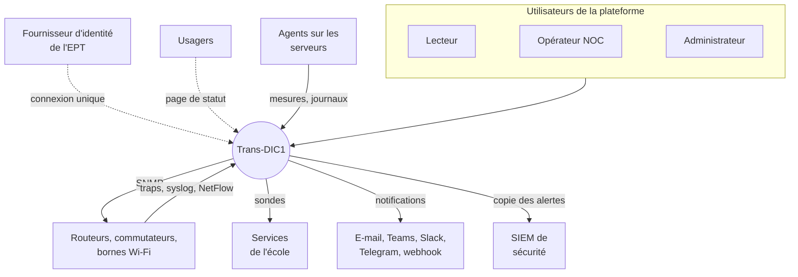
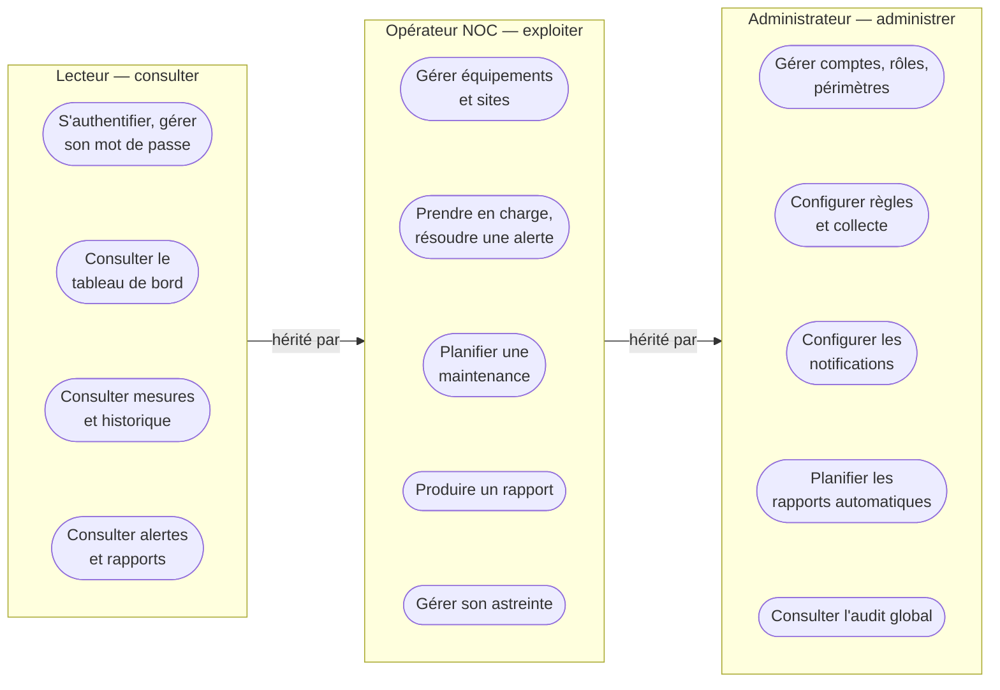

# Contexte, besoins et acteurs

## Le problème à résoudre

L'EPT dispose d'un parc informatique réparti sur plusieurs bâtiments : serveurs (ENT, messagerie, scolarité), machines virtuelles, routeurs, commutateurs de distribution et d'accès, bornes Wi-Fi des amphithéâtres et des salles de TP. Ce parc est exploité par le CRI avec une petite équipe.

Trois difficultés reviennent :

1. **La détection dépend des plaintes.** Une panne est connue quand un usager la signale, souvent longtemps après son début. Un disque qui se remplit doucement ou un processeur saturé ne se voit pas avant qu'un service tombe.
2. **Le traitement n'est pas tracé.** On ne sait pas qui s'occupe d'un incident, depuis quand, ni comment il a été résolu. Les mêmes pannes se répètent sans mémoire.
3. **Il n'y a pas de chiffres.** Impossible de dire quelle a été la disponibilité de la messagerie le mois dernier, ni quels équipements tombent le plus souvent.

## Objectifs

### Objectifs métier

| Objectif | Ce qui permet de dire qu'il est atteint |
|---|---|
| Détecter avant les usagers | Une alerte s'ouvre dans les minutes qui suivent une panne ou un dépassement de seuil |
| Prévenir la bonne personne | La personne concernée (ou d'astreinte) reçoit une notification sur le canal qu'elle a choisi |
| Suivre le traitement | Chaque alerte a un état, un ou plusieurs responsables et un historique complet |
| Anticiper | La plateforme annonce une saturation à venir (« disque plein dans 9 jours ») |
| Rendre des comptes | Rapports de disponibilité par période et par site, pages de statut pour les usagers |

### Objectifs techniques et contraintes

Ces contraintes ont guidé presque tous les choix décrits au chapitre 6 :

- **Fonctionner dans le réseau interne, sans dépendre d'Internet.** La plateforme est installée chez l'EPT ; aucun service en ligne n'est nécessaire à son fonctionnement.
- **Ne jamais exposer la topologie ni les secrets.** Aucun mot de passe, communauté SNMP, jeton ou adresse interne ne doit apparaître dans le code, dans la base de données ou dans les journaux.
- **Tracer les actions sensibles.** Connexions, modifications de l'inventaire, traitement des alertes, changements de droits : tout est enregistré dans un journal que personne ne peut modifier.
- **Rester exploitable par une petite équipe.** Une seule application à installer et à sauvegarder, une interface en français, des réglages modifiables sans redéployer.
- **Être reproductible.** Le projet doit pouvoir être reconstruit et testé à l'identique depuis le dépôt de code.

## Les acteurs

### Trois rôles humains, emboîtés

Le porteur du projet a validé le 6 octobre 2026 trois rôles hiérarchiques : chacun possède les droits du rôle précédent.

| Rôle | Qui | Ce qu'il peut faire |
|---|---|---|
| **Lecteur** | Responsable, enseignant, membre de la direction | Consulter le tableau de bord, les équipements, les mesures, les alertes et les rapports de son périmètre, sans rien modifier |
| **Opérateur NOC** | Technicien du CRI | Tout ce que fait le lecteur, plus : gérer l'inventaire, prendre en charge et résoudre les alertes, planifier des maintenances, gérer son astreinte |
| **Administrateur** | Responsable du CRI | Tout ce que fait l'opérateur, plus : comptes et rôles, périmètres d'accès, règles d'alerte, canaux de notification, collecte, pages de statut, journal d'audit complet |

Un utilisateur peut en plus être **limité à certains sites** (par exemple un technicien d'un bâtiment) : il ne voit alors que les équipements, alertes, rapports et mesures de ces sites. Ce périmètre est vérifié par le serveur, pas seulement masqué à l'écran.

### Les systèmes avec lesquels la plateforme dialogue

*Figure 2.1 — Contexte : la plateforme au centre, ses utilisateurs et les systèmes avec lesquels elle échange.*

- **L'agent** est installé sur chaque serveur ; il envoie processeur, mémoire, disques, services et journaux d'authentification.
- **Les équipements réseau**, qui ne peuvent pas recevoir d'agent, sont interrogés en SNMP et peuvent envoyer eux-mêmes des événements (traps, syslog) et des statistiques de trafic (NetFlow).
- **Les services de l'école** (site web, ENT, messagerie) sont testés de l'extérieur par des sondes, comme le ferait un usager.
- **Les canaux de notification** et le **SIEM** de l'équipe sécurité reçoivent les alertes ; le **fournisseur d'identité de l'EPT** permet, s'il est activé, de se connecter avec son compte de l'école ; les **usagers** consultent sans compte une page de statut publique.

## Le périmètre couvert

Le tableau ci-dessous situe ce que couvre la plateforme livrée par rapport au besoin initial. Le détail par user story figure au chapitre 4.

| Domaine | Besoin initial (backlog) | Livré |
|---|---|---|
| Accès | Connexion, rôles | Connexion, rôles, périmètre par site, connexion unique de l'école, double authentification, jetons d'API |
| Inventaire | Équipements et sites | Équipements, sites, import CSV, découverte, modèles d'équipement, topologie, voisins découverts |
| Collecte | Simulation, agent, SNMP | Agent Linux et Windows, SNMP v2c et v3, interfaces réseau, sondes, traps, syslog, NetFlow |
| Alertes | Seuils, cycle de vie | Seuils avec confirmation et retour à la normale, regroupement, escalade, maintenances, sept types de détection |
| Notifications | E-mail | E-mail, Teams, Slack, Telegram, webhook, SIEM, astreinte |
| Restitution | Tableau de bord, graphiques, rapports PDF | Tableau de bord, vues personnelles, mur NOC, score de santé, rapports PDF et CSV, rapports planifiés, pages de statut, diagnostic |
| Exploitation | Déploiement Docker | Déploiement de production, sauvegarde vérifiée, supervision de la plateforme, retour arrière, chart Kubernetes |

## Les cas d'utilisation

Les cas d'utilisation ont été validés avec le porteur du projet lors d'un entretien. Le diagramme ci-dessous les regroupe par rôle ; chaque rôle hérite des cas du rôle précédent.

*Figure 2.2 — Cas d'utilisation par rôle (version simplifiée de la vue validée) : chaque rôle possède aussi les cas des colonnes précédentes.*

Certaines décisions ont été prises dès cet entretien ; le chapitre 4 indique celles qui ne sont pas encore réalisées :

- **Pas d'inscription publique** : seul un administrateur crée les comptes.
- **Retirer un équipement** : l'archiver (historique conservé) ou le supprimer définitivement après confirmation ; seule la suppression est réalisée aujourd'hui.
- **Plusieurs opérateurs peuvent partager une alerte**, tous au même niveau.
- **Deux résolutions** : manuelle par un opérateur, ou automatique au retour à la normale, distinguées dans l'historique.
- **Pendant une maintenance**, la collecte continue mais les notifications sont suspendues.
