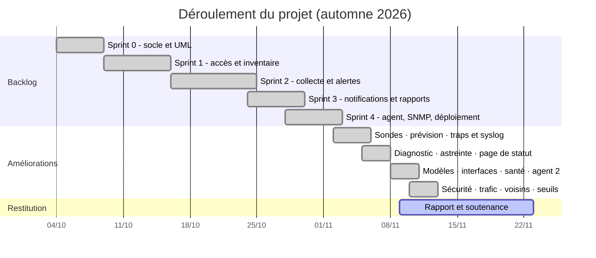

# Démarche de réalisation

Ce chapitre explique comment le travail a été organisé, de la feuille blanche jusqu'à une plateforme complète, et comment l'équipe s'est assurée de ne pas perdre le fil ni la qualité en chemin.

## Une démarche agile en sprints courts

Le projet a suivi une démarche inspirée de Scrum : un **backlog de user stories** priorisées, découpé en **six sprints** d'une à deux semaines, chacun terminé par un incrément utilisable.

| Sprint | Thème | Contenu principal |
|---|---|---|
| Sprint 0 | Socle commun | Choix de la pile technique, base de données locale, squelettes du serveur et de l'interface, cinq équipements fictifs, diagrammes UML validés |
| Sprint 1 | Accès et inventaire | Modèle de données complet, connexion sécurisée, rôles, gestion des équipements et des sites |
| Sprint 2 | Collecte et tableau de bord | Collecte simulée puis réelle, consultation des mesures, tableau de bord, graphiques, moteur d'alertes |
| Sprint 3 | Alertes, notifications, rapports | Écran de traitement des alertes, e-mails, rapports PDF, réglage des seuils, temps réel |
| Sprint 4 | Données réelles et déploiement | Agent, SNMP, déploiement de production, documentation, plan de validation à l'EPT |
| Sprint 5 | Restitution | Rapport final, support de soutenance, répétitions |

Chaque user story porte une **estimation**, une **priorité**, ses **dépendances** et des **critères d'acceptation vérifiables** (par exemple : « une seule alerte non résolue existe par équipement, règle et occurrence continue »). Une story n'est considérée comme terminée que lorsque ses critères sont couverts par des tests automatisés.

Le backlog a été chargé dans GitHub sous forme d'Issues rattachées à des jalons (un par sprint), avec un tableau de suivi *Backlog → Ready → In progress → In review → Blocked → Done*. Les tâches ont été réparties entre les deux membres, certaines étant partagées.

## De la modélisation au code

Avant d'écrire du code métier, l'équipe a produit et fait valider un **jeu de diagrammes UML** : cas d'utilisation, modèle du domaine, séquences de collecte et de traitement d'alerte, machine à états de l'alerte, composants, déploiement. Ce travail a permis de trancher tôt des questions structurantes :

- un équipement a un **type** (serveur, routeur, commutateur, machine virtuelle, borne Wi-Fi) plutôt que d'être modélisé par une hiérarchie de classes ;
- le **cycle de l'alerte** (ouverte, prise en charge, résolue, archivée, supprimée) est le même partout ;
- les **trois rôles** sont emboîtés.

Le code a ensuite été écrit en suivant ce modèle, puis les diagrammes ont été mis à jour quand la réalisation a fait évoluer une décision (par exemple le passage du WebSocket au SSE pour le temps réel).

## Au-delà du backlog : se comparer pour s'améliorer

À la fin du sprint 4, le backlog de développement était terminé (59 Issues fermées). Plutôt que de s'arrêter là, l'équipe a comparé honnêtement la plateforme aux outils de référence (Zabbix, LibreNMS, Prometheus et Grafana, Checkmk, PRTG, Uptime Kuma), fonction par fonction. Cette comparaison a fait ressortir trois catégories :

1. **Les écarts à combler** : ce que tous les outils sérieux font et que Trans-DIC1 ne faisait pas (sondes sans agent, prévision de saturation, réception des traps et du syslog, modèles d'équipement, agent Windows, jetons d'API, rapports planifiés).
2. **Les occasions de dépasser** : ce que les outils libres font mal ou pas du tout et qui a de la valeur pour une petite équipe (diagnostic d'incident expliqué, astreinte intégrée, page de statut reliée au parc supervisé, score de santé).
3. **Ce qu'il ne fallait pas promettre** : la largeur de collecte et le passage à grande échelle de Zabbix.

Un **plan d'améliorations** a été rédigé en phases (fiabiliser l'acquis, combler les écarts, dépasser), suivi d'un volet **sécurité** (supervision des journaux, détection d'attaques web, comportement inhabituel, passerelle vers un SIEM, trafic réseau et détection de balayages) et d'un volet **apprentissage automatique raisonné** (détections statistiques explicables plutôt que modèles opaques).

## La chronologie réelle

*Figure 3.1 — Chronologie du projet, reconstituée à partir de l'historique du dépôt.*

Le rythme de travail se lit dans l'historique : une douzaine de modifications par semaine pendant la mise en place (semaines 40 à 42), une vingtaine en semaine 43, puis plus de 100 en semaine 44 et près de 90 en semaine 45, quand le socle a permis d'enchaîner les fonctionnalités, et une trentaine en semaine 46, consacrée à la sécurité et à la finition.

## Les règles de travail qui ont permis d'aller jusqu'au bout

Livrer autant de fonctions en six semaines sans que l'ensemble devienne fragile a reposé sur quelques règles simples, appliquées à chaque modification.

### Une branche par sujet, une revue avant intégration

Le dépôt suit un modèle à deux branches principales : `main` pour la version stable, `develop` pour l'intégration. Chaque sujet est développé sur sa propre branche (`feature/…`, `fix/…`, `docs/…`) puis intégré par une demande de fusion. Les messages de modification suivent une convention (*Conventional Commits* : `feat`, `fix`, `docs`, `test`…), vérifiée automatiquement avant chaque enregistrement, ce qui rend l'historique lisible et permet de générer le journal des changements.

### Des tests avant de dire « c'est fait »

Chaque fonction arrive avec ses tests, et les tests du serveur tournent sur un **vrai moteur PostgreSQL** (et non une base imitée), pour que ce qui passe en test passe aussi en production. Un script unique lance l'ensemble des contrôles (tests, qualité du code, compilation de l'interface, parcours dans un navigateur) et affiche un tableau récapitulatif réussi / échoué.

### Une relecture critique de chaque fonction

Chaque fonction notable a été relue après coup avec un œil critique, en cherchant ce qui pouvait casser : cas limites, concurrence entre traitements, sécurité, coût. Ces relectures ont trouvé des défauts à presque chaque fonction (une fausse alerte de prévision juste après un nettoyage de disque, une course entre deux traitements de traps, deux sondes ping qui faisaient clignoter une alerte…) ; ils ont tous été corrigés avant fusion. **La qualité est venue autant des relectures que du premier jet.**

### Une décision écrite pour chaque choix structurant

Chaque choix important (technologie, mode de stockage, mode de collecte, sécurité de la connexion…) a été consigné par écrit avec son contexte, les options envisagées, la décision et son prix. C'est ce travail qui permet aujourd'hui de justifier chaque choix au chapitre 6, et d'expliquer pourquoi certaines décisions ont évolué.

### Dire honnêtement ce qui n'est pas prouvé

Chaque fonction livrée précise ce qu'elle ne fait pas et ce qui n'a pas été vérifié (« aucun matériel réel n'a été lu », « seuils raisonnés, non mesurés sur le parc »). Un **registre des risques** tient la liste de ces limites, avec pour chacune l'impact, ce qui la réduit déjà et ce qu'il reste à faire.

## Un aléa en cours de route : la perte de l'intégration continue

Au départ, chaque demande de fusion déclenchait automatiquement sur GitHub les tests, l'analyse de qualité et la recherche de secrets et de failles. En cours de projet, le compte GitHub a été bloqué pour une raison de facturation et les automatismes ont dû être supprimés. L'équipe a compensé par :

- un **script de vérification locale** qui reproduit les mêmes contrôles sur le poste ;
- des **crochets Git** (*hooks*) qui vérifient le format des messages et la qualité du code avant chaque enregistrement, et facultativement les tests avant chaque envoi ;
- une **chaîne de livraison par scripts**, prévue pour tourner sur le futur serveur de préproduction (tests, construction des images, analyse de vulnérabilités, déploiement, contrôle de bon fonctionnement).

Cette solution fonctionne mais dépend de la discipline de l'équipe : elle ne bloque aucune fusion et ne laisse aucune trace hors du poste. La rétablir en ligne fait partie des pistes d'amélioration.
