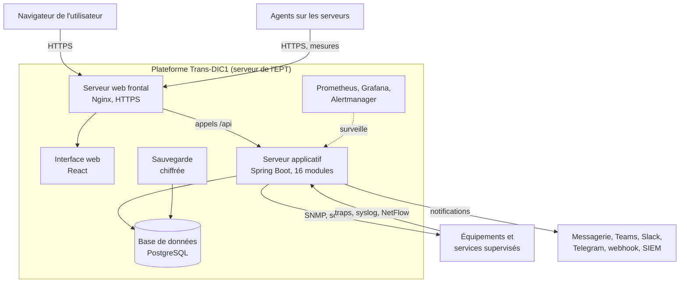
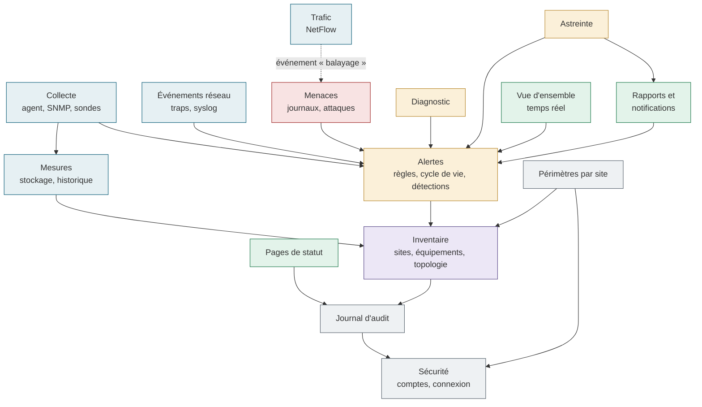
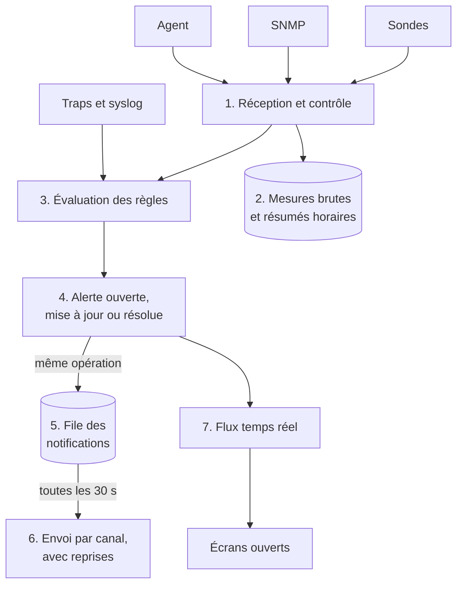
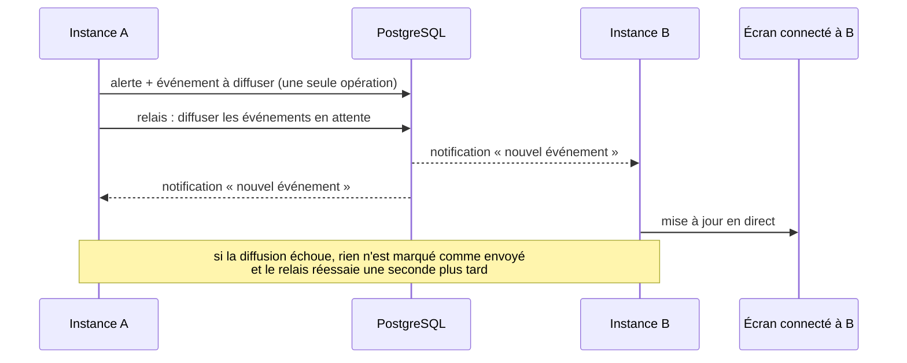
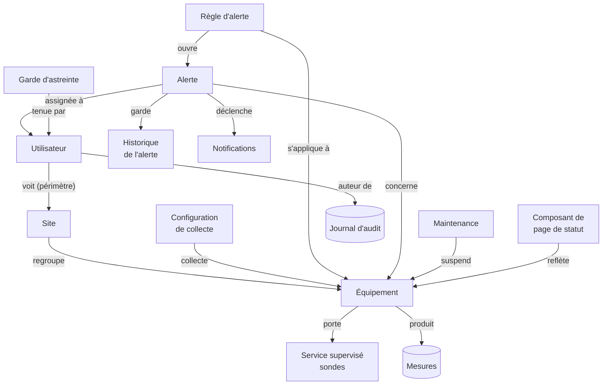
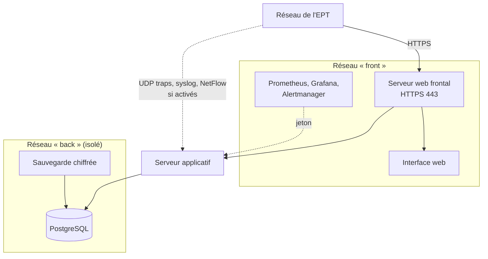

# Architecture

Ce chapitre décrit comment la plateforme est construite : ses grands blocs, la façon dont elle est découpée à l'intérieur, le chemin suivi par une mesure, l'organisation des données et l'installation en production. Les raisons de chaque choix technologique sont détaillées au chapitre 6.

## Vue d'ensemble : les grands blocs

La plateforme se compose de quatre blocs principaux, auxquels s'ajoutent les outils d'exploitation.

*Figure 5.1 — Les blocs de la plateforme et leurs échanges.*

| Bloc | Rôle |
|---|---|
| **Interface web** | Les écrans utilisés dans le navigateur. Elle ne contient aucune règle de sécurité définitive : elle affiche et demande, le serveur décide. |
| **Serveur applicatif** | Le cœur : il reçoit les mesures, les stocke, évalue les règles, gère les alertes, envoie les notifications, produit les rapports et sert l'API utilisée par l'interface. |
| **Base de données** | L'unique mémoire de la plateforme : inventaire, mesures, alertes, comptes, journal d'audit, configuration. |
| **Serveur web frontal** | La seule porte d'entrée : il chiffre les échanges (HTTPS), distribue l'interface et transmet les appels d'API au serveur applicatif. |
| **Agents** | De petits programmes installés sur les serveurs supervisés, qui envoient leurs mesures. |
| **Outils d'exploitation** | Sauvegarde chiffrée, supervision de la plateforme elle-même, alertes techniques en cas de problème de la plateforme. |

## À l'intérieur du serveur : un monolithe modulaire

### Le principe

Le serveur applicatif est **une seule application**, déployée d'un bloc, mais **découpée en modules métier** qui ont chacun une responsabilité claire et des frontières contrôlées. C'est ce qu'on appelle un *monolithe modulaire*.

Ce choix est un compromis entre deux extrêmes :

- une application monolithique « en vrac », simple à démarrer mais qui devient vite un enchevêtrement où tout dépend de tout ;
- des microservices (une application par fonction), qui isolent bien les fonctions mais imposent d'exploiter, de sécuriser, de surveiller et de faire communiquer une dizaine de services, ce qui est hors de portée d'une petite équipe d'exploitation.

Le monolithe modulaire garde la simplicité d'exploitation d'une seule application (une installation, une sauvegarde, un journal) tout en gardant le code organisé. Si un jour un module devait être séparé (par exemple la collecte, pour la rapprocher des équipements d'un site distant), ses frontières sont déjà nettes.

### Les modules

Les seize modules se regroupent en six familles :

*Figure 5.2 — Les modules et leurs principales dépendances ; une flèche signifie « utilise ». Couleurs : collecte en bleu, sécurité du parc en rouge, détection et traitement en ocre, restitution en vert, inventaire en violet, accès et traçabilité en gris.*

Quelques règles structurent ces dépendances :

- **La sécurité et les outils communs ne dépendent d'aucun module métier.** Ils sont à la base de tout.
- **L'inventaire est au centre** : presque tous les modules ont besoin de connaître les équipements, mais l'inventaire, lui, ne dépend d'aucun d'eux.
- **La collecte et les événements réseau sont « en bout de chaîne »** : ils alimentent les autres modules, mais aucun module ne dépend d'eux. On peut donc ajouter un nouveau mode de collecte sans toucher au reste.
- **Le trafic et la sécurité ne se connaissent pas** : quand le module de trafic repère un balayage, il publie un événement ; le module de sécurité l'écoute et ouvre l'alerte. Chacun peut évoluer seul.
- **Aucun cycle** : si A utilise B, B n'utilise jamais A, directement ou indirectement.

### Des couches dans chaque module

Chaque module est organisé de la même façon, en trois couches superposées :

| Couche | Rôle | Règle |
|---|---|---|
| Points d'entrée de l'API | Recevoir les demandes, vérifier les droits et les données reçues | N'accède jamais directement à la base |
| Services métier | Appliquer les règles du métier (ouvrir une alerte, calculer une disponibilité…) | Seule couche qui orchestre le travail |
| Accès aux données | Lire et écrire en base | N'est appelée que par les services |

Le **cœur métier** (ce qu'est un équipement, une alerte, une règle) ne dépend d'aucune de ces couches.

Ces règles ne sont pas de simples conventions : **elles sont vérifiées automatiquement à chaque compilation** par des tests d'architecture. Si un développeur fait appeler la base de données par un point d'entrée, ou crée une dépendance circulaire entre deux modules, la compilation échoue. C'est ce qui a permis d'ajouter une dizaine de modules en quelques semaines sans que la structure se dégrade.

## Le chemin d'une mesure

Le flux principal de la plateforme va de la mesure à la notification. Il est découpé en étapes indépendantes, pour qu'une panne à une étape (par exemple un serveur de messagerie indisponible) ne bloque jamais les autres.

*Figure 5.3 — Le chemin d'une mesure, de sa source jusqu'aux écrans et aux notifications.*

1. **Réception.** Les mesures arrivent de l'agent (qui les pousse), du SNMP et des sondes (que la plateforme va chercher). Chaque mesure est contrôlée : équipement connu, valeur plausible, qualité de la mesure.
2. **Stockage.** Les mesures brutes sont rangées dans une table découpée par mois ; un résumé par heure (moyenne, minimum, maximum) est calculé à part. Les mesures brutes sont gardées 30 jours, les résumés horaires 13 mois.
3. **Évaluation.** Chaque nouvelle mesure est comparée aux règles qui concernent l'équipement. La règle tient compte d'une durée de confirmation et d'un seuil de retour distinct (voir chapitre 7).
4. **Alerte.** Si nécessaire, une alerte est ouverte, mise à jour ou résolue, et l'événement est inscrit à son historique.
5. **File des notifications.** Dans la **même opération** que l'alerte, une ligne est ajoutée dans une file d'attente pour chaque destinataire concerné. Soit l'alerte et ses notifications sont enregistrées ensemble, soit aucune des deux : on ne peut pas perdre une notification ni en envoyer une pour une alerte qui n'existe pas.
6. **Envoi.** Un traitement séparé vide la file toutes les 30 secondes et envoie chaque message sur son canal, avec jusqu'à trois tentatives espacées. Une panne du serveur de messagerie retarde les e-mails, mais n'empêche ni la collecte ni l'ouverture des alertes.
7. **Temps réel.** En parallèle, les écrans ouverts sont avertis du changement et se rafraîchissent seuls.

## La communication entre modules par événements

Les modules ne s'appellent pas directement pour tout : quand quelque chose d'important se produit (« une alerte s'est ouverte », « un balayage a été détecté »), le module concerné **publie un événement**, et les modules intéressés l'écoutent. Le module des alertes ne sait donc pas qu'il existe des e-mails, des Teams ou une astreinte : il annonce l'alerte, et c'est le module des notifications qui décide qui prévenir.

Pour le jour où la plateforme tournera sur **plusieurs serveurs en parallèle**, un relais est prévu : chaque événement est d'abord écrit dans une table d'envoi, dans la même opération que le changement qui l'a produit, puis diffusé à toutes les instances par le mécanisme de notification intégré à PostgreSQL. Ainsi, un utilisateur connecté au serveur B voit en direct une alerte ouverte par le serveur A, sans ajouter de logiciel de messagerie supplémentaire. Ce relais est désactivé par défaut, car il ne sert qu'à partir de deux instances.

*Figure 5.4 — Diffusion d'un événement entre plusieurs instances du serveur.*

## Le modèle de données

Le schéma ci-dessous présente les concepts principaux et leurs liens. Il est volontairement simplifié : la base complète compte une soixantaine de tables. Les ajouts de novembre en comptent cinq de plus : les incidents et leurs alertes rattachées, les liens entre équipements appris de l'historique, l'état des plages apprises par port, et les causes confirmées par l'opérateur.

*Figure 5.5 — Les concepts principaux du modèle de données.*

Quelques règles importantes sont garanties **par la base elle-même**, et pas seulement par le code, pour qu'aucune erreur de programmation ne puisse les violer :

- **une seule alerte active** par équipement et par règle (index unique partiel) ;
- **le journal d'audit est en ajout seul** : la base refuse toute modification d'une entrée existante (seul le lien vers l'auteur est détaché si son compte est supprimé, son nom restant inscrit) ;
- **les états, sévérités et types** sont limités à leurs valeurs autorisées (contraintes de vérification) ;
- **les secrets ne sont jamais stockés** : la base ne contient que des références du type « prendre la valeur de la variable d'environnement X ».

### Faire évoluer la base sans la casser

La structure de la base a évolué 54 fois au cours du projet. Chaque évolution est un script numéroté, appliqué automatiquement au démarrage, de la même façon en développement, en test et en production. On peut ainsi reconstruire la base de n'importe quelle version à l'identique, et une base de production est mise à jour sans intervention manuelle.

### Tenir le volume des mesures

Les mesures sont de loin la donnée la plus volumineuse : un équipement qui remonte dix indicateurs par minute produit plus de 400 000 lignes par mois. Trois dispositifs gardent la base rapide :

1. **Découpage par mois** : chaque mois a sa propre partition ; supprimer un mois ancien revient à supprimer une partition, instantanément, au lieu d'effacer des millions de lignes une à une.
2. **Résumés horaires** : les graphiques sur plusieurs semaines et les rapports lisent les moyennes horaires, pas les mesures brutes.
3. **Index adaptés** : un index par équipement, indicateur et date pour l'historique, et un index très compact sur la date pour les traitements qui parcourent le temps.

## Le temps réel

Les écrans (tableau de bord, alertes, mur NOC) se mettent à jour seuls. Chaque navigateur ouvre une **connexion de flux** (SSE) authentifiée vers le serveur, qui y pousse un court message à chaque changement (« l'alerte X a changé »). L'écran recharge alors seulement ce qui le concerne. Si la connexion est coupée, le navigateur se reconnecte automatiquement avec un délai croissant, et l'écran indique qu'il n'est plus « En direct ».

## L'installation en production

*Figure 5.6 — Installation de production : deux réseaux séparés, une seule porte d'entrée.*

La production repose sur des conteneurs (Docker Compose), avec plusieurs protections :

- **Une seule porte d'entrée** : seul le serveur web frontal est exposé, en HTTPS ; il ajoute les en-têtes de sécurité et limite le débit de la page de statut publique.
- **Deux réseaux séparés** : la base de données et la sauvegarde sont sur un réseau interne que seul le serveur applicatif peut joindre ; ni l'interface, ni le serveur frontal, ni les outils de supervision ne peuvent atteindre la base.
- **Conteneurs en lecture seule et sans droits d'administration** : même compromis, un conteneur ne peut ni modifier ses propres fichiers ni prendre la main sur la machine.
- **Contrôles de santé et redémarrage automatique** de chaque service.
- **Sauvegarde chiffrée chaque jour**, avec une restauration d'essai automatique pour prouver que la sauvegarde est utilisable.
- **Supervision de la plateforme elle-même** : Prometheus mesure son fonctionnement, Alertmanager prévient l'équipe si elle ralentit ou tombe, Grafana affiche ses tableaux de bord.

Une variante pour Kubernetes (chart Helm avec des valeurs pour la préproduction et la production) a été préparée, pour une future installation à plusieurs machines.
