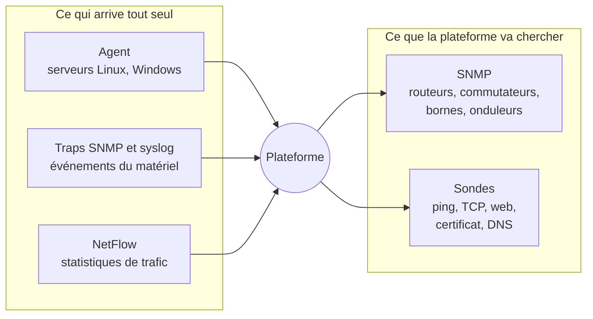
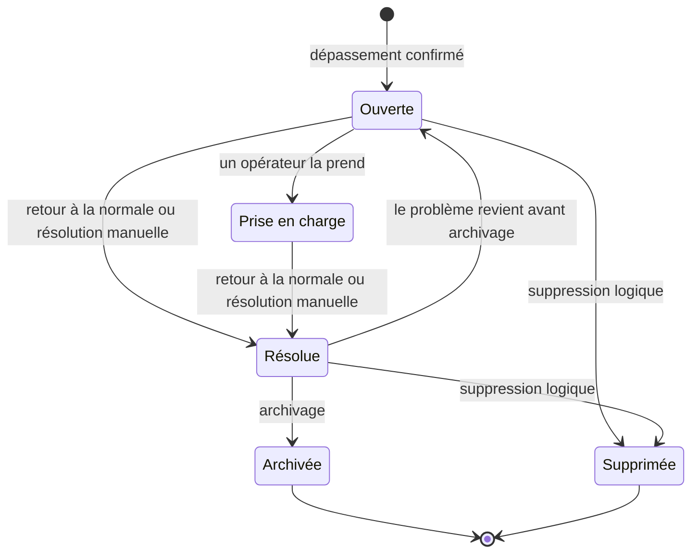

# Fonctionnalités

Ce chapitre décrit ce que sait faire la plateforme, domaine par domaine, et comment chaque fonction a été pensée. Le chapitre 8 montre ensuite comment on s'en sert, et le chapitre 9 comment elles s'enchaînent face à un incident.

## Connaître le parc : l'inventaire

### Sites et équipements

Le parc est organisé en **sites** (bâtiments ou zones du campus) qui regroupent des **équipements**. Chaque équipement a un type (serveur, routeur, commutateur, machine virtuelle, borne Wi-Fi), une adresse de gestion, un mode de collecte et un **statut** calculé par la plateforme : en service, dégradé, hors service, en maintenance ou inconnu (aucune mesure reçue).

Un **assistant d'ajout** guide l'opérateur selon le mode de supervision choisi : avec agent, en SNMP, ou sans agent (sondes seulement). Chaque fiche d'équipement présente ses mesures, ses alertes, ses sondes et sa collecte dans des onglets.

### Trois façons d'alimenter l'inventaire

| Méthode | Pour qui | Garde-fous |
|---|---|---|
| Saisie manuelle | Quelques équipements | Validation de chaque champ, site obligatoire |
| **Import CSV** | Reprise d'un inventaire existant (tableur) | Aperçu avant import, erreurs signalées ligne par ligne |
| **Découverte automatique** | Trouver les équipements d'une plage d'adresses | Réservée aux administrateurs, **uniquement sur les plages autorisées par l'exploitation** (aucune par défaut), nombre d'adresses, parallélisme et durée bornés ; les équipements trouvés sont proposés, pas ajoutés d'office |

### Modèles d'équipement

Configurer le SNMP d'un équipement demande de connaître les bons identifiants d'indicateurs (OID) pour chaque constructeur. Dix **modèles** sont livrés (hôte SNMP générique, Linux, Windows, MikroTik, Cisco, Ubiquiti UniFi, HPE/Aruba, onduleur APC, imprimante, service web HTTPS). Appliquer un modèle configure en un clic les indicateurs et crée les règles d'alerte associées, **désactivées par défaut**. Chaque modèle indique s'il a été vérifié sur du matériel réel : à ce jour, seuls les indicateurs standard le sont, et l'écran l'affiche clairement.

### Topologie et voisins

La **topologie** décrit qui est branché à qui (le commutateur d'accès d'un amphithéâtre dépend du commutateur de distribution, qui dépend du routeur de cœur). Elle sert à deux choses : calculer **l'impact d'une panne** (quels équipements et services en aval sont touchés) et **regrouper les alertes** d'une même panne (voir plus loin).

La plateforme lit aussi chaque heure, en SNMP, les **voisins annoncés** par les équipements (protocole LLDP). Elle propose les liens découverts, mais **ne modifie jamais la topologie toute seule** : un administrateur accepte ou écarte chaque proposition, et peut en inverser le sens. Un lien inventé à l'envers fausserait l'impact d'une panne et le diagnostic.

## Mesurer : la collecte

La plateforme combine cinq sources de données, parce qu'aucune ne suffit seule : un serveur accepte un agent, un commutateur non ; un service web se teste de l'extérieur ; un équipement peut signaler lui-même un problème.

*Figure 7.1 — Les cinq sources de données de la plateforme.*

### L'agent

Installé sur un serveur avec un **jeton d'enrôlement** à usage unique, l'agent relève sans configuration le processeur, la mémoire, chaque disque et chaque carte réseau (découverts automatiquement), l'état des services, et le top des processus. Il envoie ses mesures par lots, en HTTPS, en vérifiant le certificat du serveur. Il peut aussi suivre les **journaux d'authentification** du système et des **journaux d'accès web**, pour la supervision de sécurité. Si l'agent se tait plus de cinq minutes, une alerte de collecte critique s'ouvre ; elle se résout d'elle-même à la mesure suivante.

### Le SNMP

Pour chaque équipement réseau, l'administrateur choisit la version (v2c, ou v3 authentifiée et chiffrée, recommandée), la fréquence et les indicateurs (ou applique un modèle). Les mots de passe ne sont **jamais saisis dans la plateforme** : on indique seulement le nom de la variable d'environnement du serveur qui les contient. La plateforme peut en plus **découvrir et suivre les interfaces réseau** de l'équipement (débit entrant et sortant, erreurs, occupation du lien, état du port), en gérant les compteurs qui repassent à zéro.

### Les sondes, sans agent

Pour un service qu'on ne peut pas équiper d'agent, la plateforme envoie elle-même des sondes, comme le ferait un usager :

| Sonde | Ce qu'elle vérifie |
|---|---|
| Ping | Que l'équipement répond, avec la latence, la **perte de paquets** et la **gigue** (variation de la latence) |
| Port TCP | Qu'un service écoute (par exemple la base de données de la scolarité) |
| Page web (HTTP, HTTPS) | Que la page répond avec le bon code, éventuellement qu'elle contient un texte attendu |
| Certificat | Combien de jours avant l'expiration du certificat HTTPS |
| DNS | Que le serveur de noms résout un nom donné, éventuellement vers l'adresse attendue |

Comme une sonde fait contacter par le serveur une adresse choisie par un utilisateur, elle est encadrée pour éviter qu'on s'en serve pour explorer le réseau interne : réservée aux administrateurs, adresses locales et de métadonnées refusées, pas de redirection, lecture bornée, contenu jamais stocké.

### Les événements du matériel : traps et syslog

Les équipements réseau peuvent signaler d'eux-mêmes un événement (« le port 12 vient de tomber », « redémarrage », « échec d'authentification ») par **trap SNMP** ou par **syslog**. La plateforme sait les recevoir (désactivé par défaut). Une source n'est acceptée que si son adresse est celle d'un équipement inventorié ; les autres sont rejetées et comptées. Des **règles d'événements** transforment certains messages en alertes, et un message contraire peut fermer l'alerte (un « lien rétabli » ferme l'alerte « lien tombé »).

### Le trafic réseau : NetFlow

Les routeurs peuvent exporter des statistiques de trafic (NetFlow v5 et v9). La plateforme les additionne en mémoire par conversation et n'écrit en base qu'une synthèse par minute : volume et débit, plus grosses conversations, adresses les plus actives, services, équipements exportateurs. Les adresses étant des données personnelles, elles sont **effacées au bout de 7 jours**. Cette fonction est désactivée par défaut.

## Détecter : les alertes

### La règle à seuil, pierre angulaire

Une règle dit : « si l'indicateur *processeur* d'un équipement de ce périmètre dépasse *90 %* pendant *5 minutes*, ouvrir une alerte *critique* ; la fermer quand il repasse sous *80 %* ». Trois mécanismes évitent le bruit, première cause d'abandon des outils de supervision :

1. **La durée de confirmation** : un pic isolé de quelques secondes n'ouvre rien.
2. **Le seuil de retour distinct** (hystérésis) : une valeur qui oscille autour de 90 % n'ouvre et ne ferme pas l'alerte en boucle.
3. **La déduplication** : une seule alerte active par équipement et par règle ; si le problème revient avant archivage, l'alerte existante est rouverte au lieu d'en créer une nouvelle.

Une règle peut viser des sites, des équipements précis ou tout le parc, et une famille d'indicateurs (« tous les disques »). Avant d'enregistrer une règle, l'administrateur peut la **tester sur l'historique** (« sur les 7 derniers jours, elle aurait ouvert 12 alertes sur 3 équipements ») ou demander une **proposition de seuils** calculée sur ce que les équipements ont réellement mesuré : trois propositions (prudente, équilibrée, sensible), chacune rejouée sur la même période.

### Le cycle de vie d'une alerte

*Figure 7.2 — Les états d'une alerte et les transitions autorisées.*

Chaque transition est **contrôlée par le serveur** (une transition interdite est refusée), **horodatée**, attribuée à son auteur et inscrite à l'**historique** de l'alerte et au **journal d'audit**. Plusieurs opérateurs peuvent être assignés à la même alerte. La résolution automatique et la résolution manuelle sont distinguées.

### Huit types d'alertes

| Type | Ce qui l'ouvre | Exemple de message |
|---|---|---|
| Seuil | Une règle est franchie | « Disque presque plein : D: = 92,5 % (seuil > 90) » |
| Collecte | Un agent ou un équipement ne répond plus | « L'agent du routeur de cœur ne communique plus depuis 1 min » |
| Absence de donnée | Un indicateur qui arrivait régulièrement cesse d'arriver alors que l'équipement répond | Disque démonté, service disparu |
| Comportement inhabituel | Une valeur très éloignée de la normale de ce créneau (même jour, même heure) | « 88,7 % alors que la normale en semaine vers 14 h est 57,8 ± 1,7 » |
| Écart aux semblables | Un équipement se démarque nettement des autres du même type sur le même site | Un commutateur beaucoup plus chargé que ses voisins |
| Prévision | La saturation est prévue dans l'horizon, avec une confiance suffisante | « Disque plein dans 9 jours, vers 14 h » |
| Événement | Une règle d'événement reconnaît un trap ou un message syslog | « Lien tombé sur le port 12 » |
| Sécurité | Une attaque ou un comportement suspect est repéré | « Force brute : 37 échecs de connexion depuis une même adresse » |

Les détections avancées (comportement inhabituel, semblables, prévision) **écartent les anciens incidents** de leur calcul de la normale, pour ne pas apprendre une panne comme si c'était normal. La prévision compare deux modèles (une droite de tendance et un modèle à cycle journalier, utile pour un indicateur qui monte chaque matin et redescend la nuit) sur les dernières 24 heures mises de côté, et retient le plus juste.

### Les détections ajoutées après la comparaison au marché

Les huit types ci-dessus sont ceux que porte la base de données. Les détections suivantes, livrées
en novembre, s'y rattachent — la plupart ouvrent une alerte de type **Comportement inhabituel** —
mais répondent chacune à une question que les précédentes ne posaient pas.

| Détection | La question à laquelle elle répond | Ce qu'aucune autre ne voyait |
|---|---|---|
| **État d'ensemble inhabituel** | Les mesures de cette machine vont-elles encore ensemble ? | La machine peu chargée qui répond lentement : chaque chiffre est dans sa plage, c'est leur combinaison qui est inédite |
| **Rupture de niveau** | Ce niveau a-t-il changé et y est-il resté ? | Une rupture arrivée un samedi soir est invisible le lundi, parce que le nouveau niveau *est* devenu l'habitude |
| **Plage apprise sur un port** | Ce port sort-il de sa plage habituelle ? | Un port tout juste découvert, qu'une normale par créneau ne surveillerait pas avant plusieurs semaines |
| **Écart aux semblables par modèle** | Cet équipement se démarque-t-il de **ceux qui lui ressemblent** ? | Un routeur de cœur mélangé à huit commutateurs d'accès se démarquait en permanence |
| **Budget d'erreur d'un service** | Son objectif de disponibilité va-t-il être manqué ? | « 99,2 % ce mois-ci » ne dit pas s'il faut s'inquiéter ; « il en a dépensé un tiers dans la dernière heure » le dit |
| **Mesures liées à une alerte** | Qu'est-ce qui a bougé **avec** la mesure en alerte ? | L'indicateur qui monte et descend en même temps sans changer de niveau moyen, et ceux des voisins directs |
| **Liens appris de l'historique** | Quels équipements tombent toujours ensemble ? | Un serveur et le stockage qu'il monte, que la topologie saisie à la main ignore |

Deux principes communs. D'abord, **chacune dit ce qu'elle ne dit pas** : l'état d'ensemble précise
que « la méthode dit qu'un état est rare, pas pourquoi » ; le budget d'erreur distingue un constat
(« le mois est déjà perdu ») d'une prévision (« si la coupure s'arrête, le budget tient ») ; les
mesures liées annoncent combien de séries ont été éprouvées pour en retenir trois. Ensuite, **aucune
ne modifie la topologie ni le classement des causes toute seule** : un lien appris des alertes attend
qu'un administrateur l'accepte, et une corrélation n'entre jamais dans les causes probables.

### Réduire le bruit quand tout tombe en même temps

Quand le routeur de cœur tombe, tous les équipements derrière lui deviennent injoignables : sans précaution, l'opérateur recevrait des dizaines d'alertes pour une seule panne. La plateforme utilise la topologie pour **regrouper** ces alertes sous une **alerte racine** : les alertes des équipements en aval restent visibles, marquées « Regroupée, sans notification : amont injoignable », et seule la racine notifie. D'autres mécanismes vont dans le même sens :

- **Alerte qui clignote** : au-delà de 4 ouvertures en une heure, l'alerte reste visible mais cesse de notifier jusqu'au retour au calme.
- **Maintenance** : pendant une fenêtre planifiée sur un équipement ou un site, la collecte continue et les alertes sont tracées, mais personne n'est notifié.

### Un fait plutôt que ses morceaux : les incidents

Le regroupement par topologie décrit ci-dessus ne valait que pour les pertes de collecte. Depuis
novembre, l'**incident** est un objet à part entière qui rassemble les alertes d'un même fait, tous
types confondus, et n'en laisse parler qu'une seule.

Trois règles ordonnées décident, et toutes exigent que les alertes arrivent dans la même dizaine de
minutes : **même équipement** (trois alertes sur un serveur sont un fait, pas trois), **voisinage
dans la topologie** (deux liens au plus, dans un sens ou dans l'autre), puis **même site et même
nature** (même règle d'alerte, ou messages de gabarit identique).

Un score pondéré aurait été possible ; il aurait fallu inventer trois poids que rien ne justifie.
Des règles ordonnées se disent en une phrase, et **chaque rattachement porte la sienne** à l'écran :
« Voisin dans la topologie : Routeur de cœur (lien direct) ». Un regroupement que l'opérateur ne peut
pas vérifier ne mérite pas sa confiance, et il aurait raison : une fenêtre de dix minutes rapproche
aussi des faits qui n'ont rien à voir.

Une seule alerte de l'incident prévient l'équipe. L'incident **redonne la parole si la gravité
monte** : un incident notifié en avertissement qui devient critique réveille quelqu'un une seconde
fois. Un incident est en cours ou terminé, rien de plus, et il se referme seul quand ses alertes
retombent — la prise en charge reste sur les alertes, car deux cycles de vie concurrents créeraient
deux vérités sur l'état d'une panne.

## Prévenir : notifications et astreinte

### Sept canaux

| Canal | Usage |
|---|---|
| E-mail | Canal de base, à l'ouverture et à la résolution |
| Teams, Slack | Messages dans le canal de l'équipe |
| Telegram | Message d'un robot, pratique sur téléphone |
| Webhook signé | Pour brancher un autre outil (la signature prouve que le message vient de la plateforme) |
| Collecteur syslog (SIEM) | Copie des alertes vers l'outil de l'équipe sécurité, au format standard |

Chaque utilisateur choisit ses canaux et la **sévérité minimale** qui le concerne ; personne ne reçoit de message qu'il n'a pas demandé. Les adresses des canaux (URL de Teams, de Slack, du robot Telegram) sont des secrets : elles vivent dans l'environnement du serveur, la base ne contient qu'une référence. Les messages ne contiennent jamais d'adresse interne. L'administrateur peut modifier les **modèles de messages**, consulter **l'historique des envois**, rejouer un envoi en échec et envoyer un message de test.

### Escalade et astreinte

Une alerte importante ne doit pas attendre que quelqu'un regarde l'écran. Deux mécanismes s'enchaînent :

1. **L'astreinte** : des plannings (tout le parc ou par site) définissent pour chaque période une personne **principale** et une **secondaire**. Les gardes sont générées par rotation (liste ordonnée, durée, heure de relève, changement d'heure géré), avec remplacements et passation de garde. À l'ouverture d'une alerte d'au moins la sévérité *avertissement*, la principale est prévenue ; si l'alerte est toujours ouverte après 10 minutes (5 si elle est critique), la secondaire est prévenue.
2. **L'escalade finale** : si personne ne l'a prise en charge, l'alerte remonte aux administrateurs.

Une personne d'astreinte sans canal actif est signalée dans l'historique et la secondaire est prévenue sans attendre.

## Rendre compte

### Tableau de bord, vues et mur NOC

Le **tableau de bord** montre d'un coup d'œil l'état du parc : compteurs par état, carte du parc en alvéoles colorées, problèmes en cours, équipements les plus chargés, activité des alertes, saturations prévues, équipements muets. Tout est cliquable et filtrable par site. Chacun peut composer ses **vues personnelles** (et les partager), et le **mur NOC** est une version plein écran pensée pour un écran mural de salle d'exploitation.

### Score de santé

Chaque équipement et chaque site reçoit un **score de 0 à 100**, avec le détail des points perdus (alertes actives selon leur sévérité, statut, silence, indicateurs hors de la normale). C'est une façon de hiérarchiser : un site à 62 mérite plus d'attention qu'un site à 95, et l'écran dit pourquoi.

### Diagnostic d'un incident

Dans le détail d'une alerte, un **diagnostic** rassemble ce qu'un opérateur expérimenté irait chercher : un résumé, l'impact (équipements en aval, services, sites), jusqu'à cinq **causes probables classées** avec leurs preuves (équipement en amont en panne, trap reçu, changement de configuration tracé juste avant, silence de collecte, prévision, comportement inhabituel), les alertes voisines, les événements et changements récents, les indicateurs qui ont bougé en même temps, les incidents similaires passés et les prochaines étapes conseillées.

Le diagnostic repose sur des **règles fixes et un score documenté**, sans IA ni appel extérieur. L'écran parle de « cause probable », affiche toujours le score et les preuves (« Pourquoi ? ») et dit « aucune cause probable identifiée » plutôt que d'inventer.

### Rapports

| Rapport | Contenu |
|---|---|
| Disponibilité | Coupures reconstituées depuis l'historique, disponibilité par équipement et par site comparée à un objectif (maintenances exclues) |
| Incidents | Nombre d'incidents, délai moyen de résolution, équipements les plus touchés |

Les rapports couvrent une journée, une semaine, un mois ou une période choisie, et s'exportent en **PDF** (avec période et date de génération) ou en **CSV** pour un tableur. Les **rapports planifiés** partent automatiquement par e-mail, PDF joint, à leurs destinataires.

### Pages de statut

Une **page de statut** présente aux usagers l'état des services de l'école (messagerie, ENT, Wi-Fi…) : chaque service est relié à une sonde, un équipement ou un site, mais affiché **sous un nom choisi pour les usagers**. L'état est calculé automatiquement (opérationnel, dégradé, panne partielle, panne majeure, maintenance), avec la disponibilité sur 90 jours et les incidents en cours accompagnés de leurs mises à jour. Une page peut être interne ou **publique**, consultable sans compte. Une page publique n'affiche jamais de nom d'hôte, d'adresse ni de nom d'équipement (liste blanche stricte vérifiée par un test), répond de la même façon pour une page inconnue ou privée, et est protégée contre les abus (limite par adresse, cache).

## Protéger le parc : la supervision de sécurité

À partir des journaux transmis par l'agent et des flux réseau, la plateforme repère plusieurs familles de menaces :

| Détection | Principe |
|---|---|
| Attaques web | Signatures inspirées des règles de référence du domaine (injection SQL, script injecté, traversée de répertoire, exécution de commande…) avec un score cumulé |
| Requêtes web inhabituelles | Un petit modèle appris repère les formes de requêtes qu'aucune signature ne couvre ; il n'ouvre qu'un avertissement, après plusieurs requêtes d'une même adresse |
| Force brute | 10 échecs d'authentification d'une même adresse en 5 minutes |
| Balayage web | 40 requêtes en erreur d'une même adresse en 5 minutes |
| Comportement inhabituel | Connexion réussie d'un compte depuis une adresse jamais vue ; volume horaire d'échecs très supérieur à l'habitude |
| Balayages et inondations | Dans les flux réseau : une source qui contacte des centaines d'adresses ou de ports, ou des centaines de sources qui visent une même machine |

Un écran **Sécurité** présente les compteurs de la période, les adresses les plus actives, les équipements visés et les dernières lignes retenues. Les requêtes ordinaires ne laissent aucune trace : seules les tentatives d'authentification, les attaques reconnues et les erreurs sont gardées, 30 jours au plus. Ce n'est pas un pare-feu : l'attaque est vue après coup, pour alerter.

## Administrer

| Fonction | Détail |
|---|---|
| Comptes et rôles | Création par un administrateur, changement de rôle, activation, réinitialisation du mot de passe ; on ne peut pas modifier son propre compte et le dernier administrateur est protégé ; un changement de droits coupe les sessions du compte |
| Périmètres | Limiter un opérateur ou un lecteur à certains sites ; un objet hors périmètre est traité comme inexistant |
| Double authentification | Code à six chiffres d'une application d'authentification, activé par l'utilisateur, désactivable par un administrateur en cas de téléphone perdu |
| Jetons d'API | Chacun peut créer des jetons pour qu'un autre outil appelle l'API en son nom, avec ses droits ; le secret n'est montré qu'une fois et seule son empreinte est gardée |
| Journal d'audit | Qui a fait quoi, quand ; filtrable, exportable en CSV, en ajout seul |
| Recherche globale | Ctrl K depuis n'importe quel écran pour aller à un équipement ou à une page sans passer par les menus |
