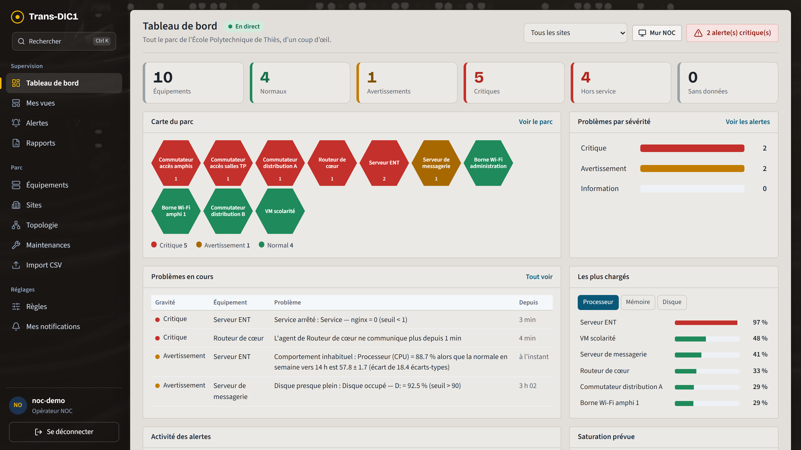
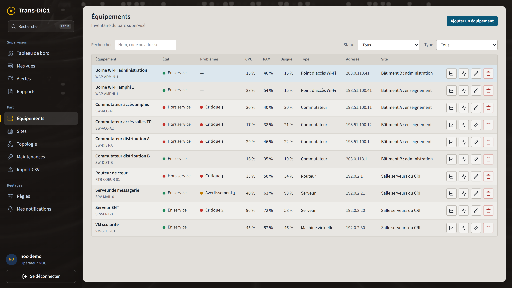
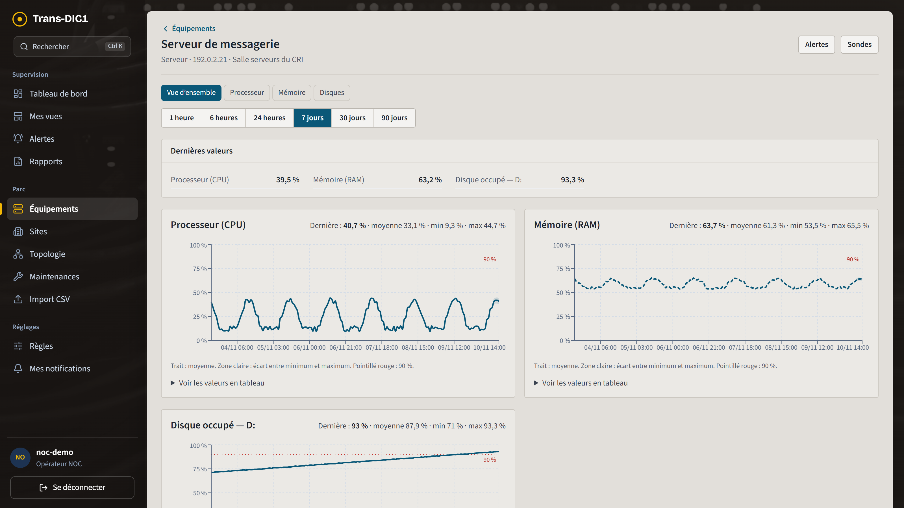
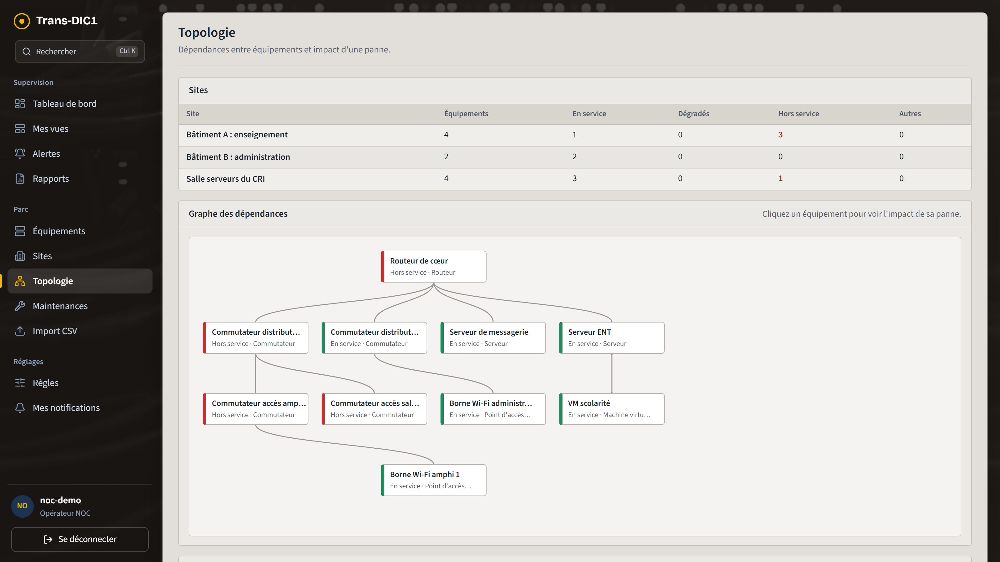
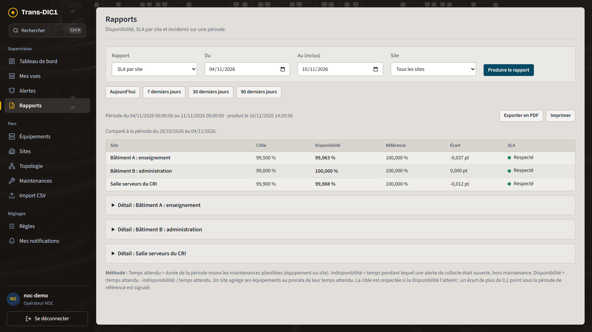
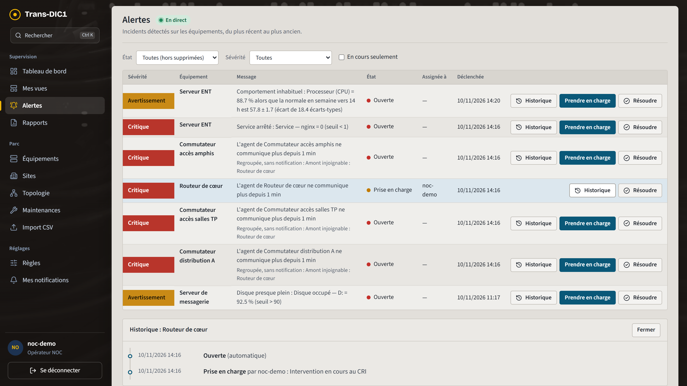
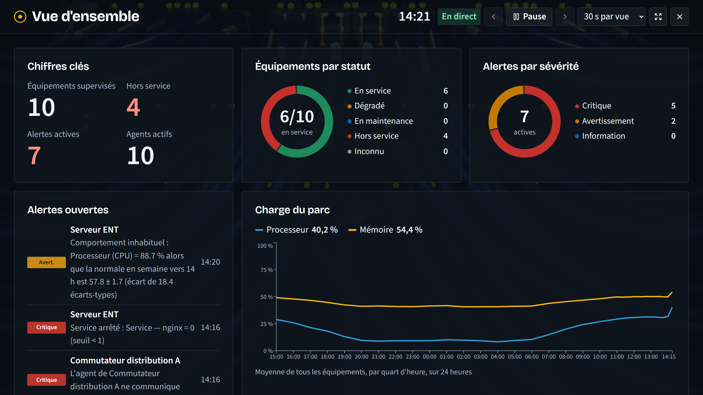
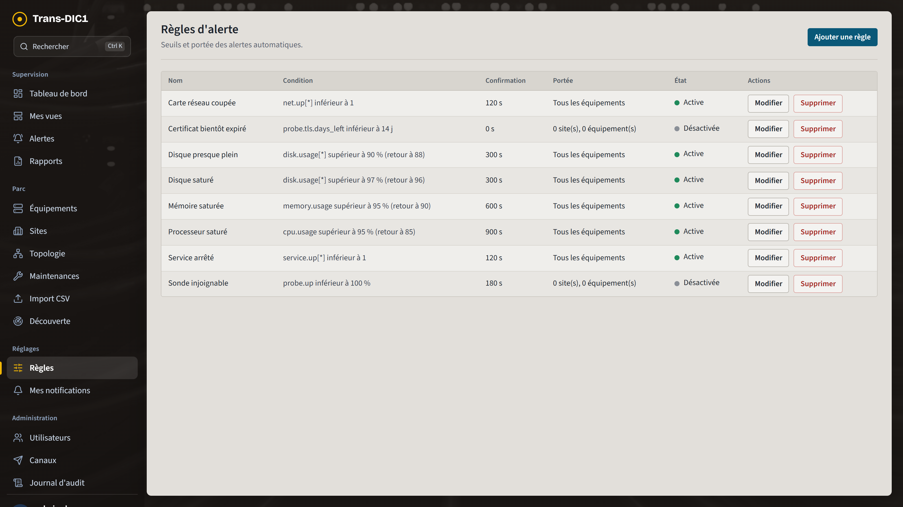
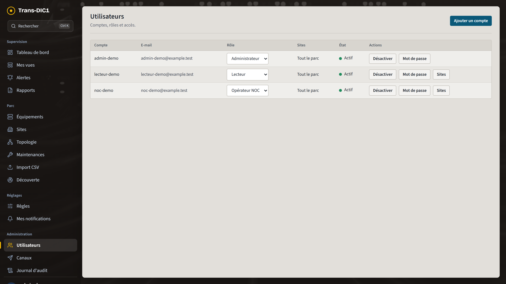

# Utilisation

Ce chapitre montre comment la plateforme s'utilise au quotidien, selon son rôle. Les captures proviennent de l'application réelle, alimentée par un jeu de démonstration fictif (aucune donnée de l'EPT).

## Mise en route

### Installer

Deux façons d'installer la plateforme sont prévues :

| Mode | Pour qui | En résumé |
|---|---|---|
| Développement, sans Docker | Poste d'un développeur | Installer Java 21, Node.js 24 et PostgreSQL 16, copier le modèle de configuration, lancer le serveur puis l'interface |
| Production, avec Docker | Serveur de l'EPT | Renseigner le fichier de configuration de production (nom public, certificat, mots de passe), lancer le script de déploiement, qui vérifie le bon fonctionnement et revient à la version précédente en cas d'échec |

Au premier démarrage, un **compte administrateur initial** est créé à partir de la configuration ; son mot de passe doit être changé à la première connexion. Les commandes exactes figurent en annexe.

### Se connecter

L'utilisateur se connecte avec l'identifiant et le mot de passe créés par un administrateur, ou avec son compte de l'école si la connexion unique est activée. Si la double authentification est active sur son compte, un code à six chiffres lui est demandé ensuite. La session dure au plus 8 heures.

## Le parcours du lecteur

Le lecteur consulte ; il ne modifie rien.

### Le tableau de bord

C'est l'écran d'accueil. En haut, les compteurs (équipements, normaux, avertissements, critiques, hors service, sans données) ; au centre, la carte du parc où chaque alvéole est un équipement coloré selon son état, avec son nombre d'alertes ; à droite, la répartition des problèmes par sévérité ; en dessous, la liste des problèmes en cours et les équipements les plus chargés. La pastille « En direct » indique que l'écran se met à jour tout seul.

Tout est cliquable : une alvéole ouvre la fiche de l'équipement, un compteur filtre la liste des alertes, le sélecteur de site restreint l'affichage à un bâtiment.

### Les équipements et leur historique

La liste des équipements permet de rechercher, filtrer par site, type ou état, et d'ouvrir une fiche. Depuis la fiche, l'historique affiche les courbes des indicateurs (processeur, mémoire, disques, réseau, sondes) sur la période choisie, avec les trous de mesure visibles et la carte de prévision de saturation.

### Les alertes, la topologie, les rapports

Le lecteur voit les alertes de son périmètre et leur historique, la topologie du réseau avec l'impact d'une panne, et les rapports. Il peut exporter un rapport en PDF ou en CSV.

## Le parcours de l'opérateur NOC

L'opérateur fait tout ce que fait le lecteur, et traite les incidents.

### Traiter une alerte, pas à pas

1. **Repérer.** L'alerte apparaît en direct sur le tableau de bord et dans **Alertes** ; l'opérateur reçoit aussi une notification sur les canaux qu'il a choisis.
2. **Prendre en charge.** Il clique sur **Prendre en charge**, avec un commentaire facultatif (« Intervention en cours au CRI »). Ses collègues voient qu'il s'en occupe ; d'autres opérateurs peuvent se joindre à lui.
3. **Comprendre.** Il ouvre le **diagnostic** : impact, causes probables avec leurs preuves, changements récents, incidents similaires, prochaines étapes.
4. **Intervenir.** Il agit sur l'équipement, hors de la plateforme.
5. **Clore.** Si l'indicateur revient à la normale, l'alerte se résout d'elle-même ; sinon, il clique sur **Résoudre** avec un commentaire.
6. **Tracer.** L'**historique** de l'alerte garde chaque étape, avec son auteur et son heure.

Sur cette capture, on voit le regroupement en action : le routeur de cœur est injoignable, et les trois commutateurs placés derrière lui sont marqués « Regroupée, sans notification : amont injoignable ». L'opérateur n'a reçu qu'une notification et sait d'emblée où chercher.

### Les autres tâches de l'opérateur

| Tâche | Où | Ce qu'il faut savoir |
|---|---|---|
| Planifier une maintenance | **Maintenances** | Sur un équipement ou un site, avec début et fin ; les notifications sont suspendues pendant la fenêtre |
| Tenir l'inventaire | **Équipements**, **Sites** | Ajouter avec l'assistant, modifier, supprimer après confirmation |
| Importer un inventaire | **Import CSV** | Aperçu ligne par ligne avant l'import réel |
| Choisir ses notifications | **Mes notifications** | Canaux et sévérité minimale ; inactif par défaut |
| Gérer son astreinte | **Astreinte** | Voir ses gardes, passer sa garde à un collègue |
| Sécuriser son compte | **Double authentification**, **Jetons d'API** | Activer le code à six chiffres ; créer un jeton pour un script |

### L'écran mural

Le **mur NOC** est une version plein écran du tableau de bord, pensée pour un écran fixé au mur de la salle d'exploitation : grands chiffres, carte du parc, charge, activité des alertes, sans menus.

## Le parcours de l'administrateur

L'administrateur fait tout ce que fait l'opérateur et configure la plateforme.

### Règles d'alerte

Dans **Règles**, l'administrateur crée une règle en choisissant l'indicateur, l'opérateur de comparaison, le seuil d'ouverture et le seuil de retour, la durée de confirmation, la sévérité et la portée (sites, équipements ou tout le parc). Avant d'enregistrer, il peut **tester la règle sur l'historique** ou demander une **proposition de seuils**. Chaque modification est journalisée avec l'ancienne et la nouvelle valeur.

### Comptes, rôles et périmètres

Dans **Utilisateurs**, il crée les comptes, attribue les rôles, limite un compte à certains sites, active ou désactive un compte et réinitialise un mot de passe.

### Autres réglages

| Réglage | Écran |
|---|---|
| Collecte SNMP d'un équipement, application d'un modèle | **Équipements > Collecte**, **Modèles** |
| Sondes d'un équipement | **Équipements > Sondes** (avec bouton Tester) |
| Découverte automatique | **Découverte** (plages autorisées par l'exploitation uniquement) |
| Canaux de notification, modèles de messages, historique des envois | **Canaux** |
| Plannings d'astreinte et rotations | **Astreinte** |
| Rapports envoyés automatiquement | **Rapports planifiés** |
| Pages de statut et incidents | **Pages de statut** |
| Règles d'événements (traps, syslog) | **Règles d'événements** |
| Journal d'audit | **Audit** (filtre, export CSV) |

## En cas de problème

| Situation | Que faire |
|---|---|
| Retour soudain à l'écran de connexion | La session a expiré (8 heures au plus) ou a été coupée par un administrateur : se reconnecter |
| « L'action a échoué. Vérifiez vos droits. » | Le rôle ne permet pas cette action : demander à un administrateur |
| Un équipement reste « Inconnu » | Aucune mesure n'est arrivée : vérifier son agent ou sa collecte SNMP |
| Aucun e-mail d'alerte reçu | Vérifier **Mes notifications**, puis demander à un administrateur de consulter l'historique des envois dans **Canaux** |
| L'écran n'est plus « En direct » | La connexion de flux est coupée ; elle se rétablit seule, sinon recharger la page |
