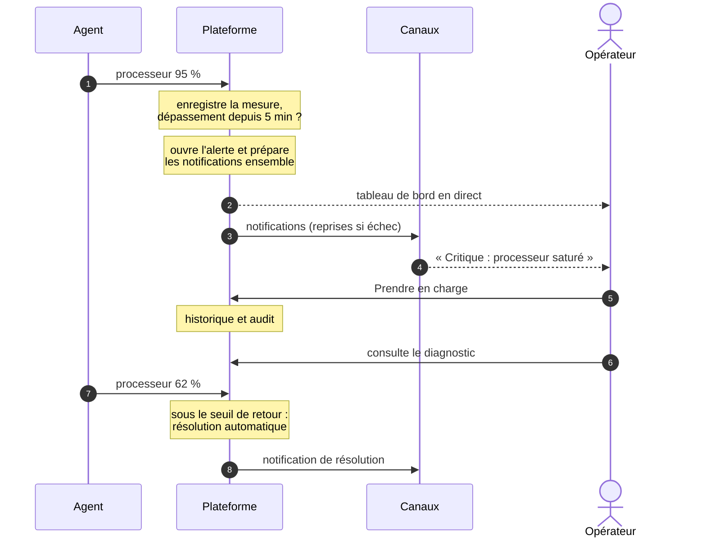
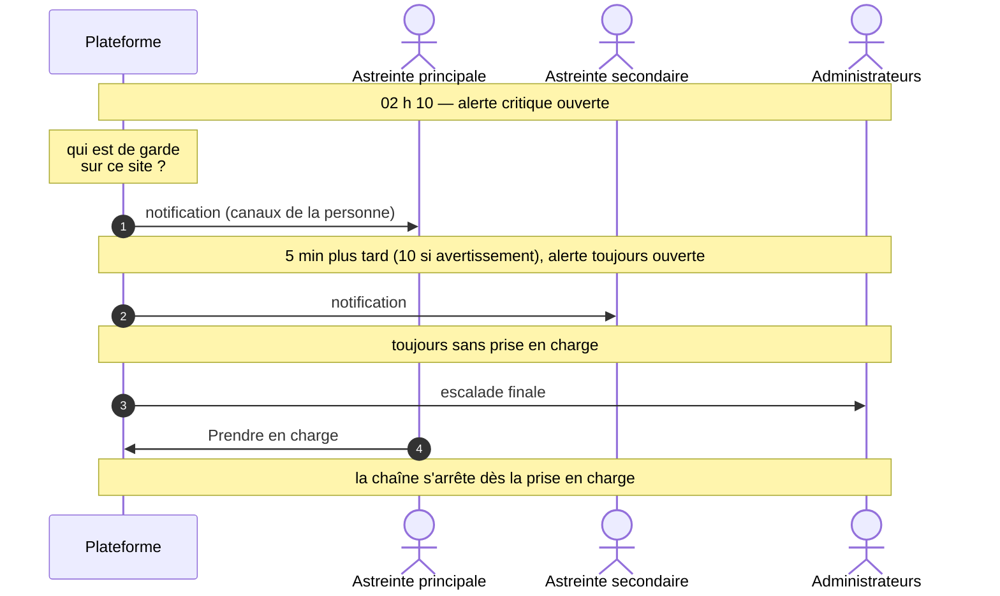
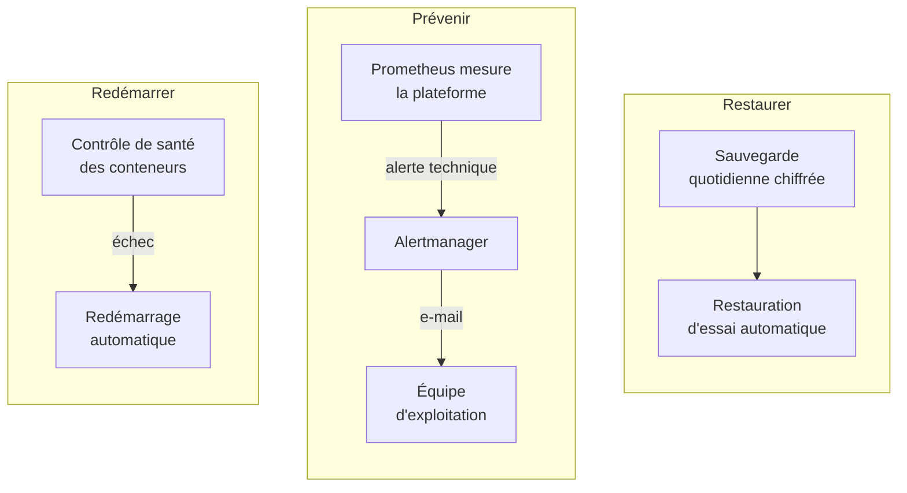

# Quand quelque chose se passe

Ce chapitre répond à une question simple : **si tel problème survient, comment est-il traité ?** Pour chaque situation, il décrit ce que la plateforme voit, ce qu'elle fait d'elle-même, et ce que l'équipe a à faire. Il couvre les incidents du parc supervisé, les attaques, et les pannes de la plateforme elle-même.

> **À garder en tête.** Tous les comportements décrits ici sont couverts par des tests automatisés, mais aucun n'a encore été observé en conditions réelles à l'EPT (astreinte, restauration, détections de sécurité). Le plan de validation de 14 cas est prêt ; l'exécuter est la première des pistes d'amélioration (chapitre 12).

## Le scénario de référence : un dépassement de seuil

Toutes les situations suivantes sont des variantes de ce scénario. Un serveur voit son processeur dépasser le seuil de la règle « Processeur saturé » (ouverture au-dessus de 90 % pendant 5 minutes, retour sous 80 %).

*Figure 9.1 — Du dépassement à la résolution : le scénario de référence.*

Points importants :

- **Rien ne s'ouvre sur un pic isolé** : il faut que le dépassement dure la durée de confirmation.
- **L'alerte et ses notifications naissent ensemble** : impossible de perdre une notification ou d'en envoyer une pour une alerte qui n'existe pas.
- **La résolution est automatique** quand la mesure repasse sous le seuil de retour ; l'opérateur peut aussi résoudre à la main. Les deux sont distinguées dans l'historique.
- **Chaque étape est tracée** avec son auteur et son heure.

## Les pannes du parc supervisé

| Situation | Ce que voit la plateforme | Ce qu'elle fait | Ce que fait l'équipe |
|---|---|---|---|
| **Un serveur s'arrête** | L'agent ne donne plus de nouvelles depuis 5 minutes | Ouvre une alerte de collecte **critique**, passe l'équipement « hors service », notifie | Prend en charge, intervient ; l'alerte se ferme seule à la première mesure reçue |
| **Le routeur de cœur tombe** | Le routeur et tous les équipements derrière lui deviennent muets | Ouvre une **alerte racine** sur le routeur, **regroupe** les autres sous elle sans les notifier, et réunit l'ensemble dans un **incident** visible à l'écran ; le diagnostic désigne l'amont comme cause probable et liste l'impact | Traite la racine depuis l'écran Incidents, qui montre le fait entier plutôt que ses morceaux |
| **Un service web tombe mais le serveur répond** | La sonde web échoue (ou l'agent signale le service arrêté) | Ouvre une alerte sur le service ; la page de statut passe le service en panne ; un incident public automatique peut s'ouvrir après quelques minutes de panne majeure (option) | Rétablit le service ; met à jour l'incident de la page de statut pour les usagers |
| **Un disque se remplit lentement** | La tendance des deux dernières semaines atteint 100 % dans l'horizon de prévision | Ouvre une alerte **Prévision** (« plein dans 9 jours, vers 14 h ») avec la méthode et l'erreur de prévision ; plus tard, la règle à seuil prend le relais | Fait le ménage ou commande du stockage, **avant** la panne |
| **Un processeur est chargé à une heure inhabituelle** | La valeur est très loin de la normale de ce créneau (même jour, même heure) | Ouvre un **avertissement** « comportement inhabituel », chiffres à l'appui | Vérifie : traitement planifié, intrusion, panne logicielle ? |
| **Un indicateur cesse d'arriver** | L'équipement répond, mais un indicateur régulier est muet depuis 30 minutes | Ouvre une alerte **Absence de donnée** (disque démonté, service disparu) | Vérifie l'élément manquant |
| **Un équipement se démarque de ses semblables** | Il est beaucoup plus chargé que les autres du même type sur le même site | Ouvre une alerte **Écart aux semblables** | Recherche une cause locale (mauvaise configuration, matériel défaillant) |
| **Un certificat HTTPS va expirer** | La sonde de certificat compte les jours restants | Ouvre une alerte selon la règle « Certificat bientôt expiré » | Renouvelle le certificat à temps |
| **Un lien réseau sature ou fait des erreurs** | Le suivi des interfaces mesure occupation et erreurs du port | Ouvre une alerte selon les règles livrées (à activer) | Répartit la charge ou change le câble |
| **Un port tombe sur un commutateur** | Le commutateur envoie un trap « lien tombé » | Une règle d'événement ouvre une alerte ; le trap « lien rétabli » la ferme | Intervient si le lien ne revient pas |
| **Une alerte clignote** | Plus de 4 ouvertures en une heure | Garde l'alerte visible mais **cesse de notifier** jusqu'au retour au calme | Corrige la cause ou ajuste le seuil (avec le test sur historique) |
| **Plusieurs alertes arrivent ensemble sur des machines voisines** | Trois alertes en dix minutes sur une machine, ou sur des équipements à deux liens l'un de l'autre | Les réunit en un **incident** et n'en laisse notifier qu'une ; chaque rattachement affiche la règle qui l'a produit | Lit l'incident, vérifie la raison affichée, et redescend aux alertes une par une si elle lui paraît fausse |
| **Un lien que la topologie ignore** | Deux équipements tombent ensemble, encore et encore, sans être reliés | **Propose** le lien sur l'écran Topologie, avec « 6 fois sur 6 » | Accepte ou écarte ; accepté, le lien regroupe leurs alertes, et le message distingue un câble d'une statistique validée |
| **Un niveau a changé et y est resté** | La somme cumulée des écarts s'éloigne sans retour sur quatorze jours | Ouvre une **rupture de niveau** avec les deux niveaux et la date du changement | Vérifie s'il s'agit d'une panne ou d'une modification volontaire — l'alerte est alors la preuve qu'elle a pris effet |
| **Un service va manquer son objectif** | La dernière heure consomme son budget d'indisponibilité quatorze fois trop vite | Ouvre un **avertissement** qui dit que c'est une prévision, et combien de minutes restent | Intervient avant que le mois soit perdu ; l'alerte se referme si la coupure s'arrête |

## Les interventions planifiées

Avant de redémarrer un serveur ou de remplacer un commutateur, l'opérateur **planifie une maintenance** sur l'équipement ou le site. Pendant la fenêtre :

- la collecte continue (on garde l'historique) ;
- les alertes sont tracées mais **aucune notification ne part** ;
- l'équipement apparaît « en maintenance » sur le tableau de bord et la page de statut ;
- la disponibilité calculée dans les rapports **exclut** la fenêtre.

À la fin de la fenêtre, la supervision normale reprend d'elle-même.

## La nuit et le week-end : l'astreinte

*Figure 9.2 — Chaîne d'astreinte pour une alerte critique ouverte la nuit.*

- Le planning est résolu **au moment de l'alerte**, selon le site de l'équipement, en tenant compte des remplacements et du changement d'heure.
- **Une personne de garde sans canal actif** est signalée dans l'historique (« Astreinte sans canal ») et la secondaire est prévenue sans attendre.
- La chaîne s'appuie sur les canaux existants (e-mail, Teams, Slack, Telegram, webhook). **Il n'y a pas de SMS ni d'appel téléphonique** : chaque personne d'astreinte doit avoir un canal qui sonne sur son téléphone (par exemple l'application Teams ou Telegram avec notifications). C'est une limite connue (chapitre 11).

## Les attaques et comportements suspects

| Situation | Ce que voit la plateforme | Ce qu'elle fait | Ce que fait l'équipe |
|---|---|---|---|
| **Force brute sur un serveur** | 10 échecs d'authentification d'une même adresse en 5 minutes, dans les journaux remontés par l'agent | Ouvre une alerte **Sécurité** par adresse et par équipement, dont le message se met à jour | Bloque l'adresse sur le pare-feu, vérifie les comptes visés |
| **Attaque web** (injection, traversée de répertoire…) | Une requête correspond aux signatures, ou plusieurs requêtes ont une forme inhabituelle | Alerte Sécurité (critique pour une signature, avertissement pour une forme inhabituelle) | Vérifie l'application visée et ses journaux |
| **Balayage du réseau** | Dans les flux, une source contacte des centaines d'adresses ou de ports | Avertissement « balayage » ; pour une inondation (des centaines de sources vers une machine), alerte critique | Identifie la machine source, l'isole si besoin |
| **Compte peut-être volé** | Connexion réussie d'un compte habitué depuis une adresse jamais vue | Avertissement « comportement inhabituel » | Contacte la personne ; si besoin, désactive le compte, ce qui coupe toutes ses sessions, puis consulte le journal d'audit |
| **L'équipe sécurité veut tout voir** | — | Le canal « collecteur syslog » envoie une copie des alertes au SIEM | Exploite les alertes dans son propre outil |

Ces détections **alertent après coup** ; elles ne bloquent rien. La plateforme n'est pas un pare-feu.

## Quand un maillon de la chaîne d'alerte casse

| Situation | Ce qui se passe |
|---|---|
| **Le serveur de messagerie est en panne** | Les notifications attendent dans la file ; chaque message est retenté jusqu'à 3 fois, avec une attente croissante. Au-delà, il passe « en échec », visible dans l'historique des envois, où un administrateur peut le rejouer. La collecte et les alertes ne sont pas affectées. Les autres canaux (Teams, Telegram…) continuent de fonctionner. Une alerte technique se déclenche si une notification attend depuis plus de 5 minutes. |
| **Un agent envoie des mesures invalides** | La mesure est enregistrée avec une qualité « mauvaise » et n'est pas évaluée : pas de fausse alerte |
| **Un équipement envoie des traps en rafale** | Chaque source est limitée à 100 événements par seconde et la file d'attente est bornée : un équipement bavard ne peut pas saturer la plateforme |
| **Quelqu'un usurpe l'adresse d'un équipement pour envoyer de faux traps** | Seules les adresses d'équipements inventoriés sont acceptées, mais une adresse UDP peut être falsifiée : c'est un risque documenté, à réduire en n'ouvrant ces ports qu'au réseau d'administration et en préférant SNMPv3 |

## Quand la plateforme elle-même a un problème

Un outil de supervision qui tombe sans prévenir est le pire des cas : il donne une fausse impression de calme. La plateforme est donc elle-même supervisée.

*Figure 9.3 — La plateforme surveillée par ses propres outils.*

| Situation | Ce que fait la plateforme | Ce que fait l'équipe |
|---|---|---|
| **Le serveur applicatif ne répond plus** | Le contrôle de santé échoue, le conteneur est **redémarré automatiquement** ; après 1 minute d'indisponibilité, une alerte technique part | Consulte les journaux ; chaque requête porte un identifiant de corrélation qui permet de suivre une erreur de bout en bout |
| **L'API ralentit ou renvoie des erreurs** | Alertes techniques si plus de 5 % d'erreurs pendant 5 minutes, ou si la latence dépasse 500 ms pendant 10 minutes | Analyse les traces de requêtes et les métriques dans Grafana |
| **Plus aucune mesure n'arrive** | Alerte technique après 15 minutes sans mesure | Vérifie le réseau, les agents, la collecte |
| **Une tâche planifiée échoue ou devient lente** | Chaque exécution est enregistrée (succès, échec, durée) ; alerte technique en cas d'échec ou de lenteur | Corrige la cause |
| **La base manque de connexions** | Alerte technique | Ajuste la configuration ou cherche la requête en cause |
| **La sauvegarde ne s'est pas faite** | Alerte technique si aucune sauvegarde depuis plus de 26 heures | Relance et vérifie la sauvegarde |
| **Le serveur est perdu ou la base corrompue** | La sauvegarde chiffrée de la veille existe, et sa restauration a été **essayée automatiquement** chaque jour | Restaure sur un nouveau serveur, avec la clé de chiffrement **conservée hors du serveur** ; objectif de remise en service : 4 heures, perte maximale : 24 heures de données |
| **Une mise à jour casse la plateforme** | Le script de déploiement sauvegarde la base, démarre la nouvelle version, vérifie son bon fonctionnement, et **revient automatiquement à la version précédente** en cas d'échec | Analyse l'échec ; si une évolution de la base pose problème, suit la procédure de restauration |
| **Deux instances veulent lancer la même tâche** | Un verrou en base garantit qu'une seule instance exécute une tâche planifiée à la fois | — |
