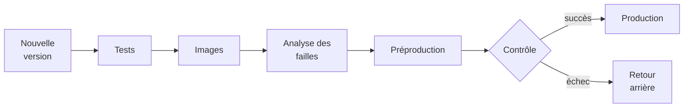

# Sécurité, qualité et mise en production

## La sécurité de la plateforme

Une plateforme de supervision connaît tout le réseau : ses équipements, ses adresses, ses faiblesses. Compromise, elle deviendrait une carte au trésor pour un attaquant. La sécurité a donc été traitée comme une exigence de départ, et non comme une couche ajoutée à la fin.

### Les principes

1. **Le serveur décide, toujours.** L'interface masque les boutons qu'un utilisateur n'a pas le droit d'utiliser, mais c'est le serveur qui vérifie chaque demande : rôle, périmètre, transition autorisée.
2. **Aucun secret dans le code, la base ou les journaux.** Les mots de passe SNMP, les adresses des canaux de notification et les clés sont dans l'environnement du serveur ; la base ne garde que des références.
3. **Le moindre privilège.** Chaque rôle ne fait que ce dont il a besoin ; un compte peut être limité à certains sites ; les fonctions qui touchent au réseau interne (sondes, découverte, collecte) sont réservées aux administrateurs.
4. **Tout est tracé.** Les actions sensibles sont inscrites dans un journal en ajout seul.
5. **Minimiser les données personnelles.** Les adresses des usagers (journaux web, flux réseau) ne sont gardées que le temps utile, et une requête ordinaire ne laisse aucune trace.

### Les protections en place

| Menace | Protection |
|---|---|
| Deviner un mot de passe | Limitation des tentatives par adresse, verrouillage progressif du compte (1 min, 2 min, 4 min… jusqu'à 30 min), double authentification facultative |
| Voler une session | Jeton d'accès de 15 minutes gardé en mémoire, renouvellement par cookie illisible par les scripts, détection de réutilisation qui révoque la session, durée maximale de 8 heures |
| Garder l'accès après un départ | Désactivation d'un compte, changement de rôle ou réinitialisation du mot de passe coupent immédiatement toutes ses sessions ; jetons d'API révocables |
| Voir hors de son périmètre | Filtrage par site côté serveur sur les équipements, alertes, mesures, rapports, topologie et notifications ; un objet hors périmètre répond « introuvable » |
| Lire les secrets | Secrets par référence uniquement ; empreintes seulement pour les jetons ; messages d'erreur et notifications nettoyés des adresses internes |
| Détourner les sondes vers le réseau interne | Sondes réservées aux administrateurs, adresses locales et de métadonnées refusées, pas de redirection, lecture bornée, contenu jamais stocké |
| Injecter de faux événements | Récepteurs désactivés par défaut, seules les adresses d'équipements inventoriés acceptées, limitation par source, expressions de règles bornées |
| Exposer le réseau par la page publique | Liste blanche stricte des informations affichées, même réponse pour une page inconnue ou privée, limitation par adresse et cache |
| Attaquer le navigateur | En-têtes de sécurité stricts (interdiction d'intégrer la page, politique de contenu, HTTPS obligatoire), échanges limités aux origines autorisées |
| Prendre la main sur le serveur | Conteneurs sans droits d'administration et en lecture seule, base sur un réseau isolé, documentation de l'API désactivée en production |
| Dépendances vulnérables | Mises à jour proposées automatiquement (Dependabot) ; analyse des images prévue dans la chaîne de livraison |

### Les risques qui restent

La sécurité n'est jamais complète. Les principaux risques connus sont tenus dans un registre, avec ce qui les réduit déjà et ce qu'il reste à faire :

- **Usurpation d'adresse sur les traps et le syslog** (protocoles UDP sans authentification forte) : n'ouvrir ces ports qu'au réseau d'administration, préférer SNMPv3.
- **Quelques adresses sensibles non encore bloquées pour les sondes** (certaines adresses de métadonnées de fournisseurs de nuage, formes particulières d'adresses) : correction simple, identifiée.
- **Syslog sortant en clair vers le SIEM** : à réserver au réseau d'administration, ou à chiffrer si le CRI l'exige.
- **Page publique** : ce qu'elle révèle (créneaux de maintenance, fragilité d'un service) dépend des noms et messages choisis par les humains ; elle doit être relue avant publication.

## La qualité : comment on s'assure que ça marche

### Les tests automatisés

| Niveau | Nombre | Ce qu'ils vérifient |
|---|---:|---|
| Serveur | 1 281 | Règles métier, API (droits, erreurs, contrats), évolutions de la base, sécurité (connexion, jetons, périmètres), détections, notifications ; sur un vrai PostgreSQL |
| Architecture | 1 ensemble de règles | Couches respectées, cœur métier indépendant, aucune dépendance circulaire entre modules |
| Interface | 340 | Comportement des écrans et composants (chargement, erreurs, droits, interactions) |
| Agent | 111 | Collecte Linux et Windows, configuration, envoi, journaux |
| Parcours complets | 8 | Dans un vrai navigateur : connexion, inventaire, alerte, rapport, sondes, astreinte, page de statut, modèles |

Quelques tests méritent d'être cités parce qu'ils protègent des propriétés essentielles :

- un test vérifie que **la description publiée de l'API correspond exactement à l'API réelle** ;
- un test **mesure qu'une méthode ne marche pas** et le fige : la ressemblance des messages d'alerte
  ne sépare pas « même fait » de « faits différents », et le test échouera si quelqu'un croit avoir
  trouvé un seuil qui sépare ;
- un test vérifie qu'une alerte **que la couche de persistance n'a pas encore écrite** est tout de
  même rangée dans son incident : c'est le défaut qui n'avait été trouvé que sur l'instance ;
- un test vérifie que l'ordre des identifiants employé par le serveur est bien **celui de
  PostgreSQL**, et non celui de Java, qui diffère ;
- un test vérifie que **seule la lecture d'une page de statut publique** est accessible sans connexion, et rien d'autre ;
- un test vérifie qu'**aucune information interne** (nom d'hôte, adresse, nom d'équipement) ne peut apparaître sur une page publique ;
- des tests prouvent chaque règle garantie par la base (une seule alerte active, audit non modifiable) **par une violation réelle**.

### Les contrôles avant chaque intégration

Un script unique lance l'ensemble des contrôles et affiche un tableau réussi / échoué / ignoré : vérification du dépôt (aucun fichier sensible), validation des fichiers de déploiement, tests et couverture du serveur, format du code, analyse statique, tests et compilation de l'interface, et en option les parcours dans le navigateur, les tests de l'agent, la recherche de secrets et l'analyse des vulnérabilités. Des crochets Git vérifient le format des messages et le code avant chaque enregistrement.

### La documentation

La documentation vit avec le code, dans le dépôt : guide de démarrage, manuel utilisateur par rôle, guides d'exploitation (déploiement, sauvegarde et restauration, agent, SNMP, événements réseau, trafic, observabilité, connexion unique, variables d'environnement), plan de validation, registre des risques, et une décision écrite pour chaque choix structurant. La documentation interactive de l'API (Swagger) est disponible hors production.

## La mise en production

### La chaîne de livraison prévue

*Figure 10.1 — Chaîne de livraison prévue pour le serveur de préproduction.*

Faute d'intégration continue en ligne, cette chaîne est écrite sous forme de scripts, déclenchés par un minuteur sur le futur serveur de préproduction à chaque nouvelle version de la branche d'intégration. Chaque étape bloque la suivante en cas d'échec. Le déploiement lui-même sauvegarde la base avant de changer de version et revient automatiquement en arrière si le contrôle de bon fonctionnement échoue.

### Ce qui est prêt et ce qui ne l'est pas

| Élément | État |
|---|---|
| Images des composants (sans droits d'administration, sans secret) | Prêtes |
| Pile de production (serveur frontal HTTPS, réseaux séparés, lecture seule, contrôles de santé) | Prête |
| Sauvegarde chiffrée et restauration d'essai | Prêtes, testées par script |
| Déploiement avec retour arrière automatique | Prêt |
| Supervision de la plateforme (métriques, alertes techniques, tableaux de bord, traces) | Prête ; l'envoi des alertes techniques est réglé sur la boîte de test et doit être configuré avec l'adresse du NOC |
| Paquets d'installation de l'agent (Linux et Windows) | Prêts |
| Chart Kubernetes | Préparé, jamais exécuté |
| Serveur de préproduction et de production | **Non fournis** : rien n'a encore tourné sur l'infrastructure de l'EPT |
