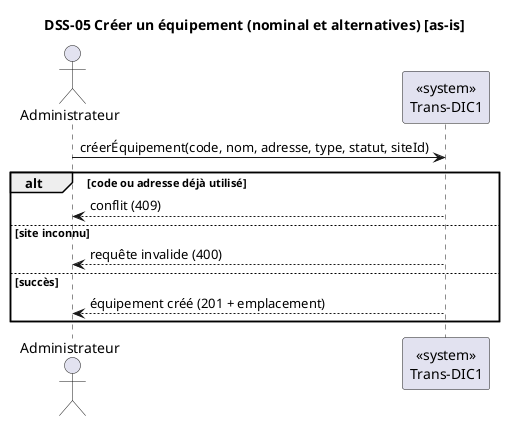
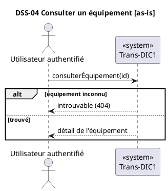
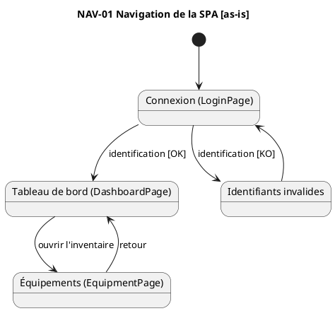

# Revue du modèle UML et compléments (état implémenté)

Revue de `docs/uml/` selon la démarche du skill `modelisation-si-web` (besoins → cas d'utilisation → DSS → DCP → conception → code). Le modèle reste **as-is** : il décrit le code actuel, pas le futur.

## 1. Constats

| # | Sujet | Constat | Action proposée |
| --- | --- | --- | --- |
| 1 | UC-01, granularité | « Vérifier l'unicité… » et « Valider le site » sont des étapes internes de « Créer un équipement », pas des objectifs d'acteur. Les `include` alourdissent le diagramme pour un lecteur métier. | Les supprimer de UC-01 et les déplacer dans les alternatives de la fiche de « Créer un équipement » (section 2). |
| 2 | UC-01, acteur système | « Démarrage de l'application » est un déclencheur technique, pas un acteur. | Garder « Créer l'administrateur initial » comme cas technique, avec l'acteur nommé « Exploitant (variables `BOOTSTRAP_ADMIN_*`) » ou le marquer `«système»`. |
| 3 | Couverture | Le cas « Consulter un équipement » (`GET /equipements/{id}`) n'a aucune séquence, et « Consulter le tableau de bord » n'a pas de DSS. | Ajouter DSS-02 et DSS-06 (section 3) ; vérifier le lien avec `DashboardPage.jsx`. |
| 4 | Séquences SD-02 à SD-06 | Ce sont des séquences de **conception** (contrôleur, service, repository) étiquetées comme séquences du cas. Il manque le niveau DSS « boîte noire » acteur ↔ système. | Ajouter les DSS (section 3) ; garder SD-xx comme séquences de conception, avec renvoi DSS → SD. |
| 5 | CD-01, accesseurs | Les `getX()` figurent dans le diagramme du domaine. Ils n'apportent rien et masquent les concepts. | Les retirer de CD-01 ; les garder, si besoin, dans les diagrammes de conception CD-02 à CD-04. |
| 6 | CD-01, enums | `Equipment → EquipmentType/EquipmentStatus` et `AppUser → Role` sont dessinés comme des associations. | Les passer en types d'attribut (déjà présents) et supprimer les trois flèches. |
| 7 | CD-01, `Site.status` | `status : String` alors que les autres statuts sont des énumérations. | Le signaler comme écart. Aucun changement tant que le code reste ainsi. |
| 8 | Unicité en modification | `EquipmentService.update` ne revérifie ni le code ni l'adresse de gestion : seul `create` appelle `existsByInventoryCodeOrManagementAddress`. Le SD-04 doit le montrer. | Vérifier que SD-04 ne suggère pas de contrôle d'unicité ; ajouter une note si la base porte une contrainte `UNIQUE` qui produirait une erreur 500. |
| 9 | Diagramme d'états | Aucun diagramme d'états, alors que `EquipmentStatus` (UP, DOWN, DEGRADED, MAINTENANCE, UNKNOWN) porte un cycle de vie. | Non ajouté : le code ne contient aucune transition (le statut est affecté librement via `update`). À réexaminer quand la collecte existera. |
| 10 | Navigation | Pas de diagramme de navigation de la SPA (Login, Dashboard, Équipements). | Ajouter NAV-01 (section 4). |
| 11 | Traçabilité | Pas de lien exigence ↔ cas ↔ séquence ↔ code. | Tableau en section 5. |

Les points ambigus déjà listés dans `README.md` (colonne `equipment.site` NOT NULL, table `audit_entry`, site unique de démo) restent ouverts.

## 2. Fiche de cas d'utilisation : Créer un équipement

```
UC-05 Créer un équipement
Acteur principal : Administrateur
Acteurs secondaires : néant (PostgreSQL est un détail d'implémentation)
Objectif : référencer un nouvel équipement dans l'inventaire.
Préconditions : l'Administrateur est authentifié (jeton valide, rôle ADMIN).
Postconditions : un équipement existe, rattaché à un site, avec un identifiant généré.

Scénario nominal
1. L'Administrateur envoie code d'inventaire, nom, adresse de gestion, type, statut et site.
2. Le Système vérifie que le code et l'adresse ne sont pas déjà utilisés.
3. Le Système vérifie que le site existe.
4. Le Système enregistre l'équipement.
5. Le Système répond « créé » avec l'adresse de la ressource.

Alternatives
*a. Jeton absent ou invalide : le Système refuse (401/403 selon la configuration). Fin en échec.
*b. Le rôle n'est pas ADMIN : le Système répond 403. Fin en échec.
1a. Données invalides (validation du DTO) : le Système répond 400. Fin en échec.
2a. Code ou adresse déjà utilisé : le Système répond 409 « Code ou adresse déjà utilisé ». Fin en échec.
3a. Site inconnu : le Système répond 400 « Site inconnu ». Fin en échec.

Exigences supplémentaires : contrat JSON versionné (`/api/v1`), identifiant de corrélation dans les journaux.
Traçabilité : UC-01 (cas), SD-03 (conception), `EquipmentController#create`, `EquipmentService#create`.
```

Fiches à produire de la même façon : UC-01 S'authentifier, UC-02 Consulter le tableau de bord, UC-03 Lister les équipements, UC-04 Consulter un équipement, UC-06 Modifier, UC-07 Supprimer.

## 3. DSS à ajouter (boîte noire)





À compléter avec : DSS-01 s'authentifier, DSS-02 lister (pagination), DSS-03 métriques récentes, DSS-06 modifier, DSS-07 supprimer. Les opérations système issues des DSS correspondent aux routes : `/auth/login`, `/equipements` (GET, POST), `/equipements/{id}` (GET, PUT, DELETE), `/metrics/latest`.

## 4. Navigation de la SPA (NAV-01) [as-is]



À valider dans `App.jsx` : routes réelles et effet de `VITE_AUTH_REQUIRED` (si `false`, `Login` est contourné et `ProtectedRoute` ne redirige pas).

## 5. Traçabilité (extrait)

| Cas | Route | DSS | Séquence de conception | Classes (conception) | Rôle requis |
| --- | --- | --- | --- | --- | --- |
| UC-01 S'authentifier | `POST /api/v1/auth/login` | DSS-01 | SD-01 | `AuthController`, `AuthService`, `JwtService` | public |
| UC-02 Tableau de bord | `GET /api/v1/metrics/latest` | DSS-03 | SD-06 | `MetricController` | authentifié |
| UC-03 Lister | `GET /api/v1/equipements` | DSS-02 | SD-02 | `EquipmentController`, `EquipmentService` | authentifié |
| UC-04 Consulter | `GET /api/v1/equipements/{id}` | DSS-04 | à créer | idem | authentifié |
| UC-05 Créer | `POST /api/v1/equipements` | DSS-05 | SD-03 | idem | ADMIN |
| UC-06 Modifier | `PUT /api/v1/equipements/{id}` | DSS-06 | SD-04 | idem | ADMIN |
| UC-07 Supprimer | `DELETE /api/v1/equipements/{id}` | DSS-07 | SD-05 | idem | ADMIN |

## 6. Ce qui n'a pas été modifié

Aucun fichier existant de `docs/uml/` (`.mdj`, `.puml`, `README.md`) n'a été changé : les corrections du tableau 1 sont des propositions. Le modèle StarUML ne se modifie pas proprement à la main ; dites-moi lesquelles appliquer et je mets à jour les `.puml`.
