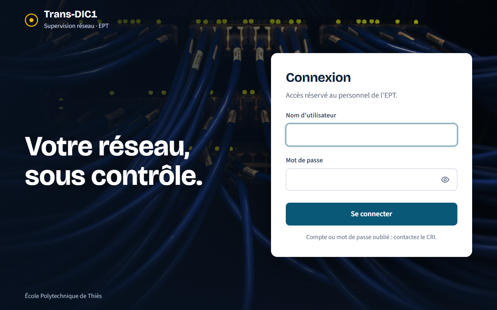
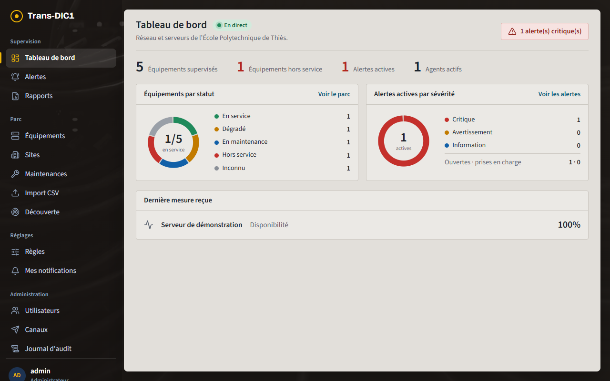
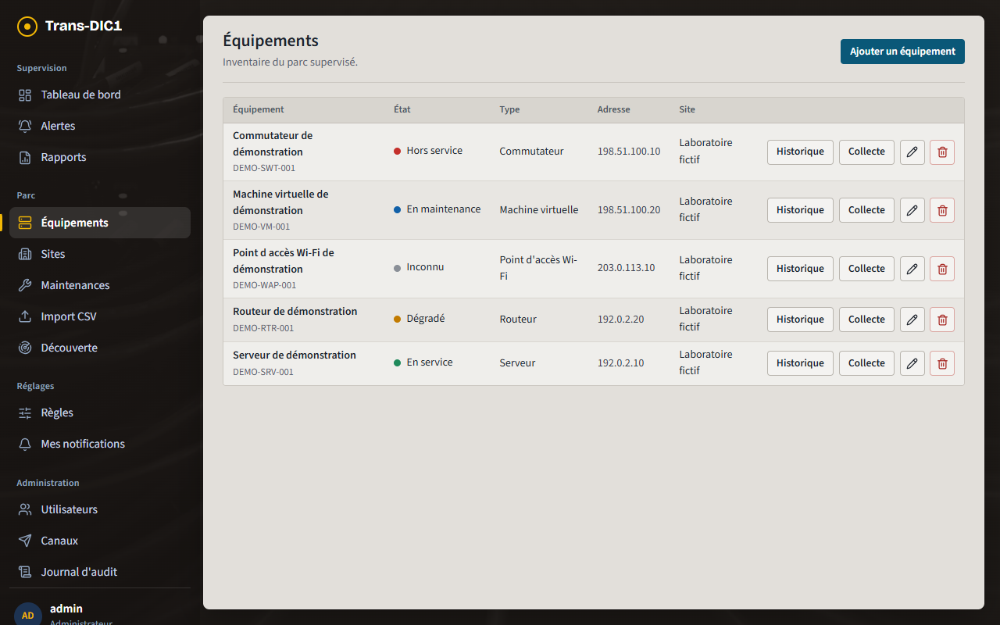
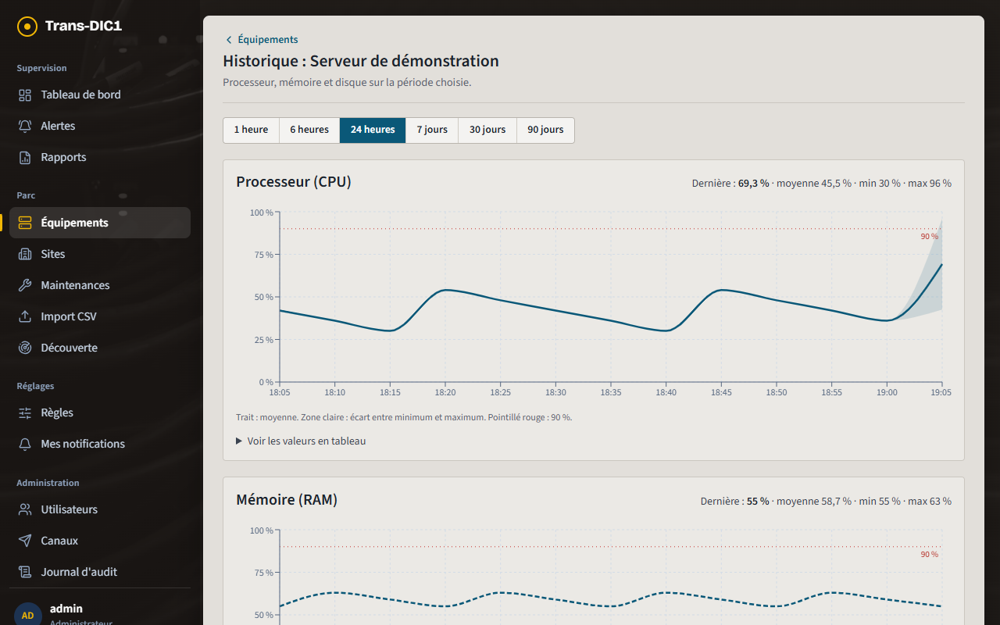
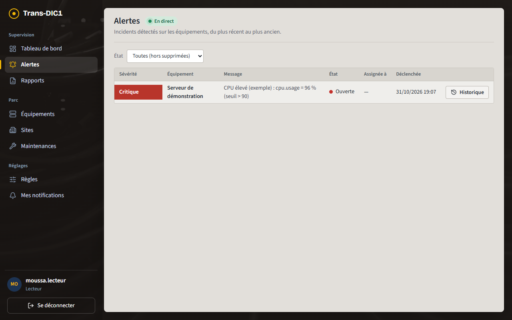
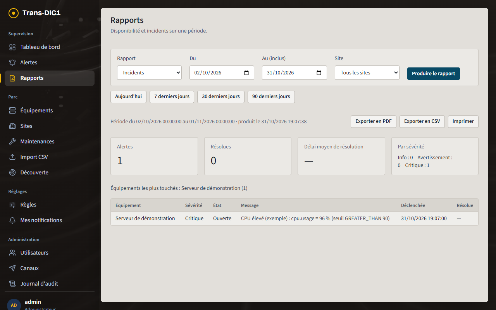
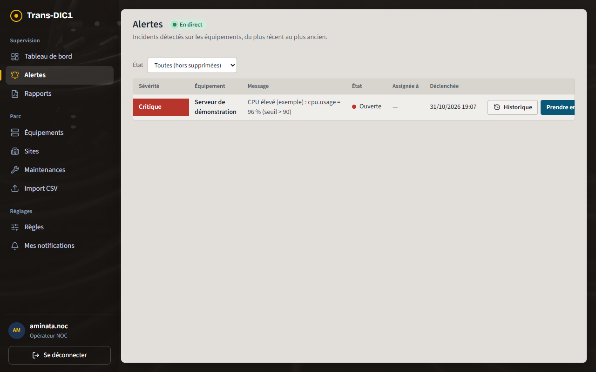
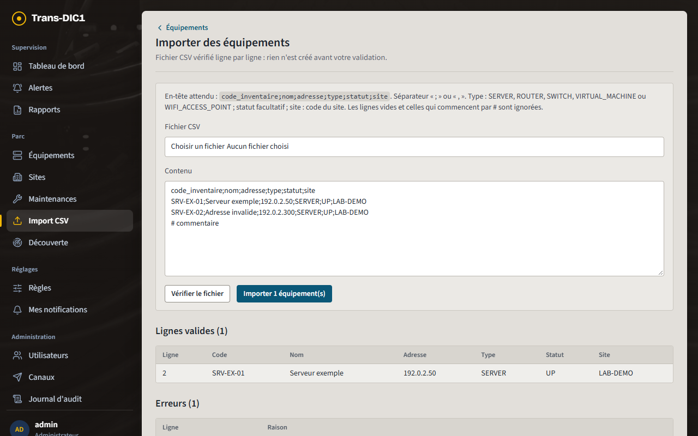
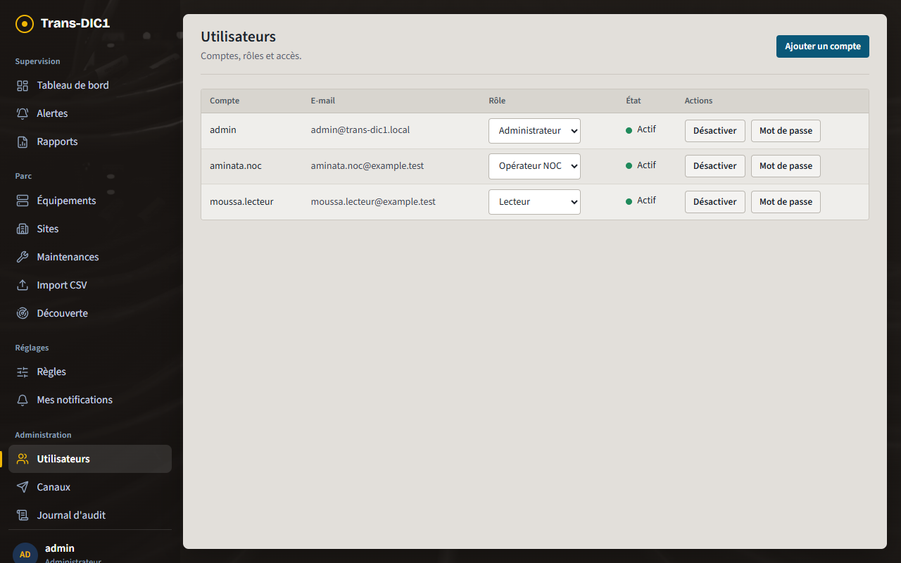
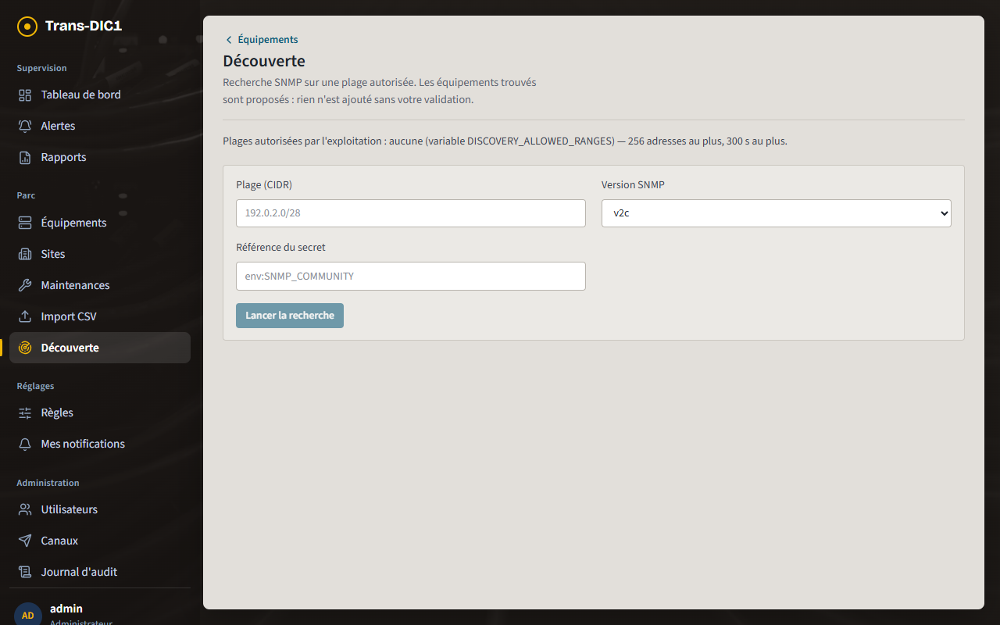

# Manuel utilisateur Trans-DIC1

Trans-DIC1 surveille les équipements réseau et les serveurs de l'EPT. La plateforme reçoit leurs mesures (processeur, mémoire, disque, disponibilité), ouvre une alerte quand un seuil est dépassé et prévient les équipes.

Ce manuel décrit les parcours de chaque rôle. Les captures ont été prises sur une instance de démonstration, avec uniquement des données fictives : équipements de démonstration, adresses de documentation, comptes `example.test`.

| Rôle | Pour qui | Peut |
| --- | --- | --- |
| **Lecteur** | direction, enseignants, toute personne qui consulte | consulter le tableau de bord, les équipements, l'historique, les alertes et les rapports |
| **Opérateur NOC** | équipe d'exploitation du réseau | tout ce que fait le lecteur, plus : traiter les alertes, gérer les équipements et les sites, importer un CSV, planifier des maintenances |
| **Administrateur** | responsables de la plateforme au CRI | tout ce que fait l'opérateur, plus : comptes et rôles, règles d'alerte, canaux de notification, collecte, découverte, journal d'audit, archivage |

Le menu de gauche n'affiche que ce que votre rôle permet. Le serveur vérifie de toute façon chaque action : masquer un bouton n'est pas la sécurité, le contrôle se fait côté serveur.

## 1. Se connecter

1. Si le bouton **Se connecter avec le compte EPT** est affiché, l'utiliser : la connexion se fait avec votre compte de l'école, et votre rôle vient de l'annuaire du CRI. Sinon, saisir votre nom d'utilisateur et votre mot de passe, fournis par un administrateur.
2. **Première connexion** avec un mot de passe donné par un administrateur (nouveau compte ou mot de passe réinitialisé) : la plateforme demande aussitôt de le remplacer par un mot de passe personnel d'au moins 12 caractères. Rien d'autre n'est accessible avant ce changement.
3. Après plusieurs erreurs, le compte est bloqué quelques minutes (1, 2, 4… jusqu'à 30) : c'est une protection, il suffit d'attendre.
4. La session reste ouverte jusqu'à 8 heures, y compris si vous rechargez la page. **Se déconnecter** (en bas du menu) la ferme tout de suite ; avec le compte EPT, la session de l'école est fermée aussi.

Compte ou mot de passe oublié : contactez le CRI.

## 2. Parcours du lecteur

### Tableau de bord

Les chiffres clés en haut : équipements, alertes actives, alertes critiques. En dessous : les équipements par statut, les alertes actives par sévérité et la dernière mesure reçue. La page se met à jour en direct, sans avoir à la recharger.

### Mes vues et écran mural

**Supervision > Mes vues** : composer son propre tableau de bord avec les blocs utiles (résumé, équipements par statut, alertes par sévérité, alertes ouvertes, équipements en panne, dernière mesure). Une vue peut être partagée avec les autres utilisateurs.

**Afficher en mur** ouvre la vue en plein écran, sans menu, pour l'écran de la salle NOC. Avec plusieurs vues, le mur passe de l'une à l'autre à intervalle régulier ; il se met à jour en direct.

### Équipements et historique

**Parc > Équipements** liste le parc : état, type, adresse, site. Le bouton **Historique** ouvre les courbes d'un équipement.

- Choisir la période (1 heure à 90 jours).
- Le trait montre la moyenne, la zone claire l'écart entre minimum et maximum, le pointillé rouge le seuil d'alerte.
- **Voir les valeurs en tableau** donne les chiffres exacts (utile aussi avec un lecteur d'écran).

### Alertes

**Supervision > Alertes** liste les incidents, du plus récent au plus ancien, avec leur sévérité et leur état :

| État | Signification |
| --- | --- |
| Ouverte | le problème vient d'être détecté, personne ne s'en occupe encore |
| Prise en charge | un opérateur s'en occupe |
| Résolue | le problème est réglé (par un opérateur, ou tout seul quand la mesure redevient normale) |
| Archivée | dossier clos par un administrateur |

Quand un équipement de cœur (un routeur, un commutateur de distribution) tombe, les équipements situés derrière lui ne répondent plus non plus. Leurs alertes sont **regroupées sous l'alerte racine** : elles apparaissent en retrait, avec la mention « regroupée sous… », pour que l'opérateur traite d'abord la cause.

Une alerte de type **Anomalie** signale une mesure inhabituelle pour l'heure et le jour (par exemple un processeur très chargé un dimanche à 3 h), même si aucun seuil n'est dépassé.

Le lecteur voit tout, mais aucun bouton d'action : c'est normal.

### Topologie

**Parc > Topologie** dessine les liens entre équipements, niveau par niveau depuis le cœur du réseau. En choisissant un équipement, on voit tout ce qui en dépend : c'est l'**impact d'une panne**.

### Rapports

**Supervision > Rapports** : choisir le rapport (Disponibilité, Incidents ou SLA par site), la période et éventuellement un site, puis **Produire le rapport**. Le résultat s'exporte en **PDF** ou en **CSV**.

Le rapport **SLA par site** compare la disponibilité mesurée de chaque site à son objectif (99,5 % par défaut, modifiable dans **Parc > Sites**). Les maintenances planifiées ne comptent pas comme indisponibilité.

## 3. Parcours de l'opérateur NOC

### Traiter une alerte

1. Dans **Alertes**, repérer l'alerte (filtre **État** si besoin).
2. **Prendre en charge** : l'alerte passe à « Prise en charge » et vous en devenez responsable. Les collègues voient qu'elle est traitée.
3. Régler le problème sur l'équipement.
4. **Résoudre** : l'alerte passe à « Résolue ».
5. **Historique** affiche la chronologie : qui a fait quoi, et quand.

Une alerte critique ouverte depuis 10 minutes (30 minutes pour les autres) sans prise en charge est **escaladée** : les administrateurs sont prévenus.

Si l'alerte a changé d'état entre-temps (un collègue l'a déjà prise), la liste se recharge et un message l'indique.

Plusieurs opérateurs peuvent suivre la même alerte : dans le détail de l'alerte, **Assignés** permet d'ajouter ou de retirer un collègue. Chacun reçoit les notifications de l'alerte.

Une alerte regroupée sous une alerte racine se résout en général avec elle : traiter d'abord la racine, puis vérifier que les alertes regroupées se ferment d'elles-mêmes.

### Gérer l'inventaire

- **Ajouter un équipement** (page Équipements) : code d'inventaire unique, nom, adresse de gestion, site, type, statut.
- Les boutons crayon et corbeille modifient ou suppriment un équipement. Toute modification est tracée dans le journal d'audit.
- **Parc > Sites** : créer et modifier les sites (bâtiments, salles) auxquels les équipements sont rattachés. Le code d'un site ne change plus après sa création.
- **Parc > Topologie** (administrateur) : déclarer qu'un équipement est relié en amont à un autre. Ces liens servent au regroupement des alertes et au calcul de l'impact d'une panne.

### Importer un inventaire CSV

1. **Parc > Import CSV** : choisir un fichier ou coller son contenu. La première ligne doit être `code_inventaire;nom;adresse;type;statut;site`.
2. **Vérifier le fichier** : la plateforme classe chaque ligne en **valide**, **erreur** (avec la raison et le numéro de ligne) ou **ignorée**. Rien n'est encore créé.
3. Corriger le fichier si besoin, puis **Importer** : seules les lignes valides sont créées.

Une ligne dont le code d'inventaire ou l'adresse existe déjà est refusée comme doublon. Le format complet est décrit dans [discovery-and-import.md](../devops/discovery-and-import.md).

### Planifier une maintenance

**Parc > Maintenances** : déclarer une période de maintenance pour un équipement ou un site. Pendant cette période, aucune alerte ne s'ouvre et aucune notification ne part pour ces équipements.

### Mes notifications

**Réglages > Mes notifications** : choisir de recevoir ou non un message à l'ouverture et à la résolution des alertes, et à partir de quelle sévérité. Le canal par défaut est l'e-mail ; d'autres canaux (Teams, Slack, webhook) sont configurés par un administrateur.

## 4. Parcours de l'administrateur

### Comptes et rôles

**Administration > Utilisateurs** :
- **Ajouter un compte** : nom, e-mail, mot de passe d'au moins 12 caractères, rôle ;
- changer le rôle, **Désactiver** un compte, réinitialiser son **Mot de passe**.

Changer le rôle, désactiver un compte ou réinitialiser son mot de passe ferme ses sessions ouvertes, immédiatement : la personne est renvoyée à l'écran de connexion dès sa requête suivante. Le mot de passe saisi à la création ou à la réinitialisation est **temporaire** : la personne doit le changer à sa première connexion. Le transmettre par un canal sûr.

Limiter un compte à certains sites n'est pas encore possible : chaque compte voit tout le parc (voir la dette technique).

### Règles d'alerte

**Réglages > Règles** : indicateur (par exemple `cpu.usage`), comparaison et seuil, seuil de retour à la normale (hystérésis), délai de confirmation, sévérité, et équipements ou sites concernés. Un seuil se modifie sans redéploiement.

Avant d'enregistrer ou d'activer une règle, **Tester sur l'historique** la rejoue sur les mesures des dernières 24 heures ou des 7 derniers jours. On voit combien d'alertes elle aurait ouvertes, sur quels équipements, quand elles se seraient ouvertes et refermées, et la valeur la plus forte atteinte. Rien n'est enregistré et personne n'est prévenu. Cela permet d'ajuster le seuil, le délai de confirmation ou le seuil de retour avant de mettre la règle en service. Le test porte sur 50 équipements au plus.

Une règle qui a déjà ouvert des alertes ne peut pas être supprimée : il faut la désactiver.

### Collecte d'un équipement

Depuis la liste des équipements, **Collecte** ouvre la configuration de la collecte :
- **Agent** : enregistrer un agent Trans-DIC1 pour un serveur. Le jeton n'est affiché **qu'une seule fois** et doit être copié aussitôt ([installation de l'agent](../devops/agent.md)).
- **SNMP** : version, référence du secret (`env:NOM`, jamais le mot de passe lui-même), OID à lire.

### Découverte automatique

**Parc > Découverte** recherche en SNMP les équipements d'une plage d'adresses, uniquement si cette plage a été autorisée par l'exploitation. Les équipements trouvés sont **proposés** : cochez ceux à garder, complétez leur code d'inventaire et leur site, puis **Vérifier l'import**. Ils passent alors par l'écran d'import. Sans plage autorisée (cas de la capture), le bouton reste désactivé.

### Canaux, journal d'audit, archivage

- **Administration > Canaux** : modèles de messages, historique des envois, rejeu d'une notification en échec, envoi de test.
- **Administration > Journal d'audit** : qui a fait quoi, quand, avec quel identifiant de corrélation. Filtrable et exportable en CSV, en lecture seule.
- Dans **Alertes**, un administrateur peut **Archiver** une alerte résolue.

## 5. En cas de problème

| Situation | Que faire |
| --- | --- |
| Retour soudain à l'écran de connexion | la session a expiré (8 heures au plus) ou a été fermée par un administrateur : se reconnecter |
| « L'action a échoué. Vérifiez vos droits. » | votre rôle ne permet pas cette action : demander à un administrateur |
| Un équipement reste « Inconnu » | aucune mesure reçue : vérifier son agent ou sa collecte SNMP (administrateur) |
| Pas d'e-mail d'alerte | vérifier **Mes notifications**, puis demander à un administrateur de consulter l'historique des envois (**Canaux**) |
