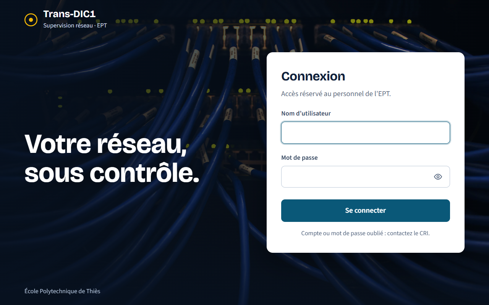
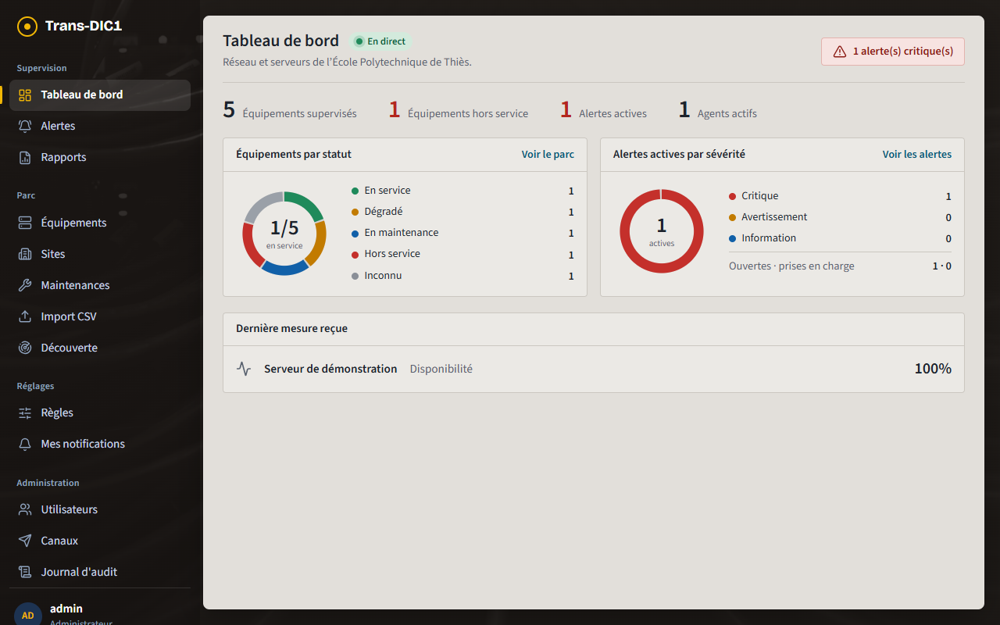
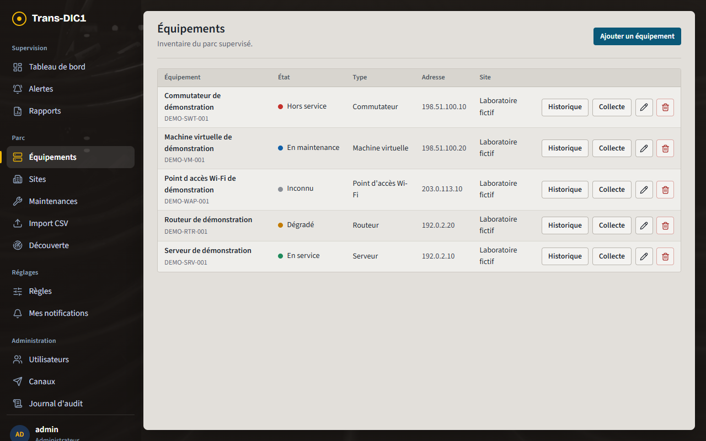
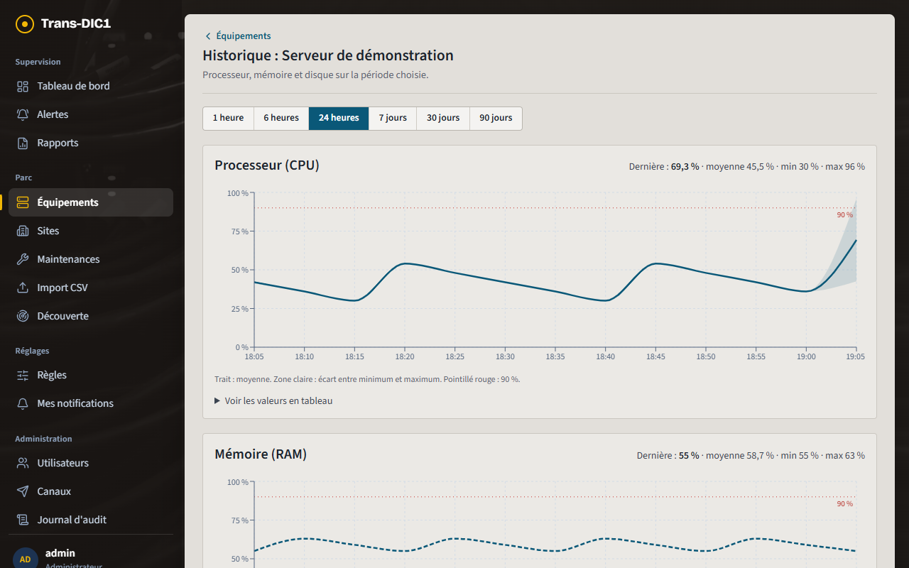
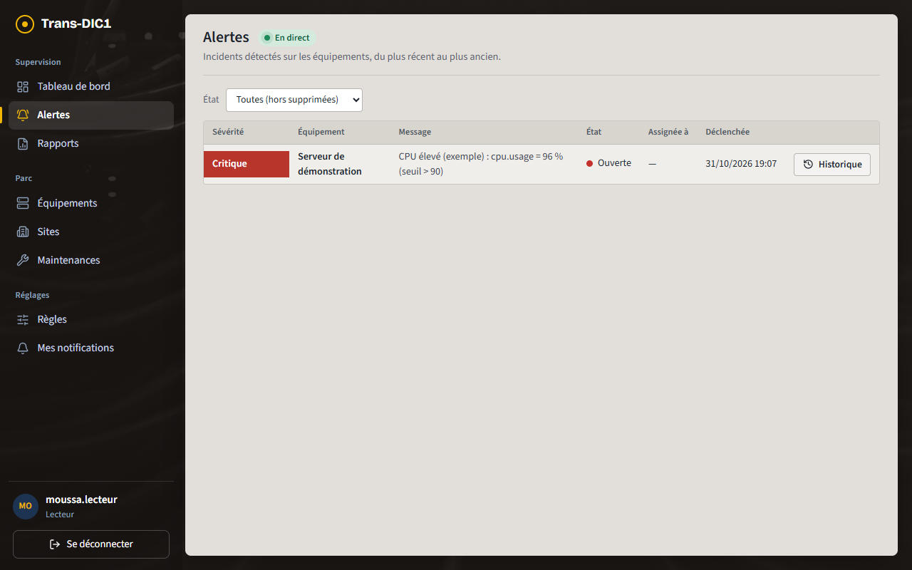
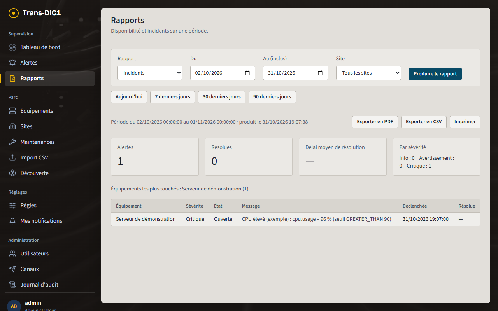
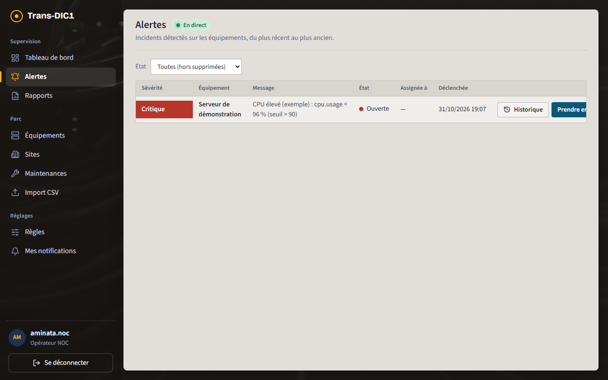
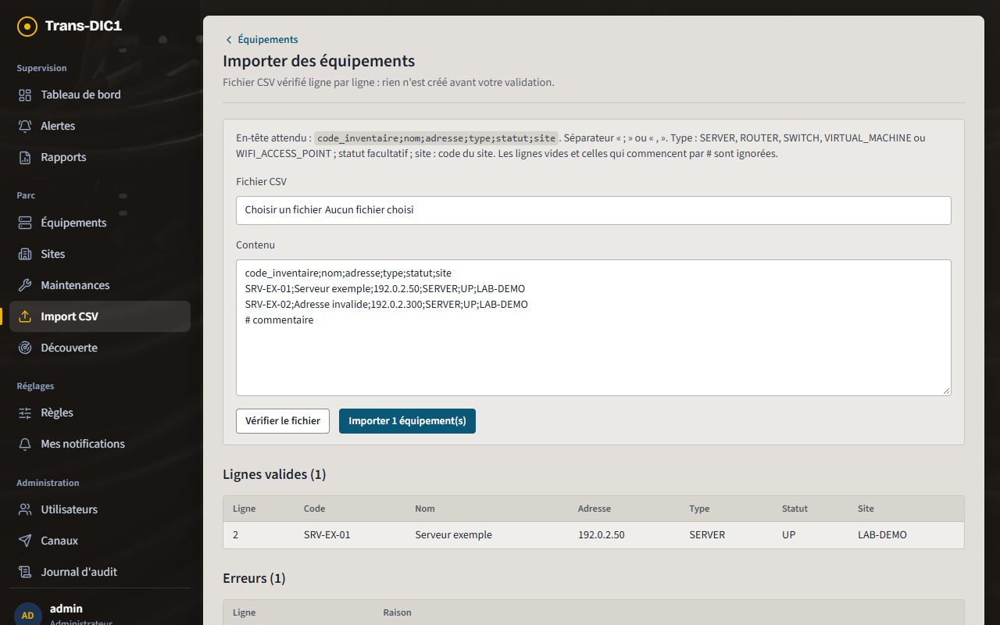
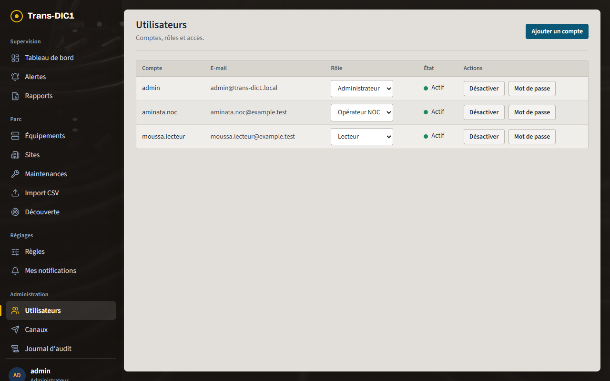
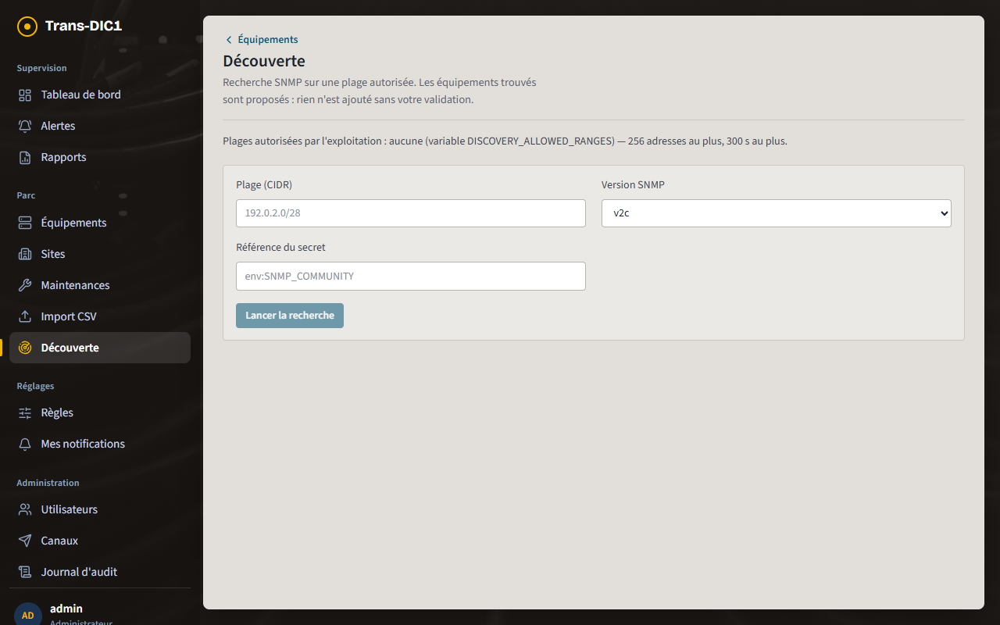

# Manuel utilisateur Trans-DIC1

Trans-DIC1 surveille les équipements réseau et les serveurs de l'EPT. La plateforme reçoit leurs mesures (processeur, mémoire, disque, disponibilité), ouvre une alerte quand un seuil est dépassé et prévient les équipes.

Ce manuel décrit les parcours de chaque rôle. Les captures ont été prises sur une instance de démonstration, avec uniquement des données fictives : équipements de démonstration, adresses de documentation, comptes `example.test`.

| Rôle | Pour qui | Peut |
| --- | --- | --- |
| **Lecteur** | direction, enseignants, toute personne qui consulte | consulter le tableau de bord, les équipements, l'historique, les alertes et les rapports |
| **Opérateur NOC** | équipe d'exploitation du réseau | tout ce que fait le lecteur, plus : traiter les alertes, gérer les équipements et les sites, importer un CSV, planifier des maintenances |
| **Administrateur** | responsables de la plateforme au CRI | tout ce que fait l'opérateur, plus : comptes et rôles, règles d'alerte, canaux de notification, collecte, découverte, journal d'audit, archivage |

Le menu de gauche n'affiche que ce que votre rôle permet. Le serveur vérifie de toute façon chaque action : masquer un bouton n'est pas la sécurité, le contrôle se fait côté serveur.

## 1. Se connecter

1. Si le bouton **Se connecter avec le compte EPT** est affiché, l'utiliser : la connexion se fait avec votre compte de l'école, et votre rôle vient de l'annuaire du CRI. Sinon, saisir votre nom d'utilisateur et votre mot de passe, fournis par un administrateur.
2. **Première connexion** avec un mot de passe donné par un administrateur (nouveau compte ou mot de passe réinitialisé) : la plateforme demande aussitôt de le remplacer par un mot de passe personnel d'au moins 12 caractères. Rien d'autre n'est accessible avant ce changement.
3. Après plusieurs erreurs, le compte est bloqué quelques minutes (1, 2, 4… jusqu'à 30) : c'est une protection, il suffit d'attendre.
4. La session reste ouverte jusqu'à 8 heures, y compris si vous rechargez la page. **Se déconnecter** (en bas du menu) la ferme tout de suite ; avec le compte EPT, la session de l'école est fermée aussi.

Compte ou mot de passe oublié : contactez le CRI.

## 2. Parcours du lecteur

### Tableau de bord

Les chiffres clés en haut : équipements, alertes actives, alertes critiques. En dessous : les équipements par statut, les alertes actives par sévérité et la dernière mesure reçue. La page se met à jour en direct, sans avoir à la recharger.

**Santé du parc** donne une note de 0 à 100 par site, puis les équipements qui perdent le plus de points, avec la raison : alertes actives (une critique coûte 25 points, un avertissement 8, une information 2), fonctionnement dégradé, silence de plus de dix minutes, et part des indicateurs qui sortent de leur comportement habituel. Un équipement hors service est à 0 ; un équipement en maintenance n'est pas noté. La note d'un site est la moyenne de ses équipements notés. C'est un résumé pour savoir par où commencer, pas un remplacement de la liste des alertes.

### Mes vues et écran mural

**Supervision > Mes vues** : composer son propre tableau de bord avec les blocs utiles (résumé, équipements par statut, alertes par sévérité, alertes ouvertes, équipements en panne, dernière mesure). Une vue peut être partagée avec les autres utilisateurs.

**Afficher en mur** ouvre la vue en plein écran, sans menu, pour l'écran de la salle NOC. Avec plusieurs vues, le mur passe de l'une à l'autre à intervalle régulier ; il se met à jour en direct.

### Équipements et historique

**Parc > Équipements** liste le parc : état, type, adresse, site. Le bouton **Historique** ouvre les courbes d'un équipement.

- Choisir la période (1 heure à 90 jours).
- Le trait montre la moyenne, la zone claire l'écart entre minimum et maximum, le pointillé rouge le seuil d'alerte.
- **Voir les valeurs en tableau** donne les chiffres exacts (utile aussi avec un lecteur d'écran).

**Prévision de saturation.** Au-dessus des courbes, une carte **Prévision** par indicateur suivi (disque et mémoire) donne la valeur actuelle, la tendance par jour et la conclusion :

- « Plein dans ~12 jours le 17/11/2026 » : si la tendance des 14 derniers jours se poursuit, la limite de 100 % sera atteinte vers cette date ; la **confiance** (haute, moyenne, faible) dit à quel point la tendance est régulière ;
- « Pas de tendance à la hausse » : la valeur est stable ou baisse ;
- « Pas assez de données (il faut 3 jours de mesures) » : l'équipement est suivi depuis trop peu de temps.

**Cycle journalier.** Certains indicateurs montent le matin et redescendent la nuit : une droite passerait entre les pics et annoncerait la saturation trop tard. Quand les mesures montrent un tel cycle, la plateforme emploie un second modèle et la carte l'indique — « Cycle journalier reconnu, pic vers 14 h ». C'est au pic que la limite se touche : savoir l'heure évite de chercher à minuit pourquoi « rien ne dépasse ». Le choix entre les deux méthodes n'est pas deviné : chacune est mise à l'épreuve sur les dernières 24 heures, et la plus juste est retenue.

La prévision reste un ordre de grandeur pour planifier un nettoyage ou un agrandissement, pas une date exacte : elle ne connaît ni les purges à venir, ni les cycles de la semaine (un lundi matin chargé passe pour du bruit).

### Alertes

**Supervision > Alertes** liste les incidents, du plus récent au plus ancien, avec leur sévérité et leur état :

| État | Signification |
| --- | --- |
| Ouverte | le problème vient d'être détecté, personne ne s'en occupe encore |
| Prise en charge | un opérateur s'en occupe |
| Résolue | le problème est réglé (par un opérateur, ou tout seul quand la mesure redevient normale) |
| Archivée | dossier clos par un administrateur |

Quand un équipement de cœur (un routeur, un commutateur de distribution) tombe, les équipements situés derrière lui ne répondent plus non plus. Leurs alertes sont **regroupées sous l'alerte racine** : elles apparaissent en retrait, avec la mention « regroupée sous… », pour que l'opérateur traite d'abord la cause.

Une alerte de type **Absence de donnée** signale un indicateur qui arrivait régulièrement et ne remonte plus depuis une demi-heure, alors que l'équipement répond par ailleurs : un disque démonté, un service disparu de l'agent, un OID devenu muet. Si l'équipement est entièrement muet, c'est une alerte de collecte qui s'ouvre à la place. Elle se résout seule au retour des mesures.

### Objectif de disponibilité et budget d'erreur

Chaque sonde peut recevoir un **objectif de disponibilité** sur trente jours — 99,5 %, par exemple. Le champ est vide par défaut, et c'est voulu : choisir 99,5 % plutôt que 99,9 % engage des arbitrages que seule l'exploitation peut faire. Sans objectif, la plateforme ne reproche rien.

Un objectif de 99,5 % autorise 0,5 % d'indisponibilité sur trente jours, soit **216 minutes** — c'est le budget d'erreur. L'écran des sondes affiche ce qui en est dépensé, ce qu'il reste, et, quand une coupure est en cours, **à quelle vitesse il part** : « budget dépensé à 42 % · 125 min encore permises · part 3,5 fois trop vite en ce moment ».

Deux alertes en découlent, et elles ne disent pas la même chose. **Budget épuisé** est critique : le mois est perdu, ce qui reste à décider est quoi faire pour le suivant. **Consommation trop rapide** est un avertissement : à cette vitesse le mois sera perdu, mais ce n'est qu'une prévision — si la coupure s'arrête, le budget tient. Une coupure de trois minutes ne déclenche rien.

Ce qu'il faut savoir : sur un service jeune, l'écran dit « pas encore assez de relevés pour en juger » au lieu d'afficher 100 %. Et si la plateforme elle-même est arrêtée pendant une panne du service, les relevés manquants ne comptent pas comme des échecs : le budget sous-estime alors l'indisponibilité. C'est le choix le moins mauvais — vous reprocher nos propres pannes serait pire — et c'est l'alerte « plus de données » qui couvre ce trou.

### Alertes de plage apprise sur les ports

Pour les débits, erreurs, rejets, la gigue et la perte, la plateforme apprend la **plage habituelle de chaque port** au fil des mesures, sans que vous réglez quoi que ce soit. Trois mesures de suite en dehors de cette plage ouvrent un avertissement qui la donne : « net.in[Gi0/2] au-dessus de sa plage habituelle : 500 Mb/s depuis 3 mesures, alors que ce port tient d'ordinaire entre 18 et 24 Mb/s ». Le message précise que la plage est apprise, pour que vous ne cherchiez pas le seuil correspondant dans les règles : il n'y en a pas.

L'intérêt est la rapidité : la plage est utilisable après une vingtaine de mesures, soit quelques minutes, là où l'alerte **Anomalie** a besoin de plusieurs semaines d'historique au même créneau. Un port tout juste découvert est donc surveillé tout de suite.

En échange, **cette plage s'adapte** : un port dont le trafic grandit durablement verra sa plage suivre, et l'alerte se refermer. Ce n'est pas un oubli — un port qui sert davantage chaque mois ne doit pas crier tous les jours — et c'est l'alerte **Rupture de niveau** qui voit les changements durables. Les deux se complètent.

Enfin, un port éteint puis rallumé aura appris une plage autour de zéro : ses premières mesures de trafic ouvriront une alerte, qui se refermera seule en quelques dizaines de mesures.

### Se connecter avec son compte de l'école

Si le CRI a relié la plateforme à l'annuaire de l'école, vous vous connectez avec **votre identifiant et votre mot de passe habituels** : il n'y a pas de second mot de passe à retenir, et aucun compte à demander au préalable. Le vôtre est créé à votre première connexion.

Votre **rôle** dépend de vos groupes dans l'annuaire — administrateur, opérateur NOC ou lecteur. Il est relu à chaque connexion : si vos groupes changent, vos droits suivent dès la connexion suivante. Si vous figurez dans l'annuaire mais dans aucun des groupes retenus par le CRI, la connexion est refusée : c'est voulu, l'annuaire contient toute l'école.

Deux choses à savoir. Changer votre mot de passe se fait **dans l'annuaire de l'école**, pas ici : la plateforme n'en garde aucune copie. Et une série de mots de passe erronés verrouille temporairement l'accès, comme pour un compte local — attendez quelques minutes ou demandez au CRI.

### Dire quelle était la vraie cause

Dans le diagnostic, chaque cause probable porte un bouton **« C'était la vraie cause »**, et la rubrique propose aussi **« Aucune de ces causes »**. Votre réponse ne change rien à l'alerte en cours : elle corrige le **classement des prochaines**.

Le classement s'appuyait jusqu'ici sur des poids choisis par raisonnement — un équipement en amont en panne explique mieux qu'une anomalie. C'est défendable, mais c'est une opinion. Vos confirmations la remplacent progressivement par un fait : la part des fois où chaque sorte de cause avait réellement raison. Il n'y a **pas de bascule** : sans réponse, les poids d'origine s'appliquent ; avec dix réponses, ils sont à moitié chemin ; avec deux cents, votre expérience décide seule. L'écran dit toujours lequel des deux régimes s'applique.

Deux détails utiles. **Répondre « aucune » est une vraie réponse**, pas un abandon : elle dit que le diagnostic s'est trompé sur toute la ligne, et c'est la plus instructive. Et vous pouvez **revenir sur votre réponse** : reconfirmer remplace la précédente.

### Ce qui a bougé en même temps

Dans le diagnostic d'une alerte, cette rubrique réunit deux choses. Les indicateurs qui ont **changé de niveau** à l'ouverture, comme avant. Et, depuis peu, ceux qui **varient comme la mesure en alerte** — ou à son inverse —, sur la machine en alerte comme sur ses voisins directs dans la topologie. C'est souvent le plus parlant : la latence qui suit la charge, le trafic qui s'effondre à chaque pic d'erreurs. Un indicateur peut suivre la mesure en alerte sans que sa moyenne bouge d'un pouce, et la comparaison avant/après ne le voyait pas.

La ligne dit laquelle des deux raisons l'a fait retenir, le nom de l'équipement quand l'indicateur vient d'un voisin, et la force du lien (ρ, entre 0 et 1). La rubrique annonce aussi **combien de séries ont été éprouvées** pour en retenir ces quelques-unes : c'est à vous d'en juger, et un outil qui montre trois lignes sans dire qu'il en a examiné trente ne vous laisse pas ce choix.

Ce n'est **pas une cause démontrée**, et la plateforme ne s'en sert pas pour classer ses causes probables : deux indicateurs peuvent suivre la même courbe parce qu'ils subissent tous deux un troisième phénomène. C'est une piste, qui fait gagner du temps, pas une explication.

Une alerte qui ne porte sur aucun indicateur — une perte de collecte, un événement envoyé par l'équipement — n'a rien à corréler : la rubrique garde alors son ancien contenu.

### Liens appris des alertes

Sur l'écran **Topologie**, sous les voisins LLDP, la plateforme propose des liens qu'elle a **déduits de l'historique des alertes** : deux équipements qui tombent ensemble, encore et encore, alors que rien ne les relie dans la topologie. C'est souvent un lien réel que personne n'a saisi — un serveur et le stockage qu'il monte, une baie et son onduleur, deux machines derrière le même cordon mal déclaré.

Le tableau dit combien de fois ils sont tombés ensemble et sur combien d'occasions, par exemple « 6 fois sur 6 » : à vous de juger. **La statistique voit qu'ils arrivent ensemble, pas pourquoi.** Deux machines peuvent tomber de concert simplement parce qu'une coupure de courant les touche toutes les deux.

Un administrateur **accepte** ou **écarte** chaque proposition. Accepté, le lien regroupe leurs alertes en un seul incident, avec une seule notification, et le détail de l'incident précise « Lien appris des alertes, accepté » — pour qu'on ne confonde jamais un câble avec une statistique validée. Écarté, il ne sera plus proposé. Tant que personne n'a tranché, la proposition ne change rien.

La fouille tourne une fois par nuit sur le dernier mois d'alertes. Sur un parc neuf, ou tranquille, elle ne proposera rien, et c'est normal : il lui faut des semaines d'alertes réelles pour voir quoi que ce soit.

## Incidents : un fait plutôt que ses morceaux

Une panne en amont fait tomber cinq machines : cinq alertes, un seul fait. L'écran **Incidents** montre le fait entier. Les alertes qui arrivent dans la même dizaine de minutes y sont regroupées quand elles portent sur la même machine, sur un voisin direct dans la topologie, ou sur le même site avec la même règle ou le même message.

**Une seule de ces alertes prévient l'équipe.** Les autres restent visibles, dans l'incident et sur l'écran des alertes, mais ne réveillent personne. Si l'incident s'aggrave — une alerte critique rejoint un incident qui n'était qu'un avertissement —, un second message part : c'est une nouvelle information. Dans le détail de l'incident, l'alerte qui a prévenu est signalée, et **chaque autre dit pourquoi elle est là** : « Voisin dans la topologie : Routeur de cœur (lien direct) », « Même équipement : Serveur applicatif ». Un regroupement que vous ne pouvez pas vérifier ne mérite pas votre confiance : lisez la raison, et si elle vous paraît fausse, les alertes sont toujours là, une par une, sur l'écran des alertes.

Un incident est **en cours** ou **terminé**, et rien d'autre : il se referme seul quand toutes ses alertes sont retombées. La prise en charge, l'assignation et la résolution se font sur les alertes, comme avant — un incident ne crée pas un second carnet de bord.

Ce qu'il ne fait pas : un fait qui s'étale, avec plus de dix minutes entre deux symptômes, donnera deux incidents ; et un incident qui franchit un lien entre deux sites reste rattaché au site où il a commencé, donc un compte limité à l'autre site ne le verra pas dans cette liste.

Une alerte de type **Écart aux semblables** signale un équipement qui se comporte autrement que ses semblables, même si aucun seuil n'est franchi et même si c'est son habitude. Les semblables sont les autres équipements **du même modèle** sur le même site dès qu'ils sont au moins quatre ; à défaut, les autres du même type. Le message dit toujours à quoi l'équipement a été comparé. Conséquence utile à connaître : mieux l'inventaire renseigne les modèles, plus la comparaison est juste — mais les groupes rétrécissent, et un équipement dont le modèle est unique sur son site n'est plus comparé à personne, ce qui est préférable à le comparer à des machines qui ne lui ressemblent pas.

Une alerte de type **Anomalie** signale une mesure inhabituelle pour l'heure et le jour (par exemple un processeur très chargé un dimanche à 3 h), même si aucun seuil n'est dépassé. La normale est calculée sur les quatre dernières semaines au même créneau, en écartant les relevés qui étaient eux-mêmes inhabituels : un incident passé ne masque pas le suivant. Le message de l'alerte dit combien de relevés ont été écartés. Le temps de réponse d'une sonde est surveillé de la même façon.

Une alerte **Anomalie** peut aussi porter sur l'**état d'ensemble** d'une machine : « État inhabituel de … : ses mesures ne vont plus ensemble comme d'habitude ». Celle-ci ne vient d'aucun seuil et d'aucun indicateur pris à part — elle s'ouvre quand la combinaison des mesures de l'heure ne ressemble à aucune des deux dernières semaines, par exemple une machine peu chargée qui répond lentement. Le message cite les indicateurs les plus éloignés de leur habitude : c'est une **piste**, pas une cause, et le message le dit. Elle se referme seule au retour à la normale, et ne s'ouvre jamais si une alerte porte déjà sur un indicateur de la même machine. Il faut au moins trois jours de mesures complètes pour qu'une machine soit jugée ainsi.

Une alerte **Rupture de niveau** signale un indicateur qui a changé de régime et y est resté : « Rupture de niveau sur Routeur de démonstration : net.speed est descendu de 1000 Mb/s à 100 Mb/s (-90 %) depuis le 19 novembre à 14h, et s'y tient depuis ». Elle comble deux creux de l'alerte **Anomalie** ci-dessus. Celle-ci compare la valeur du moment à l'habitude du même créneau : elle crie à l'instant du changement, puis se tait dès que le nouveau niveau *est* devenu l'habitude — une rupture arrivée un samedi soir est donc invisible le lundi matin, alors que rien n'est revenu. Et un changement qui s'installe doucement, comme une mémoire qui gagne un demi-point par heure, ne franchit jamais aucun seuil. Le message donne les deux niveaux, la variation et **la date du changement**, ce qui est l'essentiel du travail de recherche. Il ne dit pas pourquoi : une rupture peut être une panne comme une modification volontaire — et dans ce dernier cas, l'alerte est justement la preuve qu'elle a pris effet, à acquitter. Le changement doit avoir duré au moins six heures et être franc ; une pointe de deux heures n'ouvre rien. Trois alertes au plus par équipement, pour qu'une machine refaite à neuf n'en ouvre pas une par indicateur, et jamais deux fois le même indicateur si une règle de seuil ou l'alerte Anomalie le signale déjà. Il faut quatre jours de mesures pour qu'un indicateur soit jugé, et une rupture plus ancienne que deux semaines sort de la fenêtre : l'alerte se referme alors seule, en disant que le niveau est redevenu stable sans trancher entre « c'est revenu » et « le nouveau niveau est devenu l'habitude ».

Une alerte de type **Prévision** annonce qu'un disque ou une mémoire sera plein dans moins de 14 jours si la tendance se poursuit, par exemple « Disque plein dans ~12 jours (tendance +2,0 %/jour, confiance haute) ». Elle devient **critique** à 3 jours ou moins, son message est actualisé au plus une fois par jour, et elle se résout seule quand la tendance disparaît ou que la saturation recule nettement (au-delà de 17 jours et demi).

Une alerte de type **Événement** vient d'un trap SNMP ou d'un message syslog envoyé par l'équipement lui-même et retenu par une règle d'événement, par exemple « Événement réseau « Interface coupée (linkDown) » : linkDown (interface coupée) ». Elle se résout seule quand l'équipement annonce le retour (linkUp), sinon à la main.

Le lecteur voit tout, mais aucun bouton d'action : c'est normal.

### Cause racine : pourquoi c'est tombé

Le panneau de diagnostic d'une alerte, et le détail d'un incident, commencent par une **cause racine** : une phrase qui dit pourquoi, par exemple « ENT est injoignable parce que le routeur rtr-coeur est hors service », « La VM vm-web-01 est éteinte parce que son hôte proxmox-02 est hors service », « nginx est arrêté sur vm-web-01 » ou « PostgreSQL ne répond plus : disque plein sur vm-db-01 ».

Dessous, la chaîne parcourue, étape par étape : le service, ce dont il dépend, l'équipement où il tourne, l'hôte ou le réseau en amont. Chaque étape dit sa relation (« dépend de », « tourne sur », « hébergée par », « derrière »), son état en toutes lettres et ses preuves (l'alerte, la dernière mesure). La dernière étape est marquée « (cause) ». Seules comptent les pannes **du même moment** (à un quart d'heure près). S'il y a plusieurs causes possibles, elles sont toutes listées sous « Autres causes possibles », la plus probable en premier.

Ce qui est hors de votre périmètre de sites n'est jamais nommé : la chaîne s'arrête sur « élément hors de votre périmètre ».

La recherche suit les **dépendances entre services** déclarées dans **Parc → Dépendances** : sans elles, elle se limite à l'équipement, à ses ressources et à son amont.

### Diagnostic d'un incident

Le bouton **Historique** d'une alerte ouvre son détail, qui commence par le panneau **Diagnostic**. Il est calculé au moment où vous l'ouvrez (bouton **Recalculer** pour le refaire), à partir des seules données de Trans-DIC1 : topologie, autres alertes, traps et messages syslog, journal d'audit, mesures et prévisions. Ce sont des règles fixes, pas une intelligence artificielle, et rien ne sort du serveur.

- **Résumé**, en tête : ce qui se passe, ce que ça touche et la cause la plus probable, par exemple « Le routeur R1 est injoignable depuis 14:02. 3 équipements en aval sont touchés. Cause probable : Interface coupée sur R1 (trap linkDown) (14:01). » Le résumé ne cite que des faits présents plus bas ; sans indice, il le dit : « Aucune cause probable identifiée dans les données disponibles. »
- **Impact** : alerte racine ou regroupée, équipements en aval (les dix plus proches, avec un lien vers leur historique), services supervisés concernés, sites.
- **Causes probables** : cinq au plus, de la plus probable à la moins probable, avec leur origine (équipement amont en panne, événement réseau récent, changement récent, silence de collecte, tendance de saturation, anomalie) et une probabilité estimée. Le bouton **Pourquoi ?** déplie les preuves : quel équipement, à quelle heure, quel trap, qui a modifié quoi. **Lisez toujours les preuves** : une cause probable reste une hypothèse (une coïncidence dans le temps peut tromper).
- **Alertes voisines** : autres alertes ouvertes 30 minutes avant ou après, sur le même équipement, en amont, en aval ou sur le même site. **Ouvrir** affiche leur détail.
- **Événements récents** et **changements récents** : traps et syslog de l'équipement et de son amont, actions tracées dans l'audit (règle modifiée, modèle appliqué, maintenance, sonde modifiée...) avec l'auteur et l'heure. Les valeurs modifiées ne sont pas montrées : elles restent dans le journal d'audit réservé aux administrateurs.
- **Contexte des mesures** : pour une alerte de seuil, la valeur à l'ouverture, le seuil, les dernières valeurs et l'écart à la moyenne des 7 jours précédents à la même heure (s'il y a au moins 3 jours d'historique) ; pour une prévision, la tendance et la date de saturation estimée.
- **Incidents similaires** : même règle sur le même équipement (ou, à défaut, sur le même site) dans les 90 derniers jours, durée médiane et moyenne de résolution, et les trois dernières résolutions avec leur commentaire. D'où l'intérêt de **commenter vos résolutions**.
- **Pistes de vérification** : deux à cinq actions conseillées selon la cause (par exemple « Vérifier l'alimentation et le câble du port signalé par le trap linkDown. »). Les cases servent d'aide-mémoire et ne sont pas enregistrées.

Un compte limité à certains sites ne voit dans le diagnostic que ce qui concerne ses sites : un équipement amont d'un autre site n'est ni nommé ni proposé comme cause.

### Événements

**Supervision > Événements** liste les traps SNMP et les messages syslog reçus des équipements inventoriés, du plus récent au plus ancien : date de réception, équipement (lien vers son historique) et adresse d'envoi, source (Trap SNMP ou Syslog), sévérité et texte. Pour un trap, l'OID de la notification est affiché ; **Détails** déplie les variables du trap ou le message complet.

Les filtres se combinent : équipement, source, **sévérité minimale** (de la plus grave, Urgence, à la moins grave, Débogage : « Erreur » montre Erreur, Critique, Alerte et Urgence), période (**Depuis**, **Jusqu'à**) et texte libre (titre, détails ou OID). Cliquez sur **Filtrer** ; **Réinitialiser** les efface.

Un opérateur limité à certains sites ne voit que les événements de leurs équipements. Les événements sont conservés 30 jours. Un message venu d'une adresse qui n'est celle d'aucun équipement inventorié n'apparaît jamais : c'est voulu (voir [evenements-reseau.md](../devops/evenements-reseau.md)). La page est vide tant que l'exploitation n'a pas activé la réception.

### Sécurité

**Supervision > Sécurité** montre ce que les journaux des serveurs révèlent sur la période choisie
(dernière heure, 24 heures ou 7 jours) : **attaques repérées**, **échecs d'authentification**, **requêtes en erreur**
et nombre d'**adresses distinctes**.

- **Adresses les plus actives** : pour chaque adresse, le compte d'attaques, d'échecs de connexion
  et de requêtes en erreur, et la dernière fois qu'on l'a vue. C'est là qu'on reconnaît une adresse
  qui insiste.
- **Équipements visés** : les serveurs qui ont vu passer ces lignes, avec un lien vers leur
  historique.
- **Dernières lignes retenues** : date, nature (attaque web, forme inhabituelle, échec ou réussite
  d'authentification, requête en erreur), équipement, adresse d'origine et détail — le compte visé, la requête, et pour
  une attaque les familles reconnues (injection SQL, script injecté, traversée de répertoire,
  exécution de commande, injection de modèle, reconnaissance).

**Forme inhabituelle.** À côté des règles, un modèle appris juge l'allure de la requête : il
repère des charges utiles qu'aucune règle ne décrit, mais il ne sait pas dire laquelle, et il se
trompe parfois. Une requête qu'il trouve louche apparaît donc comme **forme inhabituelle** et non
comme attaque, le chiffre à côté est sa confiance en pour cent, et c'est un soupçon à vérifier dans
le journal du serveur avant de conclure. Une seule ne déclenche rien : il en faut cinq de la même
adresse en cinq minutes pour ouvrir un **avertissement** — jamais une alerte critique.

**Changements d'habitude.** Deux alertes ne viennent ni d'une règle ni du modèle, mais de ce qui
est habituel :

- **Connexion depuis une adresse jamais vue** : un compte qui se connecte d'ordinaire depuis les
  mêmes machines réussit soudain depuis ailleurs. C'est le seul signe que laisse un mot de passe
  volé, puisqu'il n'y a aucun échec. Un enseignant en déplacement le déclenche aussi : appelez la
  personne avant d'en conclure quoi que ce soit. Rien ne se déclenche tant que le compte n'a pas
  cinq connexions connues.
- **Activité inhabituelle** : les échecs de connexion ou les requêtes en erreur d'une heure,
  comparés au même créneau les jours précédents. C'est ce qui attrape l'attaque patiente — trois
  mots de passe par minute toute la nuit ne franchissent jamais le seuil des dix en cinq minutes,
  et font pourtant mille essais. Il faut au moins trois jours d'historique comparable ; les
  premiers jours après l'installation, rien ne se déclenche.

Les deux sont des **avertissements**, jamais des alertes critiques, et se retrouvent dans
**Supervision > Alertes** comme les autres.

**Ce que voient les flux réseau.** Si la réception NetFlow est en place (voir
[Trafic](#trafic)), trois autres alertes de sécurité peuvent s'ouvrir, qui ne viennent pas des
journaux des serveurs mais de ce qui traverse le routeur :

- **Balayage d'adresses** : une machine contacte des centaines d'autres en une minute, toutes de
  la même façon et en échanges minuscules. Quelqu'un cherche ce qui existe sur le réseau.
- **Balayage de ports** : une machine frappe des dizaines de ports d'un même serveur. Quelqu'un
  cherche quels services tournent.
- **Inondation** : un serveur reçoit de centaines de sources à la fois. Déni de service probable ;
  c'est la seule des trois qui est **critique**, parce qu'il faut vérifier tout de suite que le
  service répond encore.

Le message donne toujours l'adresse en cause et la « répartition » observée, un nombre entre 0 et
1 : plus il est proche de 1, plus le trafic est également réparti, ce qui est la marque d'une
machine et non d'un usage humain. C'est ce qui évite de prendre un serveur de sauvegarde pour un
attaquant. Un balayage lent, lui, passe sous les seuils : aucune méthode de ce genre ne les
attrape tous.

Les attaques et les balayages ouvrent aussi des alertes de type **Sécurité**, traitées comme les
autres : une seule par adresse, équipement et nature, dont le message se met à jour tant que cela
continue.

**Ce qui n'est pas conservé.** Une requête ordinaire ne laisse aucune trace : ni l'adresse de
l'usager, ni la page consultée. Seules sont gardées les tentatives d'authentification, les requêtes
reconnues comme attaques et les requêtes en erreur ; elles sont effacées au bout de trente jours. Un
compte limité à certains sites ne voit que les lignes de leurs équipements.

**Ce que l'écran ne fait pas.** Ce n'est pas un pare-feu : la plateforme lit un journal, elle ne
bloque rien et voit l'attaque après la requête, jamais pendant. Une attaque d'une forme inconnue des
signatures et du modèle n'apparaîtra pas. L'écran reste vide tant que l'exploitation n'a pas fait lire les
journaux aux agents (voir [agent.md](../devops/agent.md)).

### Trafic

**Supervision > Trafic** montre ce que les équipements rapportent de leur trafic sur la période
choisie (dernière heure à 7 jours) : le **volume** et le débit moyen, une **courbe minute par
minute**, les **plus grosses conversations** (qui parle à qui, pour quel service), les **adresses
les plus bavardes**, les **services** et les **équipements exportateurs**.

C'est la réponse à la question qui suit toujours une alerte de saturation : non pas « le lien est
à 95 % », mais « à cause de qui ».

L'écran est vide tant que l'exploitation n'a pas activé la réception et réglé les équipements pour
qu'ils exportent (voir [flux-reseau.md](../devops/flux-reseau.md)). Comptez une à deux minutes
avant de voir les premiers flux : ils sont additionnés par minute.

**Ce qu'il faut savoir pour lire ces chiffres.** Les volumes sont ceux que l'équipement veut bien
rapporter : un écart avec les compteurs d'occupation d'un lien est normal, et un équipement qui
n'envoie qu'un flux sur mille donnera des volumes d'autant plus petits. Quand il y a trop de
conversations, le détail est plafonné et l'écran le dit : les totaux restent justes, les
classements ne montrent que les plus grosses. Les adresses sont effacées au bout de sept jours.

### Topologie

**Parc > Topologie** dessine les liens entre équipements, niveau par niveau depuis le cœur du réseau. En choisissant un équipement, on voit tout ce qui en dépend : c'est l'**impact d'une panne**.

**Voisins découverts (LLDP).** Les commutateurs savent qui est branché au bout de chacun de leurs
ports et le disent en LLDP. La plateforme le lit une fois par heure et montre ces voisins sous le
graphe, avec le port local, ce que le voisin annonce (nom, port, adresse) et l'équipement de
l'inventaire reconnu — par son adresse de gestion, ou à défaut par son nom.

**Rien n'est ajouté à la topologie sans votre accord**, et pour une raison précise : LLDP dit que
deux machines sont voisines, il ne dit pas laquelle dépend de l'autre. Deux boutons proposent donc
le sens, celui qui découle du type étant mis en premier (un commutateur dépend d'un routeur) ;
vérifiez-le avant d'accepter, car un lien à l'envers fausserait l'impact d'une panne. **Écarter**
fait taire la proposition sans effacer le voisin.

Un voisin que la plateforme ne reconnaît pas est affiché quand même : c'est souvent un équipement
à ajouter à l'inventaire. Un câble débranché fait disparaître la proposition à la lecture
suivante. Si rien n'apparaît : l'équipement n'est pas supervisé en SNMP, ou LLDP n'est pas activé
dessus — c'est souvent le cas par défaut.

### Rapports

**Supervision > Rapports** : choisir le rapport (Disponibilité, Incidents ou SLA par site), la période et éventuellement un site, puis **Produire le rapport**. Le résultat s'exporte en **PDF** ou en **CSV**.

Le rapport **SLA par site** compare la disponibilité mesurée de chaque site à son objectif (99,5 % par défaut, modifiable dans **Parc > Sites**). Les maintenances planifiées ne comptent pas comme indisponibilité.

## 3. Parcours de l'opérateur NOC

### Traiter une alerte

1. Dans **Alertes**, repérer l'alerte (filtre **État** si besoin).
2. **Prendre en charge** : l'alerte passe à « Prise en charge » et vous en devenez responsable. Les collègues voient qu'elle est traitée.
3. Régler le problème sur l'équipement.
4. **Résoudre** : l'alerte passe à « Résolue ».
5. **Historique** affiche la chronologie : qui a fait quoi, et quand.

Une alerte critique ouverte depuis 10 minutes (30 minutes pour les autres) sans prise en charge est **escaladée** : les administrateurs sont prévenus.

Si l'alerte a changé d'état entre-temps (un collègue l'a déjà prise), la liste se recharge et un message l'indique.

Plusieurs opérateurs peuvent suivre la même alerte : dans le détail de l'alerte, **Assignés** permet d'ajouter ou de retirer un collègue. Chacun reçoit les notifications de l'alerte.

Une alerte regroupée sous une alerte racine se résout en général avec elle : traiter d'abord la racine, puis vérifier que les alertes regroupées se ferment d'elles-mêmes.

### Services d'une machine et dépendances

Sur la fiche d'un équipement équipé d'un agent (onglet de vue d'ensemble), **Services et ports** liste les services actifs et les ports TCP en écoute, mis à jour toutes les 5 minutes. Les services système sans intérêt sont masqués (le nombre masqué est indiqué). **Suivre nginx** fait remonter l'état de ce service (mesure `service.up[nginx]`) au prochain passage de l'agent, sans rien changer sur la machine ; un service suivi qui s'arrête reste affiché. Une règle d'alerte sur cette mesure (inférieure à 1) vous préviendra de son arrêt.

**Parc → Dépendances** dit quel service dépend de quel autre (l'ENT dépend de PostgreSQL, PostgreSQL du service postgresql de sa VM). Ajoutez-les une à une, ou importez un fichier CSV d'une ligne par dépendance (`code_equipement;service;code_equipement;service`) : le bilan dit ce qui a été créé et pourquoi chaque ligne écartée l'a été. Une dépendance qui ferait une boucle est refusée. Les lecteurs voient la liste ; opérateurs et administrateurs la modifient.

### Gérer l'inventaire

- **Ajouter un équipement** (page Équipements) : code d'inventaire unique, nom, adresse de gestion, site, type, statut.
- Les boutons crayon et corbeille modifient ou suppriment un équipement. Toute modification est tracée dans le journal d'audit.
- **Parc > Sites** : créer et modifier les sites (bâtiments, salles) auxquels les équipements sont rattachés. Le code d'un site ne change plus après sa création.
- **Parc > Topologie** (administrateur) : déclarer qu'un équipement est relié en amont à un autre. Ces liens servent au regroupement des alertes et au calcul de l'impact d'une panne.

### Importer un inventaire CSV

1. **Parc > Import CSV** : choisir un fichier ou coller son contenu. La première ligne doit être `code_inventaire;nom;adresse;type;statut;site`.
2. **Vérifier le fichier** : la plateforme classe chaque ligne en **valide**, **erreur** (avec la raison et le numéro de ligne) ou **ignorée**. Rien n'est encore créé.
3. Corriger le fichier si besoin, puis **Importer** : seules les lignes valides sont créées.

Une ligne dont le code d'inventaire ou l'adresse existe déjà est refusée comme doublon. Le format complet est décrit dans [discovery-and-import.md](../devops/discovery-and-import.md).

### Planifier une maintenance

**Parc > Maintenances** : déclarer une période de maintenance pour un équipement ou un site. Pendant cette période, aucune alerte ne s'ouvre et aucune notification ne part pour ces équipements.

### Mes notifications

### Double authentification

**Réglages > Double authentification** : ajouter un code à six chiffres, demandé après le mot de passe à chaque connexion. Il faut une application d'authentification sur son téléphone (Google Authenticator, FreeOTP, Aegis).

En trois temps, pour qu'on ne puisse pas se verrouiller dehors :

1. **Commencer** crée une clé, affichée **une seule fois**. On l'ajoute à l'application, à la main ou par le lien qui l'ouvre directement sur téléphone.
2. **Activer** demande le code affiché par l'application : c'est la preuve qu'elle est bien configurée. Tant que ce code n'a pas été saisi, la connexion ne change pas.
3. **Couper** redemande le mot de passe, pour qu'une session volée ne suffise pas à l'enlever.

À la connexion, le champ du code n'apparaît qu'une fois le mot de passe accepté. Un code faux compte comme un échec de connexion : le compte se verrouille comme pour un mot de passe erroné. **Téléphone perdu** : un administrateur coupe la double authentification du compte depuis **Administration > Utilisateurs**, ce qui est tracé dans le journal d'audit.

### Envoyer les alertes à un SIEM

Si l'école exploite un SIEM (Wazuh ou un autre), le canal **Collecteur syslog (SIEM)** lui envoie
les alertes de la plateforme, et ses propres alertes peuvent revenir ici. La mise en place est du
ressort de l'exploitation : voir [passerelle-siem.md](../devops/passerelle-siem.md).

Une fois l'adresse du collecteur déclarée par l'exploitation, le canal se choisit dans **Réglages >
Mes notifications** comme les autres, avec sa sévérité minimale.

### Jetons d'API

**Réglages > Jetons d'API** : créer un jeton pour qu'un autre outil (tableau Grafana, script, ordonnanceur) appelle l'API en votre nom, sans partager votre mot de passe. Le jeton s'utilise dans l'en-tête `Authorization: Bearer <jeton>`, exactement comme un jeton de connexion.

Le secret n'est **affiché qu'une seule fois**, à la création : copiez-le aussitôt, il n'est plus récupérable. La base n'en garde qu'une empreinte.

Un jeton donne **exactement vos droits et votre périmètre de sites**, relus à chaque appel : si votre rôle change ou si votre compte est désactivé, ses jetons suivent sans qu'il faille les révoquer un par un. La liste montre le début du jeton, son état, sa date de création, son expiration et son dernier usage — de quoi repérer un jeton oublié. **Révoquer** le coupe tout de suite ; la ligne reste pour l'audit. Vingt jetons actifs au plus par compte, et deux jetons ne peuvent pas porter le même nom.

**Réglages > Mes notifications** : choisir de recevoir ou non un message à l'ouverture et à la résolution des alertes, et à partir de quelle sévérité. Le canal par défaut est l'e-mail ; d'autres canaux (Teams, Slack, Telegram, webhook) sont configurés par un administrateur. Pour Telegram, le secret contient l'URL complète de l'API du bot, jeton et destinataire compris (`https://api.telegram.org/bot<jeton>/sendMessage?chat_id=<identifiant>`) : le jeton n'entre jamais en base ni à l'écran.

### Astreinte

**Supervision > Astreinte** dit qui doit réagir quand une alerte s'ouvre, par exemple la nuit ou le week-end. Tous les rôles voient la page ; le tableau de bord résume la même information dans la carte **D'astreinte**.

- **D'astreinte maintenant** : pour chaque site couvert par un planning, la personne d'astreinte **principale** et la **secondaire**, par exemple « D'astreinte maintenant : awa (principal), moussa (secondaire) ». Un planning propre à un site passe avant un planning « tous les sites » ; si le planning du site n'a personne à un niveau, le planning tous sites prend le relais.
- **Mes gardes** : vos gardes en cours et des 60 prochains jours.
- **Agenda des 30 prochains jours** : un tableau, une ligne par jour, avec les personnes de garde au niveau principal et secondaire et leurs heures. Une garde marquée **Remplacement** l'emporte sur la garde normale. **Mes gardes uniquement** ne garde que les vôtres.

Quand une alerte (avertissement ou critique) s'ouvre sur un site couvert, hors maintenance :

1. la personne d'astreinte principale est prévenue **tout de suite**, sur son canal de **Mes notifications** (message « Vous êtes d'astreinte : alerte … ») ;
2. si personne n'a pris l'alerte en charge après **10 minutes** (5 si critique), la personne secondaire est prévenue ;
3. après 30 minutes (10 si critique), les administrateurs sont prévenus, comme avant.

**Prendre en charge** ou **résoudre** l'alerte arrête la chaîne. Chaque étape apparaît dans l'**Historique** de l'alerte (« Astreinte : awa prévenu(e) (niveau principal) »). **Important** : la personne d'astreinte n'est prévenue que si elle a une préférence active dans **Mes notifications**. Sinon l'historique indique « Astreinte sans canal » et la secondaire est prévenue sans attendre. Il n'y a ni SMS ni appel : choisissez un canal qui sonne sur votre téléphone (application Teams ou Slack, e-mail avec notifications).

**Passer sa garde** : un opérateur empêché clique sur **Passer ma garde** dans **Mes gardes**, choisit le collègue qui reprend et confirme. Un remplacement est créé de maintenant à la fin de la garde ; la garde d'origine reste dans l'historique et l'action est tracée dans le journal d'audit. On ne peut passer que ses propres gardes (un administrateur peut passer celles de tous) et pas une garde terminée.

## 4. Parcours de l'administrateur

### Comptes et rôles

**Administration > Utilisateurs** :
- **Ajouter un compte** : nom, e-mail, mot de passe d'au moins 12 caractères, rôle ;
- changer le rôle, **Désactiver** un compte, réinitialiser son **Mot de passe**.

Changer le rôle, désactiver un compte ou réinitialiser son mot de passe ferme ses sessions ouvertes, immédiatement : la personne est renvoyée à l'écran de connexion dès sa requête suivante. Le mot de passe saisi à la création ou à la réinitialisation est **temporaire** : la personne doit le changer à sa première connexion. Le transmettre par un canal sûr.

**Limiter un compte à certains sites** : bouton **Sites** sur la ligne d'un opérateur ou d'un lecteur, cocher les sites dont il a la charge, **Enregistrer**. Il ne voit alors que les équipements, alertes, maintenances, mesures et rapports de ces sites, et ne reçoit de notification que pour eux. Aucun site coché (ou **Tout le parc**) : il voit tout. Un administrateur voit toujours tout. Le changement s'applique tout de suite et figure dans le journal d'audit ; la colonne **Sites** du tableau le résume.

### Règles d'alerte

**Réglages > Règles** : indicateur (par exemple `cpu.usage`), comparaison et seuil, seuil de retour à la normale (hystérésis), délai de confirmation, sévérité, et équipements ou sites concernés. Un seuil se modifie sans redéploiement.

**Proposer un seuil** évite de régler à tâtons. Indiquez l'indicateur, la comparaison et les équipements concernés, puis demandez une proposition : la plateforme regarde ce que ces machines ont vraiment mesuré (1 à 14 jours) et en tire trois seuils — **prudent**, **équilibré**, **sensible** —, arrondis comme on les écrirait à la main. Pour chacun, elle dit combien d'alertes il aurait ouvertes sur cette même période et sur combien d'équipements, en tenant compte du délai de confirmation saisi. **Employer** remplit le seuil d'ouverture et le seuil de retour ; rien n'est enregistré tant que vous n'enregistrez pas la règle.

À lire avec une réserve : ces seuils décrivent le passé, **incidents compris**. Si la machine était déjà saturée toute la semaine, la proposition sera permissive. S'il y a moins de cent mesures sur la période, la plateforme le dit plutôt que d'inventer un chiffre.

Avant d'enregistrer ou d'activer une règle, **Tester sur l'historique** la rejoue sur les mesures des dernières 24 heures ou des 7 derniers jours. On voit combien d'alertes elle aurait ouvertes, sur quels équipements, quand elles se seraient ouvertes et refermées, et la valeur la plus forte atteinte. Rien n'est enregistré et personne n'est prévenu. Cela permet d'ajuster le seuil, le délai de confirmation ou le seuil de retour avant de mettre la règle en service. Le test porte sur 50 équipements au plus.

Une règle qui a déjà ouvert des alertes ne peut pas être supprimée : il faut la désactiver.

### Plannings d'astreinte

En bas de **Supervision > Astreinte**, la partie **Gérer les plannings** est réservée aux administrateurs.

1. **Nouveau planning** : nom (unique), description, fuseau horaire IANA (`Africa/Dakar` par défaut ; il sert à placer l'heure de relève), **Tous les sites** ou une liste de sites.
2. **Gardes** : ajouter une garde (personne, niveau principal ou secondaire, début, fin, note). Cocher **Remplacement ponctuel** pour qu'elle l'emporte sur les gardes normales (congé, échange). Seuls les administrateurs et opérateurs NOC actifs peuvent être d'astreinte. Le menu **Remplacer par…** d'une ligne confie le reste de la garde à quelqu'un d'autre.
3. **Rotation** (une par niveau) : cocher les membres dans l'ordre de passage, date de début, durée d'une garde en jours et heure de relève, puis **Enregistrer la rotation**. **Aperçu des gardes générées** montre les gardes des 60 prochains jours sans rien enregistrer ; **Confirmer la génération** les crée. Une tâche de nuit garde ensuite 60 jours d'avance. Relancer la génération ne crée pas de doublon. Changer une rotation retire seulement ses gardes futures (pas la garde en cours, ni le passé, ni les remplacements) : prévisualisez et confirmez de nouveau. Une garde issue d'une rotation ne se supprime pas seule : modifiez la rotation ou créez un remplacement.

Les changements d'heure (pays à heure d'été) sont gérés : la relève a toujours lieu à l'heure locale choisie. Toutes les actions sont tracées dans le journal d'audit. Vérifiez que chaque personne d'astreinte a une préférence active dans **Mes notifications** : sans canal, elle n'est pas prévenue.

### Pages de statut

**Supervision > Pages de statut** montre à tous les comptes connectés l'état des services de l'école tel que le voient les usagers : un bandeau d'état global (« Tous les services fonctionnent normalement », « Panne partielle en cours »…), chaque service avec son état (mot et icône), une barre par jour sur 90 jours (survolez une barre pour lire le jour et sa disponibilité, un lecteur d'écran lit chaque jour ; hachurée = aucune mesure ce jour-là, jamais comptée à 100 %), les incidents en cours et ceux des 14 derniers jours. La page se met à jour toute seule chaque minute. Un compte limité à certains sites ne voit que les services de ses sites.

L'état d'un service se calcule ainsi : maintenance en cours sur l'équipement ou son site → **En maintenance** ; sonde en ligne → **Opérationnel** ; 1 ou 2 échecs de suite → **Dégradé** ; 3 échecs ou plus, ou équipement injoignable → **Panne majeure** ; alerte critique → **Panne partielle**, alerte d'avertissement → **Dégradé** ; sonde désactivée, jamais exécutée ou sans résultat récent → **État inconnu**. Un site agrège ses équipements.

Administrateurs :

1. **Nouvelle page** : titre, identifiant de l'adresse (minuscules, chiffres et tirets, par exemple `services-ept`), description, visibilité **Interne** (comptes connectés) ou **Publique**, page active. **10 pages au plus.**
2. **Gérer** une page : ajouter des composants (50 au plus) en choisissant le type de source (sonde, équipement ou site), en la cherchant par son nom, puis en lui donnant un **nom affiché aux usagers** (« Messagerie », « Wi-Fi bâtiment B ») et un groupe facultatif. Seul ce nom apparaît sur la page, jamais le nom technique de la sonde ou de l'équipement.
3. **Déclarer un incident** : titre, statut (analyse en cours, cause identifiée, sous surveillance, résolu), impact, message aux usagers et services touchés ; puis **Publier la mise à jour** à chaque étape. Texte brut uniquement (les caractères `<` et `>` sont refusés), 2000 caractères au plus.
4. Si l'exploitation a activé l'incident automatique, un service en panne majeure plus de 5 minutes ouvre « Perturbation détectée », résolu quand le service revient ; vous pouvez le modifier ou le supprimer (il n'est pas rouvert pendant la même panne).

Une page publique et active se lit **sans connexion** à l'adresse `https://<serveur>/statut/<identifiant>` : pas de menu, pas de compte, même contenu pour tout le monde, thème sombre si le navigateur le demande. Une page interne, inactive ou inexistante donne la même réponse (« Cette page de statut n'existe pas ou n'est pas publique »).

**Avant de rendre une page publique : relire ce qu'elle montre.** Tout le monde pourra voir les noms des services, leurs pannes et leurs maintenances sur 90 jours, ainsi que vos messages d'incident. Choisissez des noms compréhensibles par les usagers et qui ne révèlent rien du réseau interne (pas de nom de serveur, d'adresse, de salle technique) ; écrivez les messages pour le public, sans détail technique ni nom de personne ; n'ajoutez que les services que l'école accepte de montrer. Toutes les actions sont tracées dans le journal d'audit.

### Rapports planifiés

**Administration > Rapports planifiés** : programmer l'envoi automatique du rapport de disponibilité par e-mail, avec le PDF en pièce jointe. On choisit un nom, une fréquence (chaque jour, chaque semaine, chaque mois), l'heure d'envoi (heure de Dakar), le périmètre (un site ou tout le parc) et les destinataires parmi les comptes actifs.

La période couverte est celle qui vient de s'achever : la veille pour un envoi quotidien, les sept derniers jours pour un hebdomadaire, le mois écoulé pour un mensuel. Un envoi manqué (serveur arrêté) part au prochain passage, une seule fois : il n'y a jamais de rafale de rattrapage. Le bouton **Envoyer** déclenche l'envoi tout de suite, pour vérifier la liste des destinataires sans attendre l'heure dite. Un destinataire désactivé ou sans adresse ne reçoit rien.

### Collecte d'un équipement

Depuis la liste des équipements, **Collecte** ouvre la configuration de la collecte :
- **Agent** : enregistrer un agent Trans-DIC1 pour un serveur Linux ou Windows. Le jeton n'est affiché **qu'une seule fois** et doit être copié aussitôt ([installation de l'agent](../devops/agent.md), [section Windows](../devops/agent.md#windows)). Un agent Windows envoie en plus `uptime.seconds` (durée depuis le démarrage, en secondes), visible dans l'historique de l'équipement.
- **SNMP** : version, référence du secret (`env:NOM`, jamais le mot de passe lui-même), OID à lire.

**Suivre les interfaces réseau** (case à cocher de la configuration SNMP, décochée par défaut) ajoute la supervision port par port, sans rien déclarer : Trans-DIC1 lit la table des interfaces de l'équipement (une fois par heure) puis relève leurs compteurs à chaque passage. Pour chaque port apparaissent, dans l'onglet **Réseau** de son historique, le trafic entrant et sortant, les erreurs et les rejets par seconde, l'occupation du lien en pourcentage de sa vitesse, et son état. Les règles d'alerte par famille s'y appliquent : deux règles sont livrées inactives, **Lien réseau saturé** et **Erreurs sur un lien réseau**, à activer dans **Règles d'alerte**.

À savoir : les débits n'apparaissent qu'au deuxième passage (un compteur seul ne dit rien, il faut deux relevés) et après le redémarrage d'un équipement. Le bouclage et les ports désactivés par l'administrateur sont inventoriés mais pas suivis. Un port ajouté met jusqu'à une heure à apparaître. L'occupation du lien dépend de la vitesse annoncée par l'équipement : si elle est mal renseignée, le pourcentage l'est aussi.

### Repères MITRE ATT&CK

L'écran **Sécurité** a un panneau « Techniques MITRE ATT&CK repérées » : pour chaque type d'attaque vu sur la période, la technique correspondante de la matrice du MITRE, avec un lien vers sa fiche officielle. C'est un **repère** pour parler le même langage que les équipes de sécurité, pas une classification : il dit à quoi ressemble ce qui a été vu, pas qui attaque.

Certaines lignes n'ont **aucune technique, et c'est voulu** : un soupçon du modèle appris, un écart de volume ou une simple page introuvable ne correspondent à aucune technique précise. Les alertes de sécurité portent aussi le repère à la fin de leur message, par exemple `[MITRE ATT&CK T1110]`.

### Relais de collecte d'un bâtiment

Quand un bâtiment est relié par une liaison qui tombe de temps en temps, installez-y un **relais de collecte** plutôt qu'un agent par machine. Sur la page **Sites**, le bouton « Proxy » ouvre le panneau du site : « Enregistrer un proxy » donne un jeton, **affiché une seule fois** — copiez-le tout de suite, personne ne pourra le relire.

Ce que le relais change pour vous : pendant une coupure, il garde les mesures et les envoie au retour de la liaison. Le trou dans les courbes **se remplit après coup**, et les taux de disponibilité de la journée se stabilisent donc un peu plus tard. En revanche, ces mesures rattrapées **n'ouvrent pas d'alerte** : une panne terminée depuis six heures n'a pas à réveiller qui est d'astreinte. L'état du moment, lui, est bien évalué.

Si le relais lui-même se taît, c'est tout le bâtiment qui est sans collecte : le panneau le dit en rouge, et une alerte s'ouvre sur les équipements relayés — regroupées, elles ne font **qu'un seul incident** à traiter. Tout rentre dans l'ordre à la première mesure reçue.

Un site peut mélanger relais et agents : un équipement qui a son propre agent reste suivi par lui, sans double alerte.

### Inscription des agents

Pour installer l'agent sur des centaines de serveurs sans créer chaque équipement à la main, ouvrez **Parc → Inscription des agents** et créez un **jeton d'inscription** : un nom (« Vague 1 : bâtiment A »), le site où ranger les machines, le type (serveur ou machine virtuelle), une durée de validité, le nombre maximal de machines et, si vous voulez, les plages d'adresses autorisées. Le jeton est **affiché une seule fois**, avec un bouton « Copier » et les commandes d'installation : donnez-le à l'équipe qui déploie (il va dans le coffre de son pipeline), jamais par courriel.

Chaque agent installé avec ce jeton s'inscrit seul : l'équipement apparaît dans l'inventaire avec le nom de la machine, puis passe « en service » à sa première mesure. Une machine réinstallée **retrouve son équipement** au lieu d'en créer un second.

Deux modes :

- **Automatique** : la machine est inscrite aussitôt.
- **Sur approbation** : la machine apparaît dans **Demandes en attente**, avec son nom, ses adresses et l'adresse d'où elle s'est présentée. Cochez une ou plusieurs lignes (ou la case d'en-tête pour tout sélectionner), puis **Approuver la sélection** ou **Refuser la sélection**. Le bilan dit combien de demandes ont été traitées et pourquoi les autres ne l'ont pas été.

Le tableau des jetons montre, pour chacun, le nombre de machines déjà inscrites sur le maximum et son état (actif, expiré, épuisé, révoqué — écrit en toutes lettres). **Révoquer** demande une confirmation : plus aucune machine ne peut alors s'inscrire avec ce jeton, mais les agents déjà inscrits continuent normalement. Chaque création, inscription, refus et décision est dans le journal d'audit.

Cette page est réservée aux administrateurs.

### Hyperviseurs : les VM sans agent

**Parc → Hyperviseurs** relie la plateforme à un cluster Proxmox VE. Une fois le connecteur créé (voir le guide d'exploitation `docs/devops/hyperviseurs.md` : il faut un jeton en lecture seule préparé sur Proxmox), chaque hôte et chaque VM apparaissent seuls dans l'inventaire, sans rien installer dedans, et la **Topologie** montre sur quel hôte tourne chaque VM — le lien suit la VM quand elle migre.

Sur chaque ligne de connecteur :

- **Essayer la connexion** lit le cluster sans rien créer et dit combien d'hôtes et d'invités il voit, ou pourquoi il échoue (jeton refusé, certificat refusé, hyperviseur injoignable…) ;
- **Synchroniser** fait un passage tout de suite, sans attendre l'intervalle ;
- **Ressources** liste les hôtes, VM et conteneurs vus, avec leur état en toutes lettres (allumée, éteinte, hors ligne), leur adresse et un lien vers l'équipement. Une VM supprimée du cluster reste listée comme « supprimée de l'hyperviseur » : son équipement et son historique sont conservés.

Ce que vous verrez dans les alertes : une VM **éteinte après avoir tourné** ouvre une alerte de collecte ; quand un **hôte** est hors ligne, son alerte s'ouvre et celles de ses VM sont rangées dessous, pour ne traiter qu'un seul incident. Une VM qui n'a jamais été allumée n'ouvre pas d'alerte. Les mesures de l'hyperviseur portent des noms qui commencent par `hv.` (par exemple `hv.cpu.usage`) dans l'historique de l'équipement.

Quand l'adresse d'une VM est connue, une sonde ICMP est préparée **inactive** sur son équipement : activez-la si vous voulez suivre la VM par ping. Cette page est réservée aux administrateurs.

**Redémarrer une VM bloquée** (si l'administrateur l'a permis sur le connecteur, avec un second jeton dédié) : dans **Ressources**, le bouton **Redémarrer …** d'une VM demande un motif et enregistre une demande ; un **autre** administrateur l'approuve avec **Approuver et redémarrer**, ou la refuse. C'est un redémarrage forcé, sans arrêt propre, à réserver aux VM figées. Une demande non décidée expire au bout d'une heure.

### Actions correctives : vérifier et limiter

Sur l'écran **Règles**, la fenêtre « Action corrective » d'une règle propose, en plus du mode et du délai de grâce :

- **Vérification après l'action** (en minutes, 0 = aucune) : si l'alerte n'est pas résolue à la fin de ce délai, la correction est jugée **inefficace** — la personne d'astreinte est prévenue tout de suite et l'action ne repart plus d'elle-même : la fois suivante, elle attendra une approbation. Choisissez un délai qui laisse à la règle le temps de confirmer le retour à la normale.
- **Exécutions automatiques au plus** sur **une fenêtre** (en heures) : au-delà, pour cet équipement, l'action passe d'office en approbation et l'astreinte est prévenue. Une panne qui revient sans cesse est l'affaire d'un humain.

Dans le détail de l'alerte, chaque exécution affiche son verdict (« Efficace », « Inefficace ») ou l'heure de la vérification prévue, et, quand l'approbation a été imposée, sa raison. Aucune action corrective n'est jamais demandée pour un routeur, un commutateur ou une borne Wi-Fi.

### Sondes (supervision sans agent)

Pour un équipement qui n'a ni agent ni SNMP (imprimante, borne Wi-Fi, ENT, messagerie, site web), **Parc > Équipements**, bouton **Sondes** sur la ligne de l'équipement. Tous les rôles voient la page (dans leur périmètre de sites) ; seuls les administrateurs ajoutent, modifient, testent, réactivent ou suppriment.

Les sondes sont lancées **par le serveur Trans-DIC1** : elles ne voient que ce que le réseau du serveur voit. Un équipement dans un bâtiment que le serveur ne peut pas joindre ne peut pas être surveillé ainsi.

**Les types de sonde**

| Type | Ce qui est vérifié | Cible |
| --- | --- | --- |
| Ping (ICMP) | l'équipement répond au ping ; latence, perte de paquets et gigue | adresse de l'équipement, ou une adresse IP ou un nom d'hôte saisi (sans `icmp://`) |
| Port TCP | une connexion s'ouvre sur le port ; latence | adresse de l'équipement ou nom d'hôte (sans schéma), plus le port |
| HTTP / HTTPS | la page répond avec un statut attendu (200 à 399 par défaut), éventuellement avec un texte attendu ; latence | adresse ou URL (`http://` pour HTTP, `https://` pour HTTPS ; sans identifiant dans l'URL) |
| DNS | le serveur de noms résout bien un nom ; temps de réponse, et adresse attendue si elle est renseignée | le nom à résoudre (par exemple `ent.ept.sn`) ; la question part vers l'adresse de l'équipement, port 53 par défaut |
| Certificat TLS | nombre de jours avant l'expiration du certificat présenté par le serveur | nom d'hôte, plus le port |

La sonde **Ping** envoie quatre paquets à chaque passage : elle mesure donc aussi la **perte de paquets** (`probe.loss`, en %) et la **gigue** (`probe.jitter`, en millisecondes, l'écart moyen entre deux réponses), et la latence rendue est la moyenne des réponses reçues. Un lien qui perd des paquets ou dont la gigue monte se dégrade avant de tomber. Une règle **Perte de paquets** est livrée inactive, à activer dans **Règles d'alerte**.

Trans-DIC1 surveille aussi le **temps de réponse inhabituel** d'un service : si une sonde répond nettement plus lentement que d'habitude au même moment de la semaine, une alerte d'anomalie s'ouvre sur le service, avant la panne. Un service plus rapide que d'habitude ne déclenche rien.

Un nom d'hôte est résolu **une fois** à chaque vérification ; si le nom donne plusieurs adresses, la première adresse autorisée est utilisée (une adresse interdite, comme la boucle locale, est ignorée).

**Ajouter une sonde** : **Ajouter une sonde**, nom, type, cible, intervalle (30 secondes au minimum) et délai de réponse (de 100 à 30 000 ms), puis **Enregistrer**. La première vérification a lieu au prochain passage. **Tester** lance la sonde tout de suite (30 secondes au plus) et affiche le résultat sans rien enregistrer ni alerter. Une sonde HTTP sans texte attendu ne juge que la ligne de statut : un serveur qui répond puis se fige compte comme en ligne ; renseignez un texte attendu pour juger le contenu. Au plus 50 sondes actives par équipement.

**Lire l'état** : *En ligne*, *Injoignable* (avec le motif court), *Indéterminé* (la vérification n'a pas pu conclure, par exemple « Ping non autorisé sur le serveur » : rien n'est enregistré et ce n'est pas compté comme un échec), *En attente* (pas encore vérifiée) ou *Désactivée*, la latence et l'heure de la dernière vérification. La page ne se rafraîchit pas seule : **Actualiser**. Les courbes (`probe.latency`, `probe.tls.days_left`) sont dans l'historique de l'équipement ; **plusieurs sondes du même type sur un même équipement y partagent une seule courbe** (limite connue).

Changer le **type** d'une sonde referme ses alertes ouvertes (« Type de sonde modifié »).

**Désactiver et supprimer** : désactiver une sonde referme ses alertes ouvertes (« Sonde désactivée »). Supprimer une sonde qui a déjà un historique ne fait que la **désactiver** et son nom reste pris : **Réactiver** la sonde, ou la renommer pour réutiliser le nom.

**Statut de l'équipement** : une sonde ne change pas l'état d'un équipement qui a un agent actif ou une configuration SNMP active. Sur un équipement qui n'a ni l'un ni l'autre, la sonde **Ping** le pilote comme un agent : au 3e échec de suite, l'équipement passe hors service et une **alerte de collecte** s'ouvre (notifiée, sauf en maintenance) ; au premier succès, il repasse en service et l'alerte se résout. Avec plusieurs sondes Ping sur le même équipement, il reste hors service tant qu'au moins une d'entre elles a 3 échecs consécutifs, même si les autres répondent ; désactiver ou supprimer cette sonde le remet en service. Changer le type ou la cible (adresse, port) d'une sonde, ou la réactiver, remet ses compteurs à zéro. Cette panne compte dans la disponibilité (SLA).

**Alertes : activer les deux règles par défaut.** En dehors du cas Ping ci-dessus, les sondes ne préviennent personne tant qu'aucune règle ne les lit. Deux règles sont créées **inactives** et **sans périmètre** ; dans **Réglages > Règles**, un administrateur les active **et** les rattache aux sites ou équipements voulus : **une règle sans périmètre ne s'applique à aucun équipement**.

- **Sonde injoignable** : `probe.up` inférieur à 100 pendant 3 minutes, sévérité critique.
- **Certificat bientôt expiré** : `probe.tls.days_left` inférieur à 14 jours, sévérité avertissement.

Chaque sonde ouvre sa propre alerte : deux sondes en panne sur le même équipement donnent deux alertes. Elles suivent le cycle habituel (prise en charge, résolution, notifications, maintenances, rapport d'incidents) mais **ne comptent pas dans la disponibilité (SLA)**, qui ne lit que les alertes de collecte. Les mesures de sonde ne déclenchent pas non plus la détection d'anomalies.

**Interpréter `probe.tls.days_left`** : c'est le nombre de jours entiers qui restent avant la date de fin du certificat. 30 : il reste un mois ; 13 : la règle par défaut s'ouvre ; 0 : il expire dans moins de 24 heures ; une valeur négative : il est déjà expiré. La sonde Certificat TLS lit le certificat **sans en valider la chaîne**, exprès : elle mesure la date, même d'un certificat auto-signé ou d'une autorité inconnue. Une sonde HTTPS, elle, **valide** le certificat et échoue s'il est invalide.

**Limites actuelles** : pas de sonde DNS, pas de scénario web à plusieurs étapes, pas d'en-têtes ni d'authentification HTTP, pas d'exécuteur par site. Le panneau « Tester sur l'historique » des règles ne rejoue pas encore les mesures `probe.*`. Le ping fonctionne sur un serveur Linux ou Windows (Windows en anglais, français, allemand ou espagnol) et, en conteneur, demande une configuration décrite dans [sondes-icmp-conteneur.md](../devops/sondes-icmp-conteneur.md).

### Règles d'événements

**Réglages > Règles d'événements** décide quels traps et messages syslog ouvrent une alerte de type Événement. Tout le monde peut lire les règles ; seul l'administrateur les modifie.

Une règle combine les critères renseignés, qui doivent **tous** être vrais (au moins un des trois derniers est obligatoire) :

- **Source** : Trap SNMP, Syslog ou toutes ;
- **Sévérité minimale** : par exemple Erreur ;
- **Préfixe d'OID du trap** : `1.3.6.1.6.3.1.1.5.3` (linkDown) couvre cet OID et ceux qui sont dessous, pas `…5.30` ;
- **Expression sur le texte** : expression régulière, insensible à la casse, 200 caractères au plus, cherchée dans le message syslog ou dans le titre et les variables du trap. Inutile d'écrire `.*` autour : `disk (full|plein)` suffit. Une expression qui demanderait trop de calcul est refusée à l'enregistrement.

Facultatif : **OID de retour** ou **expression de retour** (par exemple `1.3.6.1.6.3.1.1.5.4`, linkUp) : l'événement correspondant résout l'alerte automatiquement. Choisissez aussi la **sévérité de l'alerte** et la **fenêtre de déduplication** (300 s par défaut) : une seule alerte reste active par équipement et par règle ; si l'alerte se rouvre moins de 300 s après sa dernière ouverture (interface qui bagote), elle se rouvre sans nouvelle notification. Pendant une maintenance, l'alerte est tracée sans notification.

**Sans site ni équipement coché, la règle vaut pour tous les équipements** (contrairement aux règles de seuil).

Le cadre **Tester sur un exemple** indique si un événement d'exemple (source, sévérité, OID, texte) ouvrirait ou résoudrait l'alerte, sans rien enregistrer. Trois règles sont livrées **désactivées** : Interface coupée (linkDown, résolue par linkUp), Échec d'authentification SNMP, Erreur système (syslog de sévérité Erreur ou plus grave). Une règle qui a déjà ouvert des alertes ne se supprime pas : désactivez-la.

**Limites** : une seule alerte par équipement et par règle, quelle que soit l'interface (un linkUp de l'interface 2 résout l'alerte du linkDown de l'interface 1) ; pas de traduction des OID propriétaires (affichés en chiffres).

### Modèles d'équipement

La page **Modèles** (menu Parc, visible par tous) présente la bibliothèque livrée : hôte SNMP générique, serveurs Linux et Windows, MikroTik, Cisco IOS, UniFi, HPE/Aruba, onduleur APC, imprimante, service web HTTPS. Chaque carte indique le fabricant, la catégorie, le nombre d'indicateurs, de règles et de sondes ; **Voir le détail** montre les OID, l'objet de MIB d'où ils viennent, les conversions (par exemple « 100 - x » pour une charge CPU calculée depuis l'inactivité) et les seuils proposés.

Le badge **« Non validé sur matériel »** signifie que les OID viennent de la documentation publique et n'ont pas encore été essayés sur un équipement de l'EPT : contrôlez les premières mesures avant de vous fier aux alertes.

Pour appliquer un modèle (administrateur) :

1. Page **Équipements**, bouton **Modèle** sur la ligne de l'équipement.
2. Choisissez le modèle. Si l'équipement n'a pas encore de collecte SNMP, indiquez la version et la **référence** de la communauté (`env:SNMP_CAMPUS`) ou du compte SNMPv3 — jamais le secret lui-même — et, au besoin, le port.
3. Cochez ou non : créer les règles d'alerte suggérées, **les activer** (sinon elles sont créées inactives, à régler puis activer dans la page Règles), créer les sondes suggérées.
4. **Prévisualiser** : la liste annonce ce qui sera créé, ce qui existe déjà et ce qui est ignoré (avec la raison). Rien n'est encore modifié.
5. **Confirmer l'application**. Les règles portent le nom du modèle suivi du code d'inventaire et ne visent que cet équipement.

Réappliquer le même modèle ne crée rien en double ; appliquer un autre modèle ajoute ses éléments sans rien supprimer. Le panneau rappelle les modèles déjà appliqués (version, date, auteur). Les règles d'événements proposées par certains modèles sont seulement suggérées : créez-les depuis la page Règles d'événements.

### Découverte automatique

**Parc > Découverte** recherche en SNMP les équipements d'une plage d'adresses, uniquement si cette plage a été autorisée par l'exploitation. Les équipements trouvés sont **proposés** : cochez ceux à garder, complétez leur code d'inventaire et leur site, puis **Vérifier l'import**. Ils passent alors par l'écran d'import. Sans plage autorisée (cas de la capture), le bouton reste désactivé.

### Canaux, journal d'audit, archivage

- **Administration > Canaux** : modèles de messages, historique des envois, rejeu d'une notification en échec, envoi de test.
- **Administration > Journal d'audit** : qui a fait quoi, quand, avec quel identifiant de corrélation. Filtrable et exportable en CSV, en lecture seule.
- Dans **Alertes**, un administrateur peut **Archiver** une alerte résolue.

## 5. En cas de problème

| Situation | Que faire |
| --- | --- |
| Retour soudain à l'écran de connexion | la session a expiré (8 heures au plus) ou a été fermée par un administrateur : se reconnecter |
| « L'action a échoué. Vérifiez vos droits. » | votre rôle ne permet pas cette action : demander à un administrateur |
| Un équipement reste « Inconnu » | aucune mesure reçue : vérifier son agent ou sa collecte SNMP (administrateur) |
| Pas d'e-mail d'alerte | vérifier **Mes notifications**, puis demander à un administrateur de consulter l'historique des envois (**Canaux**) |
